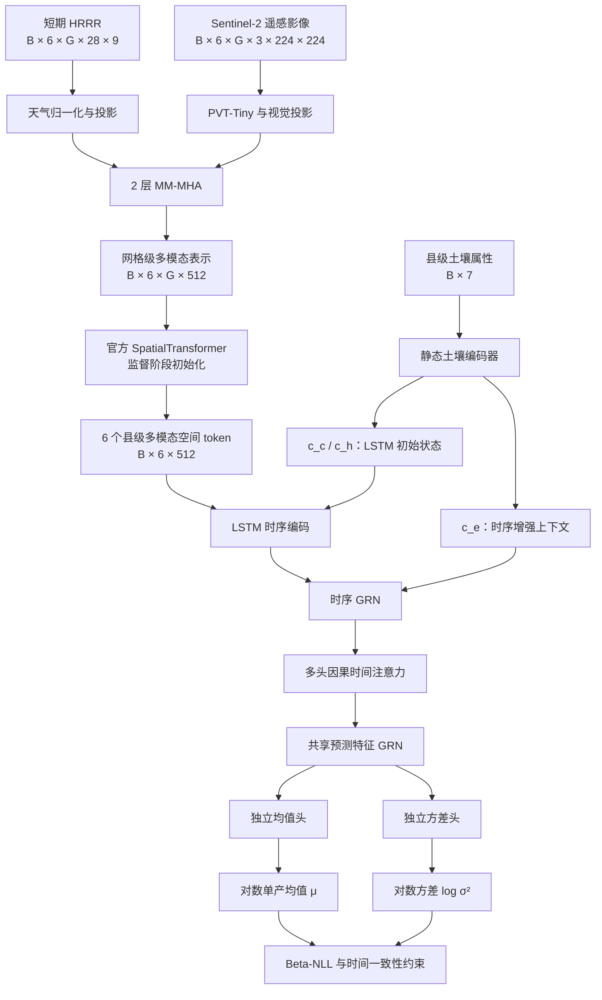

# 基于 MMST 多模态空间前端与时间融合变换器的县级玉米单产预测研究

---

## 摘要

（待填写）

**关键词：** （待填写）

---

## 1 引言

### 1.1 研究背景与意义

#### 1.1.1 研究背景

玉米是全球最重要的粮食与饲料作物之一，也是美国播种面积与产量最大的作物。美国中西部的"玉米带"（Corn Belt）是全球最重要的玉米产区之一，其县级单产统计不仅关系粮食安全与国际农产品市场，也是农业保险定价、粮食储备与宏观调控的基础依据。近年来，全球气候变化导致极端高温、干旱、强降水等异常天气事件频发，生长季内气象条件波动加剧，玉米单产的年际波动与区域差异显著放大。在此背景下，**提前且准确地预测县级尺度玉米单产**，已成为农情监测、市场调控与粮食安全决策的关键技术需求。

从市场与金融视角看，县级单产预测的经济价值直接体现在农产品衍生品交易中。美国玉米期货与期权在芝加哥期货交易所（CBOT）挂牌，其中玉米期权自 1985 年推出，是全球成交量最大的农产品期权品种，2017 年成交量约 239 万手、年末持仓约 100 万手[18]。由于玉米价格对供给冲击高度敏感，单产预测（尤其是 8 月作物巡查、USDA 月度供需报告等关键节点的单产调整）往往在短时间内显著影响 CBOT 玉米期价与期权隐含波动率，进而改变贸易、压榨与养殖企业的套保成本与头寸损益。以 2026 年为例，Pro Farmer 作物巡查给出的美国玉米单产预估为 173.2 bu/ac，较 USDA 8 月报告的 180.7 bu/ac 低 7.5 bu/ac，为六年来最大的单产分歧；若据此下调产量而需求不变，美国玉米期末库存将由 16.53 亿蒲式耳收紧至约 9.84 亿蒲式耳，库存消费比下降近 4 个百分点至约 6%，CBOT 玉米随之突破 500 美分并看向 550—600 美分区间[19]。围绕收获季产量与价格预期，市场亦出现大规模期权头寸，例如一笔约 10 万手 11 月 5.50/6.00 美元看涨价差交易（权利金约 2000 万—2200 万美元，理论最大盈利约 2.3 亿—2.5 亿美元），被普遍解读为对产量下滑与收获期价格上行的押注[20]。可见，单产预测的精度与时效会通过期货与期权市场直接转化为经济价值。

在此背景下，中国企业与机构也已参与对美国玉米产量的跟踪，并将其作为衍生品交易决策的重要输入。中粮期货研究中心等国内机构持续跟踪 Pro Farmer 巡查与 USDA 报告，把美国玉米单产预测作为 CBOT 玉米走势研判与交易策略的核心依据，并面向国内产业客户发布专题分析[19]。在期权应用层面，国内企业已积累多个玉米期权保值案例：路易达孚（中国）贸易有限责任公司在 2019 年玉米采购中通过卖出看涨期权并配合 delta 对冲锁定销售价格，综合收益约 216 万元，优于同期期货套保[21]；良运集团在大连商品交易所玉米期权上市后率先试点"期权垂直价差组合"套保策略，用于粮食采购与库存管理[22]；北大荒中垦珠海贸易有限公司则通过买入看跌期权为 2 万吨玉米库存保值[21]。此外，海大集团等大型农牧企业在 2026 年公告了覆盖玉米、大豆、豆粕等品种的期货与期权套期保值计划，单商品套保保证金上限达 40 亿元[23]。这些实践表明，产量预测能力在国内产业与国际市场上均具有可观测的商业价值。

县级单产预测具有明显的尺度矛盾。一方面，USDA-NASS 等统计机构通常以县为单位发布产量数据，县级结果是农业保险、产量预警和区域资源配置可以直接使用的空间单元；另一方面，一个县往往覆盖数百至数千平方公里，内部可能同时包含不同地形、土壤和水分条件。生长季内的最高温度、降水过程、蒸散需求和水分亏缺并不会在县域内均匀分布，将多个气象网格简单平均后，容易把局地高温、短时强降水或持续干旱等对产量形成具有重要作用的信号平滑掉。尤其在极端天气年份，平均气象条件可能看起来接近常年，但少数网格中的严重胁迫仍会显著影响县域产量，这使得县内空间异质性成为单产预测中不能忽略的因素。

此外，单产预测具有严格的时间约束。完整生长季结束后获得的高精度结果虽然便于统计核算，但对保险定损、粮食调运和灾害响应而言往往偏晚。实际业务更关注“截至当前日期已经掌握的信息能够解释多少最终产量”，因此模型需要在不使用未来观测的条件下持续更新预测。如何在县域空间结构、逐日气象过程和有限的季中信息之间建立统一表示，是当前数据驱动单产预测需要解决的核心问题。

#### 1.1.2 研究意义

从科学角度看，作物单产由品种遗传特性、生长季气象条件、土壤属性与田间管理措施等多类因素**非线性耦合**决定，且在空间与时间上高度异质，其预测问题本身具有重要的科学研究价值。从应用角度看，生长季内的**滚动预报**能够为农户、保险公司与政府部门提供及时的管理决策依据；而**可解释的预测**则有助于回答"哪些气象因子、在哪个生育阶段、在哪些区域对产量影响最大"等农学问题，推动数据驱动模型与农业科学的交叉融合。因此，发展兼顾精度、时效性与可解释性的县级玉米单产预测方法，兼具科学价值与应用价值。

本文的研究意义可以进一步分为三个层面。第一，在理论层面，研究将县域内部的多个气象网格视为具有位置和局地状态的基本单元，考察“先保留网格级多模态信息、再进行县级汇总”是否比直接平均更适合产量形成过程。第二，在方法层面，本文将 Sentinel-2、短期 HRRR 和县级土壤纳入完整 MMST 空间前端与 TFT temporal backend，通过空间注意力和时间注意力提供可观测接口。第三，在应用层面，模型融合网格级气象、县级土壤与 Sentinel-2 遥感影像，兼顾县域内部空间异质性与作物长势信息，可为遥感与气象多源数据协同的县级单产预测提供可复现的技术方案。

同时，本文特别关注模型性能在不同县和不同州之间是否均匀。总体 RMSE 可能掩盖少数区域的系统性偏差，而这些区域往往正是极端气候更频繁、产量波动更大的地区。通过逐县误差和分州指标分析，可以识别模型的“困难区域”，更完整地评估模型在不同空间单元上的适用性与局限性。

### 1.2 国内外研究现状

#### 1.2.1 传统单产预测方法

传统作物单产预测方法大致可分为两类。其一为**机理模型（过程模型）**，即基于作物生理生态过程的逐日模拟模型，能够刻画作物生长发育与产量形成机理，但通常需要大量难以获取的田间管理参数、精细的土壤剖面数据和严格的气象驱动输入，在大范围县级尺度上难以规模化推广。其二为**统计与浅层机器学习模型**，如线性回归、随机森林、支持向量机等，实现简单、可解释性较好，但对气象-产量之间复杂的非线性与时序依赖关系表达能力有限。

#### 1.2.2 基于深度学习的单产预测

随着农业大数据与深度学习的发展，研究者提出了多种面向作物单产预测的深度模型。

Khaki 等提出 CNN-RNN 框架，使用一维卷积网络分别对天气时序与土壤剖面特征建模，再以长短期记忆网络（LSTM）捕捉年际时序依赖，对美国玉米带 13 个州的玉米与大豆单产进行预测，取得了优于传统机器学习方法的效果[3]。该工作较早系统地将 CNN 与 RNN 的混合结构引入作物单产预测，但其天气输入采用了县域平均或站点级数据，未涉及县域内部的空间结构。

Lin 等在注意力 LSTM（AT-LSTM）基础上结合多任务学习，提出 DeepCropNet，将美国玉米带划分为若干区域并分别拟合区域特定的输出层，利用积温（Growing Degree Days, GDD）与高温累积（KDD）等农业气象特征工程，在县尺度玉米单产估计中取得良好表现[2]。该工作说明**结合作物生理学知识的特征工程**能够提升深度模型的预测能力。

Wang 等提出知识引导的机器学习方法（Knowledge-guided Machine Learning, KGML），将作物生长的领域知识嵌入深度模型的结构中，用于干旱情境下的县尺度玉米单产预测，展示了物理知识与数据驱动模型融合的潜力[6]。Luo 等提出 PhenoYieldNet，学习作物感知的物候响应，实现多作物（玉米、大豆）单产的统一预测，验证了将物候期信息引入深度预测模型的必要性[7]。Park 等提出空间变化深度泛函神经网络（Spatially Varying Deep Functional Neural Network），将单产视为气象过程的泛函映射，并通过空间变化系数刻画区域差异，在大型作物单产预测任务中取得较好效果，强调了**空间异质性建模**的重要性[10]。

在生长季内预报方面，Schwalbert 等结合卫星影像与气象变量，对美国玉米带进行季中县尺度玉米单产预报，展示了多源数据在季中滚动预测中的价值[11]。

#### 1.2.3 空间-时间联合建模与遥感方法

作物单产同时受空间与时间因素影响，近年来空间-时间联合建模成为研究热点。

Lin 等提出了多模态空间-时间视觉变换器（MMST-ViT），将卫星遥感影像与气象观测等多模态数据输入视觉变换器，并针对气候变化下的产量预测开展研究[4]。其配套工作发布了 **CropNet 开放数据集**，涵盖美国县级玉米/大豆单产、卫星遥感影像与再分析气象数据等多模态信息，为相关研究提供了统一的数据基准[5]。MMST-ViT 的工作还系统复现并比较了包括 CNN-RNN、ConvLSTM 与 GNN-RNN 在内的多种基线模型，但上述基线均以**遥感影像**或县均值气象作为输入。

Hasan 等提出 VITA（变分预训练变换器），通过在大规模卫星气象数据上预训练变换器表征，提升模型在极端气候年景下的预测鲁棒性[8]；其关于连续气象数据的变换器编码器改造（WeatherFormer 系列）为气象时序的建模提供了统一的正余弦空间-时间位置编码方案[9]。

#### 1.2.3.1 遥感—气象数据的时间对齐与多模态融合

现有遥感—气象产量预测模型虽然使用了相近的数据来源，但对“两个模态如何对齐、在哪里交互”采用了不同策略。该问题不仅是网络结构选择，也对应不同的农业观测假设：卫星影像主要反映观测时刻的冠层状态，气象数据则描述观测日前后作物所经历的热量、水分和胁迫过程。因此，融合方式需要同时考虑观测日期、空间网格和信息可用性，而不能只在模型输入端进行无条件拼接。

**（1）MMST-ViT 的定向跨模态注意力。** Lin 等提出的 MMST-ViT 使用与本文相同或相近的 CropNet 数据体系，将 Sentinel-2 多时相影像、9 km 网格气象和县级产量联合建模[4,5]。其多模态模块先用视觉骨干网络提取遥感 patch 表征，再将遥感表征作为 Query、短期气象表征作为 Key 和 Value，计算

$$
\mathbf{Z}=\operatorname{softmax}\left(\frac{\mathbf{Q}_{RS}\mathbf{K}_{W}^{\mathsf T}}{\sqrt d}\right)\mathbf{V}_{W}.
$$

这种方式使遥感 token 主动查询气象序列，随后再进行空间 Transformer 和时间 Transformer。它的优点是模态角色清晰，能够直接学习遥感冠层状态与气象过程之间的对应关系；但其交互具有明显的方向性，输出主要由气象 Value 聚合得到，遥感 token 与气象 token 并未作为同一日期 block 中的平等 token 进行双向更新。对于同一日期内“天气条件—冠层状态—局地网格”之间的联合观测关系，模型需要依赖后续模块间接表达，且原方法没有将遥感缺失日期作为不产生 token 的观测事件显式处理。更准确地说，MMST-ViT 预训练阶段未显式编码 28 天短期天气的日序，也未将逐日天气与遥感 patch 的对应关系作为对比学习目标；这一限制不能外推为其完整模型缺少全部时间或位置信息。PVT 内部保留的是图像 patch 的二维空间位置编码，监督微调模型还具有面向 6 个遥感月份和网格的可学习位置编码，二者均不等同于预训练阶段的 28 天天气日序编码。

**（2）CMAViT 的气象条件化视觉注意力。** Kamangir 等提出 CMAViT，将多时相 Sentinel-1/2、同期气象数据和产量信息输入多模态视觉 Transformer[24]。其 STMM 模块分别计算视觉相似度和气象相似度，并将两者相加后用于视觉注意力：

$$
\operatorname{STMM}=\operatorname{softmax}\left(
\frac{\mathbf{Q}_{s}\mathbf{K}_{s}^{\mathsf T}}{\sqrt d}
 +
\frac{\mathbf{Q}_{m}\mathbf{K}_{m}^{\mathsf T}}{\sqrt d}
\right)\mathbf{V}_{s}.
$$

该方法不是把天气 token 与遥感 token 拼入同一序列，而是让天气相似度改变视觉 self-attention 的 logits，最终仍聚合视觉 Value。其优点是天气能够条件化视觉特征提取，避免简单拼接；局限是天气信息主要作为注意力条件或偏置发挥作用，难以直接保留天气 token 本身的独立表示，也不显式区分“同一观测步交互”和“跨时间步预测因果”。此外，该方法采用固定的周尺度观测对齐和云量筛选，适合规则观测场景，但对缺失遥感日期、不同网格的可用观测数量以及不规则观测间隔的处理空间有限。

**（3）高频气象子序列与遥感时间步的跨模态注意力。** Luo 等提出 PhenoYieldNet，用于多作物县级产量预测。该方法将卫星图像时间序列输入 Vision Transformer，将每个遥感观测周期内的高频气象记录输入 MLP adapter，并通过 cross-attention 生成统一的多模态时间表示。与将气象变量在预处理阶段直接平均或与遥感特征拼接的方法相比，该设计保留了一个遥感观测周期内的多个气象记录，能够在跨模态注意力中利用短期天气变化。需要指出的是，论文主文明确使用了 cross-attention，但没有完整公开多模态融合模块的 Q/K/V 方向，也没有引入日期级 token 对齐损失、同网格匹配约束或双向气象—遥感 token 更新。因此，该方法更适合归类为“高频气象窗口与遥感时间步的跨模态融合”，而不是严格意义上的显式 weather-token-to-remote-sensing-patch temporal alignment。

**（4）时间步特征拼接。** Pathak 等将时间对齐后的 Sentinel-2、ERA5 气象、土壤和地形特征在每个时间步直接拼接，再送入 LSTM 或树模型[25]：

$$
\mathbf{z}_{t}=[\mathbf{x}_{t}^{RS};\mathbf{x}_{t}^{W};\mathbf{x}^{soil};\mathbf{x}^{DEM}].
$$

这种 early fusion 实现简单、计算代价低，并且适合构造统一的多模态基线。但拼接本身不包含模态间的动态匹配机制：同一时间步内所有气象变量和遥感特征被无差别地送入后续编码器，模型不能明确表达某一气象过程对某些遥感网格的选择性影响；当不同模态的时间分辨率或有效观测日期不一致时，重采样和聚合还可能将观测误差隐藏在拼接向量中。

**（5）独立编码后的高层融合。** Mia 等分别使用 CNN 和天气序列编码器处理 UAV 多光谱影像与天气数据，再拼接两类高层表示并通过全连接层预测水稻产量[26]。Aviles Toledo 等则对多模态遥感、环境和遗传信息分别进行时序编码，再通过 late fusion attention 汇聚不同模态[27]。这类方法保留了各模态的专用编码能力，适合作为稳健的多模态基线；但遥感与天气在独立编码阶段不发生交互，最终的模态权重或特征拼接也难以表达“某个日期的天气胁迫是否改变某个空间网格的遥感响应”。同时，若先对每个模态压缩成一个全局向量，县域内部网格的空间异质性会在融合前被部分消解。

**（6）融合后再做时间注意力。** Shyam 和 Chandrakar 的模型先分别用 CNN/MLP 编码卫星与气候数据，再拼接为时间步表示，最后用时间注意力选择重要日期[28]。这类结构能够回答“哪些时间步对预测重要”，但不能直接回答“某日哪些遥感网格与哪些气象变量共同重要”。此外，时间注意力是在模态已经压缩和拼接之后计算的，因而无法像 token 级注意力一样保留模态之间的细粒度空间对应关系。由于该工作是预印本且方法和数据描述尚不完整，本文不将其作为主要实验依据，而仅将其作为融合后时间加权结构的补充例子。

**（7）本文采用的 MMST 前端与 TFT 后端。** 本文不另行设计局部跨模态注意力，而是直接复用官方 PVTSimCLR 的完整多模态编码路径。对每个月份、每个县内网格，PVT 提取 Sentinel-2 视觉表示，视觉投影层将其映射到 512 维；同网格当月 28 天、9 维短期 HRRR 经天气归一化和天气投影映射到相同维度，再由 2 层多模态多头注意力完成融合。该前端整体由自监督 checkpoint 严格初始化，而不是只加载 PVT 参数。

网格级多模态表示随后送入官方 `SpatialTransformer`。空间 CLS token、月份—网格位置参数和 `SpatialTransformer` 在监督阶段初始化并训练，不属于 MMST 自监督预训练目标。空间模块逐月聚合县内有效网格，形成 6 个县级多模态空间 token；TFT temporal backend 再结合 7 维县级土壤属性，对这 6 个 token 进行 LSTM 与因果时间注意力建模。该结构仅使用短期 HRRR。

上述工作表明，**空间-时间联合建模**与**可迁移的预训练表征**是当前作物单产预测的重要发展方向。然而，遥感影像的高获取成本与复杂性，使得"仅依赖气象与土壤数据、仍能保留空间结构"的建模路线具有重要的实用价值。

#### 1.2.4 可解释时序建模与时间融合变换器

Lim 等提出的时间融合变换器（Temporal Fusion Transformer, TFT）是为多步预测设计的一种注意力架构，能够同时处理静态（时不变）协变量、已知的未来输入以及仅在历史观测到的外生时序，并具备良好的可解释性[1]。TFT 的核心组件包括：用于静态信息编码的上下文网络、用于变量筛选的**变量选择网络（VSN）**、用于局部时序处理的**循环层（LSTM）**以及用于长期依赖建模的**多头因果注意力**。其中，VSN 通过可学习的软选择权重显式输出各输入变量的重要性，因果注意力则输出时间维度上的注意力分布，二者共同赋予 TFT 以可解释性。

TFT 的可解释机制（特征重要性 + 时间注意力）与作物产量预测中对"关键气象因子与关键生育期"的农学分析需求高度契合，但 TFT 本身面向通用多步时序预测，将其适配到"网格级气象输入 + 单产标量预测"的县级产量预测任务，并保留空间信息建模，仍是值得探索的方向。

#### 1.2.5 研究现状评述

综上，本文关注的核心研究缺口主要包括：

- 现有季内作物产量研究已经广泛使用不同截止日期或生育阶段的信息预测同一个最终产量，但这些研究通常采用逐截止日实验、独立模型或机理模型，较少在一个参数共享的前缀模型中联合训练和输出所有时间节点；
- 每个县—年样本通常只有一个最终单产标签，模型在生长季中间截止时刻缺少**独立直接监督信号**，中间预测往往由最终标签间接诱导；
- 现有方法通常关注点预测误差，或只在最终时刻进行概率建模，对不同信息截止时刻的完整预测分布如何变化缺少显式的时间一致性约束；
- 对于概率预测，需要区分“不同截止时刻预测同一个最终产量目标”的共享目标分布假设与“所有时间步具有相同方差”的同方差假设，二者不能混为一谈。

在本文核对的代表性季中产量预测研究中，尚未发现与本文完全相同的“单一参数共享模型、完整季节预测分布作为停止梯度教师、对所有中间时间步显式施加高斯 KL 约束”的训练形式。因此，本文在 CropNet 数据框架下，提出一种**保留网格级气象空间结构、结合同网格遥感条件融合、并对逐时间步概率预测进行显式分布约束**的 TFT 编码器产量预测模型。需要强调的是，共享最终目标分布是本文为提供中间时间步训练信号而采用的建模假设，并非由数据标签直接验证的事实，相关收益仍需通过独立消融和 2022 年最终评估检验。

### 1.3 研究内容

围绕上述问题，本文开展以下四方面研究：

1. **网格级气象数据的构建与预处理**：建立官方 Tiny CropNet 四州无标签预训练样本和四州监督样本组成的网格级气象—遥感数据集，明确生长季时间窗口、网格对齐规则与标准化口径，为空间结构建模提供数据基础；
2. **空间-时序联合预测模型的构建**：以完整 PVTSimCLR 生成网格级多模态表示，以官方 SpatialTransformer 输出 6 个县级空间 token，再以 7 维土壤条件化的 TFT temporal backend 生成逐月概率预测；
3. **消融验证与基线对比**：在统一数据来源、年份划分与评价指标下，检验完整 MMST checkpoint 初始化、空间模块、TFT temporal backend 和概率损失的作用，并与代表性基线模型进行对比；
4. **季中预报与区域误差评估**：设置自 4 月末起每月末一个的固定预报节点（4/28、5/28、…、9/28），评估模型的提前预报能力；利用空间与时间注意力开展诊断，并保存测试集逐县预测，比较不同州的误差分布和区域难度差异。

### 1.4 技术路线

本文的技术路线如图 1 所示，主要分为四个阶段：

1. **数据准备阶段**：从官方 Tiny CropNet 三个目录获取 Sentinel-2 影像、WRF-HRRR 网格级气象和 USDA 县级单产，并另行引入 gSSURGO 土壤属性，经时间窗口选取、网格对齐与标准化构建模型输入；
2. **模型构建阶段**：严格加载完整 PVTSimCLR checkpoint，并使用官方 SpatialTransformer 在监督阶段形成 6 个县级多模态空间 token，再接 soil-conditioned TFT temporal backend，实现“MMST 多模态编码—县级空间聚合—LSTM—因果时间注意力—逐时间步预测”的整体流水线；
3. **两阶段训练阶段**：先在官方 Tiny CropNet 四州 2017—2020 年无标签配对数据上进行多模态自监督预训练，再在同一四州 2021 年有标签数据上进行监督微调；微调不设置验证集、早停或最佳轮次选择，固定保存最终轮次模型；
4. **独立评估与分析阶段**：在同一四州 2022 年数据上评估最终预测精度与各预报节点的提前预报精度，输出逐县预测和误差，按州比较误差分布及概率校准，并结合变量权重、跨模态权重、空间注意力和时间注意力开展诊断。

本文技术路线可概括为：数据获取与质量控制 → 预训练/微调数据划分 → 生长季窗口选取、网格对齐和特征标准化 → 多模态自监督预训练 → 参数迁移与土壤条件化监督微调 → 跨模态空间聚合 → LSTM 与因果注意力时序编码 → 概率单产预测与季中滚动预报 → 迁移收益、消融、基线比较和可解释性分析。

### 1.5 本文创新点

1. **完整 MMST 多模态 checkpoint 与县级时序预测的衔接方案**。本文严格加载 PVTSimCLR 的 PVT、视觉投影、天气投影、天气归一化和 2 层多模态多头注意力参数，而非只迁移视觉骨干；官方 SpatialTransformer 在监督阶段初始化并训练，将每月网格级多模态表示聚合为 6 个县级空间 token。该空间输出再接 7 维土壤条件化的 TFT temporal backend。MMST 自监督预训练不训练 SpatialTransformer、土壤编码器、TFT 或概率预测头，其迁移收益仍需通过同预算实验验证。

2. **面向中间时间步弱监督的异方差概率预测与最终分布教师约束**。本文将时间注意力输出映射为共享预测特征，再通过参数独立的均值 head 和方差 head 输出对数单产均值与对数方差，并使用 Beta-NLL 表达样本相关的不确定性。针对每个县—年只有最终单产标签、缺少中间时间步直接监督的问题，本文将最后有效时间步的预测分布作为停止梯度教师，通过指数加权的高斯 KL 为中间时间步提供辅助训练信号。在本文核对的代表性农业产量预测工作中，虽然已经存在多截止日输入预测同一最终产量的研究，但未发现与本文相同的逐时间步最终分布教师 KL 训练形式。该设计明确建立在“不同截止时刻预测的是同一个最终单产目标分布”的共享目标分布假设上，不把中间时间步视为拥有独立真实标签，也不假设所有时间步具有相同方差；其对预测轨迹、校准和季中预报的影响需要通过受控消融和 2022 年最终评估验证。

### 1.6 本章小结

本章阐述了县级玉米单产预测的研究背景与意义，梳理了多截止日最终产量预测、空间—时序联合建模与可解释时序建模的国内外研究现状，归纳了中间时间步监督不足、概率分布时间一致性约束不足和空间—跨模态诊断不充分等问题，明确了本文的研究内容、技术路线与两点创新，为后续章节的理论介绍、模型构建与实验验证奠定了基础。

---

## 2 相关理论基础

### 2.1 循环神经网络与序列建模

循环神经网络（Recurrent Neural Network, RNN）通过沿时间维度的隐状态传递刻画序列内部的时间依赖，其隐状态更新可表示为 $\mathbf{h}_t = f(\mathbf{W}_h \mathbf{h}_{t-1} + \mathbf{W}_x \mathbf{x}_t + \mathbf{b})$。尽管 RNN 原理简洁，但在长序列上存在梯度消失与梯度爆炸问题，难以捕捉长期依赖。

#### 2.1.1 长短期记忆网络（LSTM）

长短期记忆网络（Long Short-Term Memory, LSTM）通过引入**记忆单元** $\mathbf{c}_t$ 与遗忘门、输入门、输出门三类门控结构，实现了对信息的选择性写入、遗忘与输出，有效缓解了梯度消失问题。其核心递推为

$$
\mathbf{f}_t = \sigma(\mathbf{W}_f[\mathbf{h}_{t-1};\mathbf{x}_t] + \mathbf{b}_f),\quad
\mathbf{i}_t = \sigma(\mathbf{W}_i[\mathbf{h}_{t-1};\mathbf{x}_t] + \mathbf{b}_i),
$$

$$
\tilde{\mathbf{c}}_t = \tanh(\mathbf{W}_c[\mathbf{h}_{t-1};\mathbf{x}_t] + \mathbf{b}_c),\quad
\mathbf{c}_t = \mathbf{f}_t \odot \mathbf{c}_{t-1} + \mathbf{i}_t \odot \tilde{\mathbf{c}}_t,
$$

$$
\mathbf{o}_t = \sigma(\mathbf{W}_o[\mathbf{h}_{t-1};\mathbf{x}_t] + \mathbf{b}_o),\quad
\mathbf{h}_t = \mathbf{o}_t \odot \tanh(\mathbf{c}_t),
$$

其中 $\sigma$ 为 sigmoid 函数，$\odot$ 为逐元素相乘。LSTM 能够对生长季逐日气象序列中的局部时序依赖（如连续高温、干旱累积效应）进行建模，是本文模型中时序编码模块的基础。

#### 2.1.2 门控循环单元（GRU）

门控循环单元（Gated Recurrent Unit, GRU）是 LSTM 的一种简化结构，仅保留**更新门**与**重置门**，参数量更少、训练更高效，在序列建模中同样被广泛使用。本文模型以 LSTM 为主；GRU 可作为网络结构变体用于消融比较。

### 2.2 注意力机制与 Transformer

#### 2.2.1 自注意力机制

自注意力（Self-Attention）机制通过查询（Query）、键（Key）与值（Value）三组向量计算序列元素间的依赖：将查询与各键做缩放点积相似度，经 softmax 归一化得到注意力权重，再对值向量加权求和，即

$$
\mathrm{Attention}(\mathbf{Q},\mathbf{K},\mathbf{V}) = \mathrm{softmax}\left(\frac{\mathbf{Q}\mathbf{K}^\top}{\sqrt{d_k}}\right)\mathbf{V},
$$

其中 $d_k$ 为键的维度。自注意力具有全局感受野，能够建模任意远距离元素之间的依赖，且可并行计算，是 Transformer 的核心。

#### 2.2.2 多头注意力与位置编码

多头注意力（Multi-Head Attention）将查询、键、值投影到 $H$ 个不同的子空间，并行执行注意力后拼接并线性变换，使模型能够在不同子空间关注不同类型的依赖关系。由于自注意力不含序列顺序信息，Transformer 通过正余弦位置编码注入位置先验：

$$
\mathrm{PE}_{(t,2j)} = \sin\left(\frac{t}{10000^{2j/d}}\right),\quad
\mathrm{PE}_{(t,2j+1)} = \cos\left(\frac{t}{10000^{2j/d}}\right).
$$

该编码方案可推广到**多维度**（时间、纬度、经度等），为空间-时间联合建模提供统一的位置注入手段。

### 2.3 时间融合变换器（TFT）

时间融合变换器（Temporal Fusion Transformer, TFT）是 Lim 等提出的面向多步预测的注意力架构[1]，能够统一处理静态协变量、已知的未来输入与仅历史可观测的外生序列，并兼具可解释性。其核心组件包括：

#### 2.3.1 门控残差网络（GRN）

门控残差网络（Gated Residual Network, GRN）由层归一化、线性变换、ELU 激活与门控机制组成，并通过残差连接保证深层网络的训练稳定性。GRN 以可学习的方式决定非线性变换与残差路径的权重，对不同尺度与分布的输入具有良好的适应能力，是 TFT 各模块共用的基本构件。

#### 2.3.2 变量选择网络（VSN）

变量选择网络（Variable Selection Network, VSN）对多变量输入执行**软选择**：每个变量经独立的 GRN 编码为表征，所有变量原始输入拼接后经另一 GRN 与 softmax 输出逐时间步的变量权重，再对各变量表征加权求和得到融合特征。VSN 输出的变量权重即为各输入变量的**可解释的重要性度量**。

#### 2.3.3 静态上下文编码与多步预测结构

TFT 将静态（时不变）特征编码为若干上下文向量，分别条件化变量选择、LSTM 初态与注意力等模块，实现静态信息对时序建模的注入。在时序处理上，TFT 以 LSTM 刻画局部依赖，以**多头因果注意力**刻画长期依赖——因果性保证每一时间步仅关注其历史，从而在逐时间步预测中不泄露未来信息。

对于本文的县级玉米单产任务，TFT 作为 MMST 空间编码之后的时序主干使用。每个月份先由完整 PVTSimCLR 和官方 SpatialTransformer 得到县级多模态空间 token；7 维土壤经静态编码器生成 LSTM 初态与时序增强上下文。这样的结构使空间前端回答“当前县内多模态空间状态如何”，TFT temporal backend 回答“截至当前月份，哪些历史过程对最终单产仍然有解释力”。

与普通单步回归网络相比，本文采用逐时间步预测头具有两个优点。其一，因果掩码保证第 $t$ 个输出仅依赖 $1,\ldots,t$ 的观测，因而同一模型可以在多个截止日期上进行滚动推理；其二，空间权重和时间注意力可分别从位置和时间维度提供诊断信息。需要注意的是，注意力权重是模型内部的归因信号，并不自动等价于严格的因果效应，因此本文将其与不同截止日期下的预测行为结合分析，而不单独依据某一组权重作因果判断。

### 2.4 本章小结

本章介绍了本文模型所依赖的核心理论基础：LSTM/GRU 序列建模、自注意力与多头注意力机制、位置编码以及时间融合变换器（TFT）的静态上下文、GRN 和因果注意力。VSN 作为原始 TFT 的理论组件保留介绍，但不属于本文正式模型前端。上述理论为第 4 章的 MMST 多模态空间前端与 TFT temporal backend 提供方法支撑。

---

## 3 研究区域与数据

### 3.1 研究区域概况

本文在官方 Tiny CropNet 数据集框架[5]的基础上，固定选取 Illinois、Iowa、Louisiana、Mississippi 四州作为研究区域。预训练、监督微调和最终评估均限定在这一相同区域范围内。

### 3.2 数据来源

本文使用官方 Tiny CropNet 数据集框架[5]中的三个数据源，目录结构和覆盖年份（2017—2022）如下：

| 官方数据源目录 | 内容 | 覆盖与用途 |
| -------------- | ---- | ---------- |
| `Sentinel-2 Imagery` | Sentinel-2 网格级农业影像（AG） | 2017—2022；本文选取生长季 6 个月初时相作为遥感输入 |
| `WRF-HRRR Computed Dataset` | WRF-HRRR 网格级逐日气象数据 | 2017—2022；正式模型仅使用每月 1—28 日短期气象 |
| `USDA Crop Dataset` | USDA 县级作物数据 | 2017—2022；用于县级玉米单产目标变量 |

县级土壤属性是本文另行引入的 gSSURGO 辅助数据，不属于上述官方 Tiny CropNet 三个目录。

#### 3.2.1 县级单产数据

县级玉米单产由 USDA-NASS 提供[12]，作为模型的目标变量，保留原始 bu/ac 空间，以保证 RMSE 等指标具有实际农学含义。

#### 3.2.2 网格级气象数据

网格级气象数据来自 WRF-HRRR 再分析气象产品，空间分辨率 9 km。官方 MMST 数据加载器为正式前端提供 9 个逐日变量，每月取 1—28 日，共 6 个月；这些短期气象与同网格 Sentinel-2 影像共同输入 PVTSimCLR。

**表 1 正式模型使用的 WRF-HRRR 网格级气象特征（9 维）**

| 序号 | 特征名称     | WRF-HRRR 字段                     | 单位      | 含义                                       |
| ---- | ------------ | --------------------------------- | --------- | ------------------------------------------ |
| 1    | 平均温度     | Avg Temperature                   | K         | 日均气温                                   |
| 2    | 最高温度     | Max Temperature                   | K         | 日最高气温                                 |
| 3    | 最低温度     | Min Temperature                   | K         | 日最低气温                                 |
| 4    | 降水         | Precipitation                     | kg·m⁻² | 逐日降水量（1 kg·m⁻² 相当于 1 mm 水深） |
| 5    | 相对湿度     | Relative Humidity                 | %         | 日均相对湿度                               |
| 6    | 阵风         | Wind Gust                         | m·s⁻¹  | 日最大阵风风速                             |
| 7    | 风速         | Wind Speed                        | m·s⁻¹  | 日均风速                                   |
| 8    | 下行短波辐射 | Downward Shortwave Radiation Flux | W·m⁻²  | 到达地表的向下短波辐射通量                 |
| 9    | 饱和水汽压差 | Vapor Pressure Deficit            | kPa       | 空气饱和水汽压与实际水汽压之差             |

#### 3.2.3 县级土壤数据

县级土壤属性来自美国 gSSURGO 土壤数据库，经县内加权聚合为 7 个连续变量（见表 2），作为时不变的静态特征输入。

**表 2 县级土壤特征（7 维，0–30 cm 深度加权县均值）**

| 特征名称   | 字段         | 单位         | 含义                                 |
| ---------- | ------------ | ------------ | ------------------------------------ |
| 黏粒含量   | clay_pct     | %            | 土壤黏粒（粒径 <0.002 mm）含量       |
| 砂粒含量   | sand_pct     | %            | 土壤砂粒含量                         |
| 粉粒含量   | silt_pct     | %            | 土壤粉粒含量                         |
| 有机质含量 | om_pct       | %            | 土壤有机质含量                       |
| pH         | ph           | 无量纲       | 土壤酸碱度                           |
| 容重       | bulk_density | g·cm⁻³    | 土壤容重                             |
| 有效含水量 | awc          | cm³·cm⁻³ | 田间持水量与凋萎点之差（体积含水率） |

#### 3.2.4 遥感影像数据

遥感影像来自 Sentinel-2 卫星（L1C 级），经 CropNet 数据集按县级组织为农业影像（AG）[5]。原始季度文件保留重访序列，正式模型按官方加载逻辑取得 6 个生长季时相。每个时相在县域内每个气象网格上提供一幅 RGB 影像，与同网格当月 28 天、9 维短期 HRRR 一并输入完整 PVTSimCLR；输出的网格级多模态表示再由官方 SpatialTransformer 聚合为县级 token。土壤不进入 MMST 空间前端，而是在 TFT temporal backend 中作为 7 维静态条件输入。

### 3.3 数据统计概况

本文将数据划分为无标签多模态预训练集和有标签监督数据集。两者均限定为官方 Tiny CropNet 四州，用于保证本文模型与 MMST-ViT 基线在相同目标区域上比较。

**表 3 数据集划分框架（具体样本量待填写）**

| 阶段 | 年份 | 区域 | 输入 | 标签用途 |
| ---- | ---- | ---- | ---- | ---- |
| 多模态预训练 | 2017–2020 | 官方 Tiny CropNet 四州 | 遥感 + 短期气象 | 不使用产量标签 |
| 监督微调 | 2021 | 官方 Tiny CropNet 四州 | 遥感 + 短期气象 + 土壤 | 固定监督训练；不设置验证集、早停或最佳轮次选择 |
| 最终评估 | 2022 | 同一官方 Tiny CropNet 四州、`corn_val239` | 遥感 + 短期气象 + 土壤 | 仅用于最终评价，不参与训练、调参或 checkpoint 选择 |

表 3 的具体样本量和描述性统计待官方清单校验后填写；本文不预设样本均值、数量或网格统计值。生长季内有效逐日步数按冻结的官方数据清单和时间窗口确定。

### 3.4 本章小结

本章介绍了研究区域和官方 Tiny CropNet 数据源，并将数据划分为四州 2017—2020 无标签 MMST 多模态预训练集、四州 2021 有标签微调集和四州 2022 `corn_val239` 最终评估集。当前正式适配器只读取 6 个月短期 HRRR；评估影像使用官方 `DataWrapper(train=False)`，7 维土壤使用 2021 训练县统计量 z-score。2022 不参与训练、调参、早停或 checkpoint 选择。

---

## 4 模型构建

### 4.1 问题定义与总体框架

本文以县-年（county-year）为监督样本单位。当前正式模型的流水线为“完整 PVTSimCLR checkpoint → Sentinel-2 与短期 HRRR 的网格级多模态编码 → 官方 SpatialTransformer 月度县级聚合 → 6 个县级多模态空间 token → 7 维土壤条件化 TFT temporal backend（LSTM + 因果时间注意力）→ 最后有效月份概率预测”。PVTSimCLR checkpoint 严格覆盖 PVT、视觉投影、天气投影、天气归一化和 2 层多模态多头注意力；SpatialTransformer、土壤静态编码、TFT 和预测头不在 MMST 自监督预训练阶段训练。

**图 1 模型总体结构。** 正式前端对完整 PVTSimCLR checkpoint 执行严格加载，保留 PVT、视觉投影、天气投影、天气归一化和 2 层多模态多头注意力。每月每个网格的 Sentinel-2 与 28 天短期 HRRR 经该前端形成 512 维多模态表示，再由官方 SpatialTransformer 聚合为 6 个县级空间 token。SpatialTransformer 在监督阶段初始化和训练，MMST 自监督预训练不训练该模块。7 维土壤只条件化后续 TFT temporal backend；共享预测特征分别输入独立的均值头和方差头，形成概率预测分布。

### 4.2 输入表示与特征体系

对第 $i$ 个县-年样本，定义如下输入：

- **网格级短期气象**：$\mathbf{X}_i \in \mathbb{R}^{6 \times G_i \times 28 \times 9}$，其中 $G_i$ 为县内气象网格数，6 表示 4—9 月，28 表示每月 1—28 日；
- **县级土壤静态特征**：$\mathbf{S}_i \in \mathbb{R}^{7}$，即 gSSURGO 数据库的县均土壤属性，作为时不变静态特征；
- **网格级遥感影像**：$\mathbf{V}_i \in \mathbb{R}^{6 \times G_i \times 3 \times 224 \times 224}$，即生长季内 6 个 Sentinel-2 农业影像时相；影像与对应短期气象共同输入完整 PVTSimCLR。

由于不同县的网格数 $G_i$ 与有效时间步数 $T_i$ 各不相同，输入在批内按最大值填充，并配套**有效掩码**（网格掩码与时间步掩码）以屏蔽填充位置，保证注意力与损失仅作用于有效元素。

### 4.3 多模态自监督预训练

MMST 自监督预训练使用官方 Sentinel-2 与短期 HRRR 配对数据，不使用 USDA 产量标签。预训练模型为完整 PVTSimCLR，其可训练并写入 checkpoint 的组成包括 PVT backbone、视觉投影 `proj`、9 维天气投影 `proj_context`、天气归一化 `norm1` 和深度为 2 的多模态多头注意力 `mm_transformer`。两个遥感增强视图在相同短期天气条件下分别得到多模态表示，并以对比损失训练。

需要明确，PVTSimCLR checkpoint 不包含县级空间 CLS token、月份—网格位置参数或 SpatialTransformer 的监督初始化，也不包含 7 维土壤编码器、LSTM、因果时间注意力和概率预测头。因此，MMST 预训练学习的是网格级视觉—天气多模态编码，不训练本文下游的县级空间聚合与时序预测模块。

### 4.4 监督微调与参数迁移

监督微调使用官方 Tiny CropNet 四州 2021 年有标签 Corn 数据，不设置验证集、早停或最佳 checkpoint 选择，并在同一四州 2022 年 `corn_val239` 上进行最终评估。正式训练默认读取 `MMST-ViT/output_dir/pvt_simclr/checkpoint-latest.pth`；加载器要求 checkpoint 完整包含 PVTSimCLR 的全部参数，并以 `strict=True` 加载 PVT、视觉投影、天气投影、天气归一化和 2 层多模态多头注意力。缺少任一 PVTSimCLR 参数均视为协议错误。

官方 SpatialTransformer 类直接用于监督空间前端，但其空间 CLS token、位置参数和 Transformer 权重在监督阶段初始化并训练，不从 MMST 自监督 checkpoint 加载。空间前端按 6 个月分别聚合县内网格，输出 $\mathbf{Z}_i\in\mathbb{R}^{6\times512}$。7 维土壤静态编码、TFT temporal backend、均值头和方差头同样在监督阶段训练。正式流程不使用独立 TFT 预训练 checkpoint，也不经过参数转换文件。

### 4.5 数据预处理

- **时间窗口**：使用 4—9 月共 6 个时相；每个时相配套同月 1—28 日的 9 维短期 HRRR，因此气象张量为 $6\times G_i\times28\times9$。
- **影像变换**：监督训练使用官方 `DataWrapper(train=True)`，最终评估使用官方 `DataWrapper(train=False)`，均输出 $224\times224$ 的 CHW 张量。
- **土壤标准化**：7 维土壤统计量仅由 195 个 2021 训练县计算，并写入最终 checkpoint；推理复用 embedded `soil_stats`。
- **目标变量**：官方 USDA adapter 提供 log-yield；模型预测 log-yield 的均值与方差，指标计算前对标签和均值执行 `exp` 还原到 bu/ac。
- **数据划分**：正式监督训练固定使用 `MMST-ViT/data/corn_train.json` 的 195 个 2021 县，最终评估固定使用 `MMST-ViT/data/corn_val.json` 的 239 个 2022 县。2022 年只用于最终独立评估。

### 4.6 完整 MMST 多模态编码与空间聚合

对第 $i$ 个县、第 $m$ 个月和第 $g$ 个网格，记 Sentinel-2 影像为 $\mathbf{v}_{i,m,g}$，28 天短期 HRRR 为 $\mathbf{x}_{i,m,g}\in\mathbb{R}^{28\times9}$。完整 PVTSimCLR 前端可写为

$$
\mathbf{h}^{vis}_{i,m,g}=\operatorname{Proj}_{vis}\!\left(\operatorname{PVT}(\mathbf{v}_{i,m,g})\right),
\qquad
\mathbf{h}^{w}_{i,m,g}=\operatorname{Proj}_{w}\!\left(\operatorname{LN}(\mathbf{x}_{i,m,g})\right),
$$

$$
\mathbf{u}_{i,m,g}=\operatorname{MMTransformer}_{2\ layers}
\left(\mathbf{h}^{vis}_{i,m,g},\operatorname{context}=\mathbf{h}^{w}_{i,m,g}\right)_{\mathrm{CLS}}
\in\mathbb{R}^{512}.
$$

这里的 PVT、两个投影、天气归一化和 2 层多模态多头注意力全部由同一个 PVTSimCLR checkpoint 严格初始化。正式模型没有额外的逐网格 VSN、土壤条件化局部跨注意力或独立 WeatherFormer 空间编码器；土壤也不进入该前端。

对每个月份，将县内 $G_i$ 个网格级多模态表示与一个可学习空间 CLS token 拼接，并加上官方 MMST 的月份—网格位置参数：

$$
\mathbf{U}_{i,m}=[\mathbf{c}^{space};\mathbf{u}_{i,m,1};\ldots;\mathbf{u}_{i,m,G_i}]+\mathbf{P}_{m,0:G_i}.
$$

官方 SpatialTransformer 独立处理每个月份，县级输出取空间 CLS 位置：

$$
\mathbf{z}_{i,m}=\operatorname{SpatialTransformer}(\mathbf{U}_{i,m})_0,
\qquad
\mathbf{Z}_i=[\mathbf{z}_{i,1},\ldots,\mathbf{z}_{i,6}]\in\mathbb{R}^{6\times512}.
$$

SpatialTransformer 类来自官方 MMST 实现，但其空间 CLS token、位置参数和 Transformer 权重在监督阶段初始化并训练；MMST 自监督预训练不优化这些参数。最终得到的 6 个 $\mathbf{z}_{i,m}$ 是输入 TFT temporal backend 的县级多模态空间 token。

### 4.7 时序编码与因果注意力

空间聚合后的县尺度月度表示 $\mathbf{z}_{i,m}$ 输入6步 LSTM。静态上下文 $\mathbf{c}_c$ 和 $\mathbf{c}_h$ 分别用于初始化细胞状态与隐藏状态：
$$\mathbf{h}_{i,t},\mathbf{c}_{i,t}=\operatorname{LSTM}(\mathbf{z}_{i,t},\mathbf{h}_{i,t-1},\mathbf{c}_{i,t-1}),\qquad (\mathbf{h}_{i,0},\mathbf{c}_{i,0})=(\mathbf{c}_h,\mathbf{c}_c).$$

LSTM 输出经以 $\mathbf{c}_e$ 为条件的门控残差变换后，输入多头因果缩放点积注意力。对单个注意力头，权重与输出为
$$\beta_{i,t,t'} = \frac{\exp\!\left(\mathbf{q}_{i,t}^{\top}\mathbf{k}_{i,t'}/\sqrt{d_k}\right)}{\sum_{u\le t}\exp\!\left(\mathbf{q}_{i,t}^{\top}\mathbf{k}_{i,u}/\sqrt{d_k}\right)},\quad t'\le t,\qquad \mathbf{a}_{i,t}=\sum_{t'\le t}\beta_{i,t,t'}\mathbf{v}_{i,t'}.$$
并在有效时间步内施加时间步掩码以屏蔽填充，因果约束保证预报时刻不使用未来信息。注意力分布 $\beta_{t,t'}$ 提供模型对历史时间步依赖关系的解释。

### 4.8 预测头与概率损失函数

#### 4.8.1 概率建模框架

传统的作物产量预测模型在每个时间步输出标量预测值 $\hat{y}_{i,t}$，并以均方误差（MSE）作为损失函数。然而，作物产量预测本质上是一个"信息逐步积累、不确定性逐步消解"的动态决策过程。在生长季早期，可用气象与遥感信息有限，预测应具有较大的不确定性；随生长季推进，更多关键物候、热量与水分信息注入，预测应逐步收敛至终值。标准 MSE 损失无法刻画这一过程。

为此，本文将模型的条件分布输出参数化：令第 $i$ 个样本在时间步 $t$ 的观测序列为 $\mathbf{x}_{i,1:t}=[\mathbf{x}_{i,1},\ldots,\mathbf{x}_{i,t}]$，模型输出该条件下产量 $y_i$ 的条件概率分布：

$$
q_\theta(y_i\mid \mathbf{x}_{i,1:t}) = \mathcal{N}\big(\mu_{i,t},\;\sigma_{i,t}^2\big).
$$

因果注意力输出 $\mathbf{a}_{i,t}$ 先经过共享预测 GRN 得到 $\mathbf{h}_{i,t}^{pred}$，再分别输入参数独立的均值 head 与方差 head：

$$
\mathbf{h}_{i,t}^{pred}=\mathrm{GRN}_{pred}(\mathbf{a}_{i,t}),
\qquad
\mu_{i,t} = f_\mu(\mathbf{h}_{i,t}^{pred}),
\qquad
\alpha_{i,t} = f_\alpha(\mathbf{h}_{i,t}^{pred}),
\quad
\sigma_{i,t}^2 = \exp(\alpha_{i,t}).
$$

采用对数方差 $\alpha_{i,t}$ 的参数化方式，以保证方差恒正且有利于数值稳定。

#### 4.8.2 滤波后验的数学性质

令 $\mathcal{F}_t=\sigma(\mathbf{x}_{1:t})$ 表示截至时间步 $t$ 的信息集，$z=\log y$ 表示最终单产的对数。真实条件分布为 $p(z\mid\mathcal{F}_t)$。由于 $\mathcal{F}_t\subseteq\mathcal{F}_T$ 且后者包含更多观测，一般有

$$
p(z\mid\mathcal{F}_t)\neq p(z\mid\mathcal{F}_T).
$$

因此，不同截止时间虽然预测同一个最终随机变量 $z$，其真实条件分布、条件均值和条件方差都可以不同；不能由“预测目标相同”推出 $\mu_t$ 必须与最终时间步均值完全一致，也不能推出各时间步具有相同方差。

对于真实条件分布，迭代期望给出

$$
m_t=\mathbb{E}[z\mid\mathcal{F}_t],
\qquad
\mathbb{E}[m_{t+1}\mid\mathcal{F}_t]=m_t. \tag{1}
$$

式（1）是在给定当前信息后，对所有可能下一步观测进行条件平均的概率论关系。它不表示单个样本路径上的 $m_{t+1}$ 必须接近 $m_t$、必须单调变化或不能发生跳跃，也不直接构成逐样本的均值训练约束。

类似地，令 $v_t=\mathrm{Var}(z\mid\mathcal{F}_t)$，全方差分解给出

$$
v_t=
\mathbb{E}[v_{t+1}\mid\mathcal{F}_t]
+\mathrm{Var}(m_{t+1}\mid\mathcal{F}_t). \tag{2}
$$

由于第二项非负，可得 $\mathbb{E}[v_{t+1}\mid\mathcal{F}_t]\leq v_t$。该不等式同样针对尚未观测的下一步信息取条件期望，而不是要求每一条已实现样本路径都满足 $v_{t+1}\leq v_t$。新观测可能与既有信息冲突或暴露此前未识别的风险，因此某个样本在某一步的条件方差上升并不违背式（2）。

迭代期望和全方差分解不依赖高斯假设，但它们描述的是真实条件分布在嵌套信息集下的总体关系。本文的 $q_\theta(z\mid\mathcal{F}_t)$ 是有限数据和参数化模型下的近似分布，不能把上述关系改写成逐样本均值或方差的硬性单调约束。后续 KL 项是为缺少中间标签而引入的训练正则，其依据和作用需与这些概率论恒等式区分。

#### 4.8.3 基于最终分布教师的时间一致性损失

由于每个县-年样本只有一个最终单产标签，本文不把不同时间步视为具有不同真实产量标签的独立任务。各时间步预测的目标变量均为同一个最终单产对数

$$
z_i=\log(y_i),
$$

其中 $y_i>0$。这里的共享目标是同一个随机变量 $z_i$，不表示不同信息集下的真实条件分布相等。一般而言，$p(z_i\mid\mathcal{F}_{i,t})\neq p(z_i\mid\mathcal{F}_{i,T_i})$。第 $t$ 个有效时间步的模型分布记为

$$
q_{i,t}(z)=\mathcal{N}\left(\mu_{i,t},\exp(\alpha_{i,t})\right).
$$

为在缺少中间时间步标签时稳定逐时间步分布，本文将最后一个有效时间步 $T_i$ 的模型输出作为 stop-gradient 软教师，而不是将其视为真实后验或无误差标签。记

$$
\bar\mu_i=\operatorname{stopgrad}(\mu_{i,T_i}),
\qquad
\bar\alpha_i=\operatorname{stopgrad}(\alpha_{i,T_i}),
\qquad
q_{i,T_i}(z)=\mathcal{N}\left(\bar\mu_i,\exp(\bar\alpha_i)\right).
$$

下面从高斯 log density 和 KL 定义推导正则项。教师与当前时间步的对数密度分别为

$$
\log q_{i,T_i}(z)=-\frac{1}{2}\left[
\log(2\pi)+\bar\alpha_i+\frac{(z-\bar\mu_i)^2}{\exp(\bar\alpha_i)}
\right],
$$

$$
\log q_{i,t}(z)=-\frac{1}{2}\left[
\log(2\pi)+\alpha_{i,t}+\frac{(z-\mu_{i,t})^2}{\exp(\alpha_{i,t})}
\right].
$$

按 KL 定义，

$$
D_{\mathrm{KL}}(q_{i,T_i}\|q_{i,t})
=\mathbb{E}_{z\sim q_{i,T_i}}
\left[\log q_{i,T_i}(z)-\log q_{i,t}(z)\right].
$$

在教师分布下有

$$
\mathbb{E}_{q_{i,T_i}}[(z-\bar\mu_i)^2]=\exp(\bar\alpha_i),
$$

以及

$$
\mathbb{E}_{q_{i,T_i}}[(z-\mu_{i,t})^2]
=\exp(\bar\alpha_i)+(\mu_{i,t}-\bar\mu_i)^2.
$$

将上述二阶矩代入 KL 定义并约去 $\log(2\pi)$，得到

$$
D_{\mathrm{KL}}(q_{i,T_i}\;\|\;q_{i,t}) =
\frac{1}{2}\!\left[
\exp(\bar\alpha_i-\alpha_{i,t})
+\frac{(\mu_{i,t}-\bar\mu_i)^2}{\exp(\alpha_{i,t})}
-1-\bar\alpha_i+\alpha_{i,t}
\right]. \tag{3}
$$

式（3）各项的统计含义如下：

- **$\exp(\bar\alpha_i-\alpha_{i,t})$**：教师方差与当前时间步方差之比；当前方差相对教师方差过小时，该项迅速增大。
- **$(\mu_{i,t}-\bar\mu_i)^2/\exp(\alpha_{i,t})$**：均值差的平方马氏距离，以当前时间步方差衡量均值偏离的相对尺度。
- **$-1$**：来自教师中心二阶矩除以教师自身方差，保证相同分布处的基准抵消。
- **$-\bar\alpha_i+\alpha_{i,t}$**：两个方差尺度的 log-determinant 差，与方差比项共同惩罚尺度失配，并使 KL 非负且仅在两个高斯参数相同时为零。

这一 KL 只是在模型输出之间施加非对称的软教师训练正则：它鼓励中间预测不要无约束地偏离使用更多信息的末步输出，但不声称 $p(z_i\mid\mathcal{F}_{i,t})$ 与 $p(z_i\mid\mathcal{F}_{i,T_i})$ 相等，也不要求 $\mu_{i,t}=\bar\mu_i$ 或 $\alpha_{i,t}=\bar\alpha_i$ 成为逐样本硬约束。当前异方差头在每个时间步独立输出 $\alpha_{i,t}$，因此允许各时间步具有不同方差；共享最终目标变量不等于同方差假设。

为避免早期时间步在信息不足时被过强地拉向最终分布，本文对距离最终时间步越远的时间步施加越小的指数权重：

$$
w_{i,t}=\exp\left[-\gamma(T_i-t)\right],
\qquad \gamma>0.
$$

因此，$w_{i,T_i}=1$，越早的时间步权重越小。所有有效时间步都参与 KL 计算，但最后时间步的 KL 恒为零。批内 padding 时间步通过有效时间掩码排除。

最终损失由最后时间步的 Beta-NLL 和指数加权的时间一致性 KL 组成：

$$
\boxed{
\mathcal{L} = 
\underbrace{\frac{1}{N}\sum_{i=1}^{N}\frac{1}{2}\!\left[
\exp(+\beta\alpha_{i,T_i}^{\mathrm{detach}})
\left(\frac{(z_i-\mu_{i,T_i})^2}{\exp(\alpha_{i,T_i})}+\alpha_{i,T_i}\right)
\right]}_{\text{末步 Beta-NLL}}
+
\lambda_{\mathrm{KL}}\underbrace{\frac{1}{N}\sum_{i=1}^{N}
\frac{\sum_{t=1}^{T_i}w_{i,t}D_{\mathrm{KL}}(q_{i,T_i}\;\|\;q_{i,t})}
 {\sum_{t=1}^{T_i}w_{i,t}}}_{\text{最终分布教师的时间一致性}}
}
$$

当前实现固定 $\beta=0.5$、$\lambda_{\mathrm{KL}}=0.01$ 和时间权重衰减系数 $\gamma=0.05$。Beta-NLL 的权重使用停止梯度的 $\exp(+\beta\alpha^{\mathrm{detach}})$；第一项只在最后有效时间步直接使用真实标签 $z_i$，第二项才使用末步 stop-gradient 软教师向有效中间时间步提供辅助信号。$\gamma$ 和 $\lambda_{\mathrm{KL}}$ 在协议冻结前确定，不使用 2022 年最终评估结果回选。

作为后续实验协议和消融建议，可先仅使用最终时间步 Beta-NLL 进行 warm-up，使末步均值与方差获得初步校准，再将 $\lambda_{\mathrm{KL}}$ 从 0 线性 ramp 到目标值，以避免尚未校准的教师在训练早期产生过强约束。该 warm-up 与 ramp 尚未由当前代码实现，不能作为本文当前训练结果的既成步骤；当前实现仍是从训练开始即采用固定 $\lambda_{\mathrm{KL}}=0.01$。后续应将固定权重与 ramp 策略作为独立消融比较，并同时报告末步校准和中间时间步指标。

#### 4.8.4 退化到 MSE 的情形

当方差固定为常数 $\sigma_t^2\equiv 1$（即 $\alpha_t\equiv 0$）时，上述损失退化为：

$$
\mathcal{L}_{\sigma=1} = 
\frac{1}{N}\sum_{i=1}^{N}\frac{1}{2}(z_i-\mu_{i,T_i})^2 +
\lambda_{\mathrm{KL}}\frac{1}{N}\sum_{i=1}^{N}
\frac{\sum_{t=1}^{T_i}w_{i,t}\frac{1}{2}(\mu_{i,t}-\bar\mu_i)^2}
{\sum_{t=1}^{T_i}w_{i,t}}.
$$

前一项为对数单产空间的末步 MSE，后一项退化为所有有效时间步均值向最终教师均值靠拢的指数加权平方一致性。由此可见，所提 KL 项推广了普通均值一致性，使其同时约束均值和预测方差；但这种一致性仍建立在共享最终目标分布的任务假设上，而不是由贝叶斯递推必然推出的不同时间后验等式。

#### 4.8.5 季中预报的概率解释

在所提概率损失框架下，模型不再仅输出点预测值 $\mu_t$，还同时输出不确定性度量 $\sigma_t$。推理时，在任意预报截止日期 $t^*$，可直接取最后一个可用月份的 $\mu_{i,t^*}$ 作为点预测，$\sigma_{i,t^*}$ 作为该预测的标准差；更一般地，可将 $\mathcal{N}(\mu_{i,t^*},\sigma_{i,t^*}^2)$ 解释为模型在截至 $t^*$ 的信息下对最终单产的信度分布。信息增加时不确定性是否整体下降属于模型假设下的预期行为，必须由固定截止日期诊断在 2022 年最终评估集上验证，不能由损失形式直接推出。

此外，与需为不同预报日分别训练独立模型的方案不同，本文仅在末步提供产量监督，并以 KL 一致性作为中间时间步的辅助约束。该设计预期中间分布更接近最终教师分布，但是否改善时间轨迹、NLL、覆盖率或点预测仍需由受控消融和固定截止日期实验验证；季中结果仅作为行为证据，不预先视为已经实现合理收敛。

### 4.9 本章小结

本章定义了当前正式模型的两阶段边界。MMST 阶段训练完整 PVTSimCLR 多模态编码器，但不训练 SpatialTransformer；监督阶段严格加载完整 PVTSimCLR checkpoint，初始化并训练官方 SpatialTransformer、7 维土壤编码器、TFT temporal backend 和均值/方差预测头。模型仅使用短期 HRRR，输出 6 个县级多模态空间 token，并以 Beta-NLL 与 temporal KL 训练。相关收益仍需由冻结协议下的最终评估与消融实验验证。

---

## 5 实验设计

### 5.1 冻结实验协议与公平比较规则

默认完整模型由完整 PVTSimCLR 多模态 checkpoint、监督初始化的官方 SpatialTransformer、7 维土壤条件化 TFT temporal backend、mean/variance heads、Beta-NLL 和 temporal KL 构成。正式监督微调固定使用 `MMST-ViT/data/corn_train.json` 的 195 个 2021 Corn 县，不设置验证集、早停或最佳 checkpoint 选择，保存最终轮次 `checkpoint-final.pth`。2022 年 `corn_val.json` 的 239 个县只用于最终独立评估，不参与训练、调参、早停或 checkpoint 选择。

正式微调固定使用单卡 `cuda:0`、外层县级 batch size 1、100 epochs、AdamW、`lr=1e-3`、weight decay `0.05`、betas `(0.9,0.999)`、前 5 epochs 线性 warmup 和后续 cosine 衰减，随机种子为 42。最终 checkpoint 内嵌完整模型 state dict、训练配置、优化器状态、学习率计划、PVTSimCLR 来源 checkpoint 和仅由 195 个训练县计算的土壤统计量。

最终评估将模型输出的最后有效月份 log-yield mean 与官方 adapter 的 log-yield 标签分别执行 `exp`，再报告 bu/ac 空间的 RMSE、MAE、$R^2$ 和 Corr。概率诊断可额外报告 NLL、预测区间覆盖率和区间宽度。结果未执行或未核验时统一保留“待填写”，不预设方向或显著性。

### 5.2 正式模型消融协议

消融实验只围绕当前正式实现定义，并保持数据清单、训练轮数、优化器、随机种子和最终轮次保存规则不变。不得把历史 VSN、局部跨模态注意力、WeatherFormer 空间编码器或独立 TFT 预训练入口作为正式模型组件。

**表 5 正式模型消融（结果待填写）**

| ID | 相对完整模型的唯一变化 | 研究问题 | 2022 最终评估结果 |
| --- | --- | --- | --- |
| C0 | 完整正式模型 | 完整 PVTSimCLR + 官方 SpatialTransformer + 7 维土壤 TFT + Beta-NLL + temporal KL 的基准表现如何？ | 待填写 |
| C1 | PVTSimCLR 不加载自监督 checkpoint | 完整多模态预训练初始化是否带来收益？ | 待填写 |
| C2 | 移除 7 维土壤输入 | 土壤静态条件是否带来收益？ | 待填写 |
| C3 | temporal KL 权重设为 0 | temporal KL 是否改善逐月概率输出？ | 待填写 |
| C4 | mean/variance heads 与 Beta-NLL 改为单均值 MSE | 概率建模是否改善预测质量与校准？ | 待填写 |

MMST 自监督预训练不包含 SpatialTransformer，因此不设置“加载预训练 SpatialTransformer”实验。若比较空间模块随机种子或替代聚合器，应作为单独实验明确报告，而不能描述为恢复预训练空间权重。

### 5.3 外部基线与最终模型比较

外部比较包括 MMST-ViT、DeepCropNet、CNN-RNN、ConvLSTM 和 GNN-RNN。各方法应使用同一 2021/2022 划分和同一县集合，同时保留各自方法定义所需的原生特征变换；未完成严格对齐前不作优劣结论。

**表 10 外部基线与冻结最终模型的 2022 最终评估结果**

| 模型 | 固定比较条件 | RMSE | MAE | $R^2$ | Corr | 参数量 | 训练时间 |
| --- | --- | ---: | ---: | ---: | ---: | ---: | ---: |
| MMST-ViT | 相同年份、区域与选择规则；待按当前单产监督代码重新训练 | 待填写 | 待填写 | 待填写 | 待填写 | 待填写 | 待填写 |
| DeepCropNet | 相同年份、区域、seed 与选择规则 | 待填写 | 待填写 | 待填写 | 待填写 | 待填写 | 待填写 |
| CNN-RNN | 相同年份、区域、seed 与选择规则 | 待填写 | 待填写 | 待填写 | 待填写 | 待填写 | 待填写 |
| ConvLSTM | 相同年份、区域、seed 与选择规则 | 待填写 | 待填写 | 待填写 | 待填写 | 待填写 | 待填写 |
| GNN-RNN | 相同年份、区域、seed 与选择规则 | 待填写 | 待填写 | 待填写 | 待填写 | 待填写 | 待填写 |
| 本文冻结最终模型 | 由固定 2021 微调协议的最终轮次确定 | 待填写 | 待填写 | 待填写 | 待填写 | 待填写 | 待填写 |

基线结论以完全对齐的逐县预测比较为依据，不根据未核验或不可复现的数字宣称优势。GNN-RNN 的各年份图只依据该年份已知地理坐标构建，不使用测试产量标签，并明确标记为传导式空间评估。

### 5.4 下游诊断分析

诊断只在模型冻结后执行。第一，报告 PVTSimCLR 多模态前端、SpatialTransformer 空间聚合以及时间注意力的可观测权重，但不把注意力权重直接解释为因果贡献。第二，在 2022 年逐县输出上按州统计 RMSE、MAE、Bias、$R^2$、Corr、平均预测方差以及绝对误差与预测方差的相关性。第三，概率校准分析报告 NLL、区间覆盖率和区间宽度。

**表 11 区域误差与概率校准诊断（结果待填写）**

| 诊断范围 | RMSE | MAE | Bias | $R^2$ | Corr | NLL | 覆盖率 | 区间宽度 | 误差—方差相关性 |
| --- | ---: | ---: | ---: | ---: | ---: | ---: | ---: | ---: | ---: |
| 整体及各州分别统计 | 待填写 | 待填写 | 待填写 | 待填写 | 待填写 | 待填写 | 待填写 | 待填写 | 待填写 |

第四，固定截止日期采用“单模型、多截止日”协议：模型只训练一次，各日期读取此前最后一个有效时间步的输出，不为每个截止日重新训练，也不使用未来遥感。该分析在 2022 年最终评估集上报告 RMSE、MAE、$R^2$、Corr、Bias、NLL、覆盖率和区间宽度，用于描述信息积累下的季中预测与不确定性变化；中间时间步行为仅作为诊断证据，不作因果解释。

**表 12 固定截止日期诊断（结果待填写）**

| 截止日期 | RMSE | MAE | $R^2$ | Corr | Bias | NLL | 覆盖率 | 区间宽度 |
| --- | ---: | ---: | ---: | ---: | ---: | ---: | ---: | ---: |
| 各预先冻结的截止日期 | 待填写 | 待填写 | 待填写 | 待填写 | 待填写 | 待填写 | 待填写 | 待填写 |

### 5.5 本章小结

本章围绕当前正式实现组织冻结协议、组件消融、外部基线和下游诊断。2021 年仅用于固定监督微调，2022 年仅用于最终评估；所有尚未执行或核验的性能与诊断数值均保持待填写。

---

## 6 结论与展望

### 6.1 结论

本文结论只依据第 5 章冻结协议下的 2022 年最终评估与消融结果作出；在结果尚未填入前，不预设任何方向性结论。

（1）**完整 MMST 初始化。** 只有在相同监督结构、数据、预算和 checkpoint 规则下，完整 PVTSimCLR checkpoint 相对随机初始化产生可复现差异，才能将差异归因于多模态预训练。不得将该比较改写为仅 PVT backbone 的迁移结论。

（2）**监督空间模块。** 官方 SpatialTransformer 在监督阶段初始化并训练，MMST 自监督预训练不训练该模块。因此其作用只能通过监督消融评估，不能声称继承了预训练空间权重。

（3）**TFT 与土壤条件。** 6 个县级多模态空间 token 和 7 维土壤共同进入 TFT temporal backend。只有在固定 MMST 前端与训练预算的消融中出现差异，才能讨论土壤条件或时序主干的贡献。

（4）**概率头与 temporal KL。** mean/variance heads、Beta-NLL 和 temporal KL 的作用必须分别通过受控消融验证。只有当 NLL、覆盖率或区间宽度改善且点预测指标没有稳定退化时，才能限定地讨论概率质量改善。

（5）外部基线、分州误差和固定截止日期只用于冻结最终模型后的比较与诊断，不替代组件控制比较，也不把注意力权重直接解释为因果贡献。所有结果当前均为待填写。

### 6.2 不足与展望

本文仍存在以下局限。第一，MMST 自监督预训练不训练 SpatialTransformer，县级空间聚合完全依赖 2021 年监督数据学习。第二，中间时间步没有独立真实产量标签，最终分布教师和共享目标分布假设只是近似监督，不能等同于真实后验已被直接观测。第三，temporal KL 在农业产量预测中的适用性仍需实验验证，不能由损失形式直接推断其改善早期预测。第四，概率头允许方差随样本和时间步变化，但其是否反映信息不确定性，需要通过覆盖率、区间宽度和校准分析验证。第五，县级土壤仍是粗粒度静态特征，无法表达县内土壤剖面和地块级差异。第六，固定的 2021 微调、2022 最终评估和官方 Tiny CropNet 四州覆盖协议限制了结论外推范围，不能用单个年份替代滚动跨年或跨区域评估。

后续研究将采用滚动年份、跨区域留一和更多随机种子检验稳定性；进一步研究 SpatialTransformer 的预训练或空间先验，将县级土壤细化为网格级或剖面级条件，并在不牺牲点预测的前提下检验概率头、temporal KL 和方差校准对 NLL、覆盖率及极端年份不确定性表达的作用。

---

## 参考文献

[1] Lim B, Arık S Ö, Loeff N, et al. Temporal fusion transformers for interpretable multi-horizon time series forecasting[J]. International Journal of Forecasting, 2021, 37(4): 1748–1764.

[2] Lin T, et al. DeepCropNet: a deep spatial-temporal learning framework for county-level corn yield estimation[J]. Environmental Research Letters, 2020, 15(3): 034016.

[3] Khaki S, Wang L, Archontoulis S V. A CNN-RNN framework for crop yield prediction[J]. Frontiers in Plant Science, 2020, 11: 1658.

[4] Lin F, Crawford S, Guillot K, et al. MMST-ViT: Climate change-aware crop yield prediction via multi-modal spatial-temporal vision transformer[C]//Proceedings of the IEEE/CVF International Conference on Computer Vision (ICCV). 2023: 5751–5761. DOI:10.1109/ICCV51070.2023.00531.

[5] Lin F, et al. An open and large-scale dataset for multi-modal climate change-aware crop yield predictions[C]//Proceedings of the 30th ACM International Conference on Multimedia (MM '22). 2022: 6358–6367.

[6] Wang X, Xu Y, Huang J, et al. Knowledge-guided machine learning for county-level corn yield prediction under drought[J]. 2024.

[7] Luo Y, Zhu X, Zeng S, et al. PhenoYieldNet: Learning crop-aware phenological responses for multi-crop yield prediction[J]. 2025.

[8] Hasan A, Roozbehani M, Dahleh M. VITA: Variational pretraining of transformers for climate-robust crop yield forecasting[J/OL]. arXiv preprint.

[9] Hasan A. Adapting transformer encoder architecture for continuous weather datasets with applications in agriculture, epidemiology and climate science[D]. Massachusetts Institute of Technology, 2024.

[10] Park Y, Li B, Li Y. Spatially varying deep functional neural network: Application in large-scale crop yield prediction[J].

[11] Schwalbert R, Amado T, Nieto L, et al. Mid-season county-level corn yield forecast for US Corn Belt integrating satellite imagery and weather variables[J]. Crop Science, 2020, 60(2).

[12] USDA-NASS. Field crops: Usual planting and harvesting dates for U.S. field crops[G/OL]. Agricultural Handbook No. 628. Washington, DC: U.S. Department of Agriculture, National Agricultural Statistics Service, 2010.

[13] Abendroth L J, Elmore R W, Boyer M J, et al. Corn growth and development[M]. PMR 1009. Ames, IA: Iowa State University Extension, 2011.

[14] Hargreaves G H, Samani Z A. Reference crop evapotranspiration from temperature[J]. Applied Engineering in Agriculture, 1985, 1(2): 96–99.

[15] Allen R G, Pereira L S, Raes D, et al. Crop evapotranspiration: Guidelines for computing crop water requirements[M]. FAO Irrigation and Drainage Paper No. 56. Rome: Food and Agriculture Organization, 1998.

[16] Xiong X, Zhong R, Tian Q, et al. Daily DeepCropNet: A hierarchical deep learning approach with daily time series of vegetation indices and climatic variables for corn yield estimation[J]. ISPRS Journal of Photogrammetry and Remote Sensing, 2024, 209: 249–266.

[17] Gandotra S, Chhikara R, Dhull A. AAR-LSTM: An interpretable attention based auto regressive LSTM for volatile temporal dynamics[C]//2025 2nd International Conference on Intelligent Systems for Cybersecurity (ISCS). Gurugram, India: IEEE, 2025: 1–5.

[18] 嘉吉：玉米期权开拓农业风险管理新路径[EB/OL]. 大连商品交易所, 2018-06-21. http://www.dce.com.cn/dalianshangpin/xwzx93/jysxw/6108764/index.html

[19] 中粮期货研究中心（张大龙）. 【市场聚焦】Profarmer 作物巡查总结及后市展望[EB/OL]. 新浪财经, 2026-08-25. https://finance.sina.com.cn/money/future/fmnews/2026-08-25/doc-inipnuhw1626275.shtml

[20] Massive corn options bet targets major harvest rally[EB/OL]. All Ag News, 2025. https://www.allagnews.com/massive-corn-options-bet-targets-major-harvest-rally/

[21] 巧用玉米期权 企业增强稳健经营能力[EB/OL]. 我的钢铁网（Mysteel）, 2020-03-05. https://news.mysteel.com/20/0305/08/C43409129CAE4AC3.html

[22] 马竺萱. “期权垂直价差组合”套期保值策略研究——以良运集团玉米采购与库存业务为例[D].

[23] 海大集团. 关于开展套期保值业务的可行性分析[EB/OL]. 东方财富网, 2026-07-31. https://data.eastmoney.com/notices/detail/002311/AN202607311827534510.html

[24] Kamangir H, Sams B S, Dokoozlian N, et al. CMAViT: Integrating climate, management, and remote sensing data for crop yield estimation with multimodel vision transformers[J/OL]. arXiv preprint, 2024. https://arxiv.org/abs/2411.16989.

[25] Pathak D, Miranda M, Mena F, et al. Predicting crop yield with machine learning: An extensive analysis of input modalities and models on a field and sub-field level[C]//2023 IEEE International Geoscience and Remote Sensing Symposium (IGARSS). 2023: 2767–2770. DOI:10.1109/IGARSS52108.2023.10282318.

[26] Mia M S, Tanabe R, Habibi L N, et al. Multimodal deep learning for rice yield prediction using UAV-based multispectral imagery and weather data[J]. Remote Sensing, 2023, 15(10): 2511. DOI:10.3390/rs15102511.

[27] Aviles Toledo C, Crawford M M, Tuinstra M R. Integrating multi-modal remote sensing, deep learning, and attention mechanisms for yield prediction in plant breeding experiments[J]. Frontiers in Plant Science, 2024, 15: 1408047. DOI:10.3389/fpls.2024.1408047.

[28] Shyam G K, Chandrakar I. Attention-based multi-modal deep learning model of spatio-temporal crop yield prediction with satellite, soil and climate data[J/OL]. arXiv preprint arXiv:2604.19217, 2026. https://arxiv.org/abs/2604.19217.

---

## 致谢

（待填写。）

---
