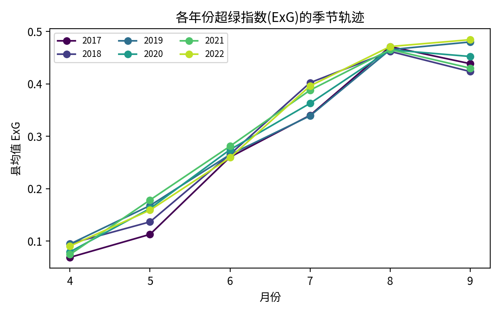
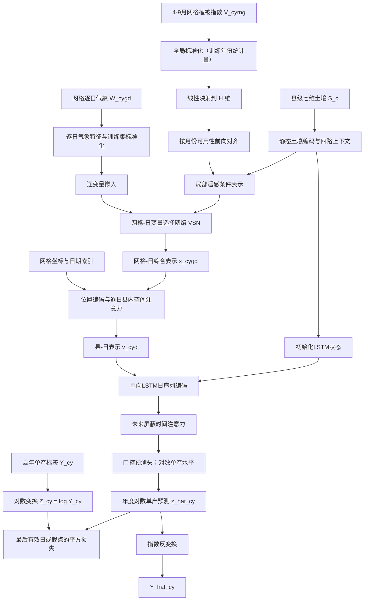
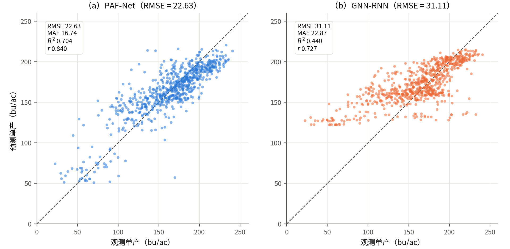
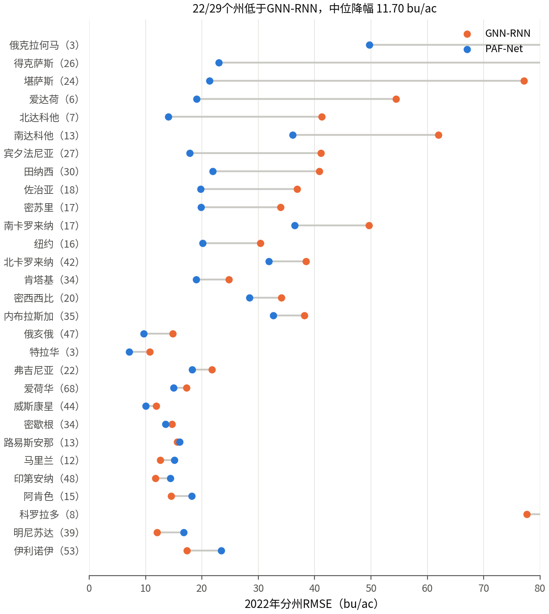
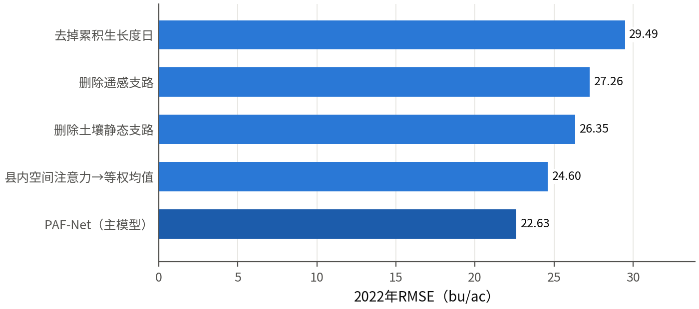
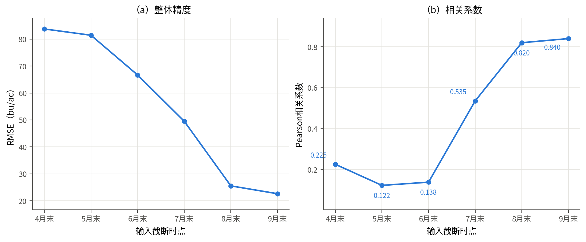
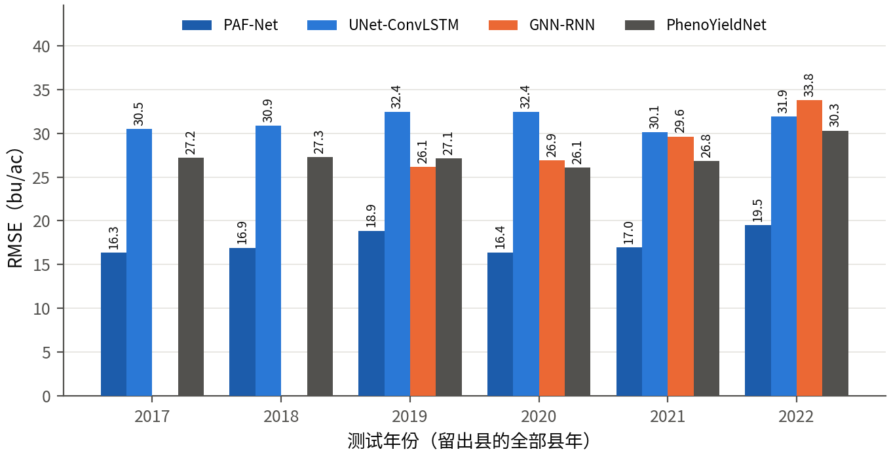

# 面向小样本县级面板的面板感知融合网络及美国玉米产区单产预测研究

## 摘要

县级作物单产预测是农业风险管理、粮食供需研判和农业保险定价的重要基础。玉米单产同时受到土壤等静态条件、逐日气象和冠层状态的影响，这些因素具有时间累积性和县内空间异质性。本文以CropNet多模态数据为基础[1]，研究美国29个州741个县2017—2022年的平衡面板（4446个县年观测），协变量包括约9 km × 9 km网格上的逐日气象、4—9月六期Sentinel-2 RGB影像和七维县级土壤属性。

县级单产预测这一任务本身有两个难点。一是样本量小、县际差异占主导：741个县只有2017—2021五年的训练标签（3705个县年），县际稳定差异占据了对数单产方差的大部分，可用于学习的年际变化很有限。二是多源输入需要融合：逐日网格气象、月度卫星影像和静态土壤要进入同一个模型，而高容量的图像编码器在如此少的年度标签上难以端到端训练。现有的深度单产模型各有侧重，但没有一个针对上述两点设计：CNN-RNN与GNN-RNN一类方法先把县内网格平均为县级序列，UNet-ConvLSTM对网格等权汇总，PhenoYieldNet依赖大规模预训练与物候对齐，而且大多只报告单次运行的结果。我们注意到时间融合变换器（Temporal Fusion Transformer，TFT）以静态协变量编码、变量选择网络、门控残差网络和可解释的时间注意力为核心组件，能同时处理静态与动态协变量、在较多候选变量中自适应选择并刻画生长季内的时间依赖，这些正是本文所需的构件。但TFT面向单条多变量序列的多步预测，把这几个构件直接套用到网格级多模态面板数据上，并不能自动满足这两点要求。

针对这两个难点，本文提出面板感知融合网络（Panel-Aware Fusion Network，PAF-Net）。模型取用时间融合变换器的静态协变量编码、变量选择网络、门控残差与因果时间注意力，在此基础上补充三处面板专用设计：变量选择作用于县内每个网格的每一天，县内空间注意力逐日把网格表示汇总为县序列，168个日步直接进入LSTM与因果时间注意力，月度遥感按最近可用月份前向对齐。第一，针对县际差异主导方差，气象、土壤与遥感输入都按训练年份的全局统计量标准化，保留县际水平差异，使网络能够从静态与动态输入中同时估计县的产量水平与年际变化。第二，针对图像编码器在少量年度标签上不可训练，以由RGB影像逐像素计算、并作全局标准化的可见光植被指数作为遥感输入，使遥感信息以低维、可训练的形式进入模型，同时保留县际与年际的绿度差异。

单折时间外推下，PAF-Net的均方根误差（Root Mean Square Error，RMSE）为22.63 bu/ac，平均绝对误差（Mean Absolute Error，MAE）为16.74 bu/ac，$R^2$为0.704，州内异常相关为0.352，比UNet-ConvLSTM（31.81）、GNN-RNN（35.56）和PhenoYieldNet（35.86）分别低28.9%、36.4%和36.9%；四个模型在同一训练配方与早停规则下比较。县分组五折空间外推下，PAF-Net在4446个县年上的RMSE为17.54 bu/ac、州内异常相关为0.401，低于同一划分上重新训练的UNet-ConvLSTM（30.00）、GNN-RNN（30.08，限于2019—2022年）与PhenoYieldNet（27.50）。消融中，把县内空间注意力换成等权均值使RMSE上升1.98 bu/ac，删除遥感支路上升4.63 bu/ac，删除土壤静态支路上升3.72 bu/ac，去掉累积生长度日上升6.86 bu/ac。生长季内截断评价提前预测能力：4月末至9月末六个截点的RMSE依次为83.76、81.43、66.69、49.53、25.54与22.63 bu/ac，州内异常相关由0.001升到0.352，8月末的RMSE与全季相差2.91 bu/ac（12.9%）。这些结果表明，在年度标签稀少的县级面板上，以静态条件化、变量选择与县内空间注意力组织多源输入，能够同时估计县际水平与年际变化，并以同一组参数在生长季内持续更新预测；县级预测因此可在收获前约一个月给出，为农业风险管理、粮食供需研判与农业保险定价提供提前的定量依据。

**关键词：** 玉米单产预测；面板感知融合网络；面板数据；多模态学习；植被指数

---

## Abstract

County-level crop yield prediction supports agricultural risk management, food supply assessment, and crop insurance. Corn yield depends on static conditions such as soil, on daily weather, and on canopy state, with temporal accumulation and within-county spatial heterogeneity. Using the CropNet data [1], this thesis studies a balanced panel of 741 counties in 29 U.S. states from 2017 to 2022 (4,446 county-years), with daily gridded weather, six monthly Sentinel-2 RGB images from April to September, and seven county-level soil attributes.

County-level yield prediction poses two difficulties of its own. First, the sample is small and between-county differences dominate: the 741 counties have only five labelled training years, 3,705 training county-years in all, and stable between-county differences account for most of the variance of log yield, so little year-to-year variation is left to learn. Second, the inputs are heterogeneous: daily gridded weather, monthly satellite imagery and static soil must enter one model, yet a high-capacity image encoder cannot be trained end-to-end on so few annual labels. Existing deep yield models each emphasise a different aspect of the task, but none is designed for these two difficulties: CNN-RNN and GNN-RNN based methods first average the grid cells within a county into a county series, UNet-ConvLSTM aggregates the grid cells with equal weights, PhenoYieldNet relies on large-scale pre-training and phenological alignment, and most report only single runs. The Temporal Fusion Transformer (TFT) combines static covariate encoders, variable selection networks, gated residual networks and interpretable temporal attention, so it can handle static and dynamic covariates together, select adaptively among many candidate variables, and capture within-season temporal dependence; these are exactly the components this task needs. TFT, however, is built for multi-horizon forecasting of a single multivariate series, and applying these components directly to grid-level multimodal panel data does not by itself meet these requirements.

To address these two difficulties we propose the Panel-Aware Fusion Network (PAF-Net). The model reuses the TFT static covariate encoder, variable selection network, gated residual network and causal temporal attention, and adds three panel-specific designs: variable selection acts on every grid and day within a county, within-county spatial attention aggregates the grid representations into a county series day by day, and the 168 daily steps enter the LSTM and causal attention directly, with monthly remote sensing forward-aligned to the latest available month. First, against variance dominated by between-county differences, the model predicts the level of county log yield directly; weather, soil and remote-sensing inputs are standardised with global training-year statistics, so that between-county level differences are retained and the network can estimate both the county level and year-to-year variation from static and dynamic inputs. Second, against an image encoder that cannot be trained on so few annual labels, the model substitutes visible-band vegetation indices, computed pixel by pixel from the RGB images and globally standardised, so that remote sensing enters the model in a low-dimensional, trainable form that retains between-county and year-to-year greenness differences.

Under a single time-forward hold-out, PAF-Net attains an RMSE of 22.63 bu/ac, an MAE of 16.74 bu/ac, an R² of 0.704 and a within-state anomaly correlation of 0.352, 28.9%, 36.4% and 36.9% below UNet-ConvLSTM (31.81), GNN-RNN (35.56) and PhenoYieldNet (35.86) respectively, with all four models compared under one training recipe and early-stopping rule. In county-grouped five-fold spatial extrapolation, PAF-Net attains an RMSE of 17.54 bu/ac and a within-state anomaly correlation of 0.401 over the 4,446 county-years, lower than UNet-ConvLSTM (30.00), GNN-RNN (30.08, 2019–2022) and PhenoYieldNet (27.50) retrained on the same folds. In the ablation, replacing the within-county spatial attention with an equal-weight mean raises the error by 1.98 bu/ac, removing the remote-sensing branch by 4.63 bu/ac, removing the soil static branch by 3.72 bu/ac and removing the cumulative growing-degree-days input by 6.86 bu/ac. In the within-season cut-off evaluation, RMSE falls from 83.76 bu/ac at the end of April to 81.43, 66.69, 49.53, 25.54 and 22.63 bu/ac at the end of May through September, and the within-state anomaly correlation rises from 0.001 to 0.352; the end-of-August RMSE is within 2.91 bu/ac (12.9%) of the full season. These results show that, on a county panel with few annual labels, organising static and daily dynamic inputs through static conditioning, variable selection and within-county spatial attention lets one model estimate both between-county level and year-to-year variation and update its prediction through the growing season with the same parameters; county forecasts can therefore be issued about a month before harvest, giving agricultural risk management, food supply assessment and crop insurance an early quantitative basis.

**Keywords:** corn yield prediction; panel-aware fusion network; multimodal learning; vegetation indices; temporal hold-out validation

---

# 第1章 引言

## 1.1 研究背景与意义

### 1.1.1 研究背景

玉米是全球产量最高、用途最广的谷物之一，不仅直接进入食品体系，还广泛用于饲料、淀粉、甜味剂、燃料乙醇和生物化工。玉米需求同时连接种植业、养殖业、能源业与国际贸易，因而产量冲击具有明显的产业链传导效应。美国是世界主要玉米生产国和出口国，美国玉米带集中分布着高商品率、规模化和机械化的玉米生产。该地区的年度收成会影响美国国内饲料与乙醇原料成本，也会通过出口和替代效应影响全球谷物市场。CropNet等公开数据进一步表明，县级统计、WRF-HRRR气象和Sentinel-2遥感已经为大范围、多年份单产建模提供了统一数据基础[1]。

区域总产量可分解为收获面积与单位面积产量的乘积。令第 $c$ 个县在年份 $y$ 的收获面积和单产分别为 $A_{cy}$ 与 $Y_{cy}$，则区域总产量为

$$
Q_y=\sum_{c=1}^{C}A_{cy}Y_{cy}.
$$

当收获面积已经播种或可由遥感较稳定识别时，单产的不确定性便成为总产量预测误差的重要来源。县级单产误差还会按面积加权积累到州级和全国供给预期。因而，县级预测并非只服务于地方管理，也可能成为全国供需平衡估计的微观信息来源。USDA月度世界农产品供需估计报告持续更新产量、消费、贸易和期末库存，市场参与者据此修正对供给宽松或紧张程度的判断[2]。

玉米单产可视为遗传潜力、环境条件和管理措施共同作用的结果。气温影响物候进程和积温累积，极端高温会影响授粉和籽粒形成；降水、蒸散需求与土壤持水能力共同决定水分胁迫；辐射、湿度和风速又通过光合作用和蒸散过程产生联合影响。这些变量的作用通常不是线性的，也不满足简单的同期加总关系。同一气象异常发生在营养生长期、开花期或灌浆期，可能产生不同后果。Khaki等使用CNN-RNN联合表示天气、土壤和管理序列，说明深度时序结构可以改善玉米与大豆单产预测[3]；Lin等通过DeepCropNet刻画气象因素的时间累积和区域差异[4]；Schwalbert等则表明遥感与天气联合信息可用于县级季中预测[5]。这些研究共同说明，单产预测需要处理高维协变量、非线性效应、时间滞后和变量交互。

气候变化进一步增加了预测难度。极端高温、干旱、强降水和复合气象事件可能同时改变平均单产和尾部损失概率。对于统计模型而言，这意味着训练期与测试期的协变量分布可能发生变化；对于产业决策而言，则意味着仅依据历史平均产量制定采购、库存或套保计划可能低估极端风险。因此，基于较高时空分辨率观测形成年度单产估计，具有潜在的农业风险管理和市场信息价值。本文在4—9月各月末截断输入，评价生长季内不同时间节点的预测精度（第5.5节）。

县级研究还面临空间支持不一致问题。单产标签以行政县为单位，气象和遥感信息却以规则网格或像元观测。若直接用县均值代替县内分布，统计上相当于以低维汇总量替代原始空间场。该操作能够降低维数，但会损失极端值、空间梯度和局部异常的信息，并产生尺度变换下的聚合偏差。只有在进一步把县级关联解释为网格或田块层面的环境效应时，才涉及典型的生态谬误。如何在保持县级监督目标的同时利用网格异质性，是本研究最初的出发点之一。

### 1.1.2 玉米期货与期权的应用背景

农产品现货生产具有季节性和不可逆性，而价格在播种、生长和收获过程中持续变化。农户、粮商、饲料企业和加工企业因持有未来产量、库存或采购需求而暴露于价格风险。期货通过锁定未来买卖价格进行线性套期保值；期权则赋予持有人在到期日按执行价格买入或卖出期货的权利，使风险管理者能够在限制不利损失的同时保留部分有利价格变化。芝加哥商业交易所集团的玉米期货与期权是国际玉米价格发现和风险转移的重要工具，其期权标的是相应玉米期货合约[6]。

设玉米期货在期权到期时的价格为 $F_T$，执行价格为 $K$，看涨和看跌期权到期收益分别为

$$
C_T=(F_T-K)^+,
\qquad
P_T=(K-F_T)^+,
$$

其中 $(x)^+=\max(x,0)$。支付权利金 $c_0$ 的看涨期权和支付权利金 $p_0$ 的看跌期权，其未计资金成本与交易费用的到期净损益分别为 $C_T-c_0$ 和 $P_T-p_0$。玉米种植者担心收获期价格下跌时，可以购买看跌期权构造价格下限；饲料或加工企业担心采购成本上涨时，可以购买看涨期权限制上行风险。通过同时买入和卖出不同执行价格期权，还可以构造牛市价差、熊市价差或领口策略，在保护范围与权利金成本之间进行权衡[7,8]。

县级单产预测与期权价值之间存在一条间接但重要的信息链。若种植面积相对稳定，单产预期下降会降低预期产量 $E(Q_y\mid\mathcal I_t)$；在需求和进口替代等条件给定时，供给收紧可能提高期货价格上行风险，也可能提高市场对尾部价格波动的定价。反之，单产预期提高可能增加供给宽松概率。USDA供需报告发布后，市场会根据产量、库存和消费修正价格预期；已有事件研究表明，政府农业信息能够影响期货市场价格和波动[9,10]。因此，如果统计模型在公开报告之前或相同信息时点提供更准确的产量信号，就可能改善方向判断、套保比例、执行价格和到期月份选择，从而产生潜在经济收益。

这种潜在收益不能简单等同于“RMSE下降就一定赚钱”。第一，本文预测的是县级单产而非期货价格，单产到价格之间还受到种植面积、需求、库存、贸易政策和市场预期影响。第二，期权价格取决于标的期货价格、执行价格、到期期限、利率和波动率；Black商品期权模型在风险中性框架下将这些量映射为期权价值[11]。第三，市场价格可能已经吸收天气、遥感和USDA信息，预测正确也不代表存在可交易的超额收益。第四，真实收益还需扣除买卖价差、手续费、滑点和保证金占用。

若要把单产模型转化为期权策略，需要至少增加两个统计层次。其一，把县级预测按收获面积聚合为区域产量分布，并估计预测不确定性，而非只给出一个点预测；其二，建立产量意外与期货收益、隐含波动率变化之间的条件关系。例如可定义相对公开基准的产量意外

$$
U_t=\widehat Q_t-Q_t^{\rm public},
$$

再估计事件窗口期货收益 $R_{t,t+h}$ 与 $U_t$ 的关系，并以严格样本外方式形成交易信号。只有当扣费后的策略收益、夏普比率、最大回撤和套期保值有效性优于基准，才能说预测产生了可验证的经济收益。上述期权定价与交易回测留作后续研究，本文的期权部分用于说明预测精度的应用前景。

近年来，遥感影像、再分析气象和土壤数据库为多源预测提供了数据基础。与此同时，循环神经网络、图神经网络、视觉变换器[12]和注意力机制为复杂函数逼近提供了方法工具。然而，高预测精度并不自动意味着可靠的统计结论或可交易利润。训练与测试的时间划分、变量标准化、预测尺度、比较模型的监督预算以及误差相关结构，都会影响预测证据；信息发布时间、交易成本与市场有效性则进一步影响经济价值。因此，本文首先解决年度单产点预测问题，并把预测分布、价格映射和期权回测作为后续研究。

### 1.1.3 研究意义

本文的理论与方法意义主要体现在三个方面。

第一，把面板数据的结构引入深度时空模型。在县级单产面板中，响应变量的方差可以分解为县际稳定差异和县内年际变化。前者主要由土壤、气候带和管理习惯决定，后者主要由天气和冠层状态解释。通用的深度时空模型常常把两部分混在一起，网络可能只学会"识别县别"；但如果把县历史均值直接作为预测起点，又会在预测年份整体偏离历史水平时失效。本文提出PAF-Net，在模型内部以静态协变量编码县际背景、以动态输入估计年际变化，直接预测对数单产水平，为深度模型利用面板结构提供了一种做法。

第二，为小样本条件下的多模态融合提供经验。高容量的图像编码器在县级年度样本上难以训练；本文以低维、可解释的植被指数作为遥感输入，并配合与样本规模相称的优化设置。第5章的结果表明，这一形式可以稳定训练，且删除遥感支路后重新训练会使误差明显上升（第5.4.2节）；如何进一步改进特征形式与接入方式，仍是后续工作要解决的问题。

第三，为深度时空模型的评价提供统计规范。本文采用同一预测目标下的架构比较、单折时间外推、县分组五折交叉验证、组件消融与输入消融评价模型之间的差异。这些检验同样适用于其他多模态农业预测模型。

在应用层面，县级预测可服务于区域供需研判、灾害损失评估、农业保险和衍生品风险管理。更准确的年度单产信息有可能降低供给判断误差，辅助期货套保比例和期权结构选择，从而改善风险调整后的经营结果。本文的日粒度模型可以在4—9月各月末用截至该时点的信息更新预测，第5.5节报告各截点的精度；把这一能力转化为期权动态对冲，还需要预测不确定性、价格映射与交易成本三个层次的分析，价格预测与交易回测留作后续研究。本文的模型与分析也可迁移到大豆、小麦等作物，但跨作物推广需要重新定义物候窗口、特征构造和训练样本，不能由本文结果直接外推。

## 1.2 国内外研究现状

### 1.2.1 传统统计与作物模型方法

早期单产研究主要包括作物机理模型和统计回归模型。作物机理模型依据光合、呼吸、水分平衡和物候过程模拟生长，具有较强的过程解释能力，但需要品种、管理和土壤剖面等参数，区域化校准成本较高。统计模型则直接估计单产与天气、趋势项及土壤之间的关系。线性回归、面板模型、广义加性模型和空间回归能够给出清晰的参数解释，但面对高维图像和复杂交互时容易受到函数形式限制。传统研究常以积温、高温度日、降水和水分亏缺作为关键解释量，利用分段函数或非参数平滑描述温度阈值效应。其优点是估计对象清楚、计算成本较低，也便于进行标准误和假设检验；不足是模型结构依赖人工设定，且对遥感影像等高维非结构化数据适应性有限。

统计模型的优势不应仅以结构简单概括。合理构造积温、高温度日和水分亏缺后，低维模型仍能提供有价值的基准，并可借助县固定效应、年份效应和空间误差结构进行推断。随机森林等集成学习方法进一步放宽函数形式，通过变量随机化和树模型平均提高非线性拟合能力[13]。但当研究目标侧重预测且协变量维数较高时，预先指定全部非线性和交互关系较为困难，这推动了深度表示学习方法的应用。

### 1.2.2 深度时序与空间模型

卷积神经网络（Convolutional Neural Network，CNN）与循环神经网络（Recurrent Neural Network，RNN）组合的方法（CNN-RNN）通常先用卷积网络提取局部或逐日特征，再用循环网络表示跨时间依赖。Khaki等将天气、土壤和管理变量输入CNN-RNN，对美国玉米带多个年份进行玉米和大豆预测[3]；DeepCropNet使用带注意力的长短期记忆网络（Long Short-Term Memory，LSTM）刻画气象因素的时间累积，并以多任务学习表达地区差异[4]。这类方法改善了固定线性形式的表达能力，但通常先把县内网格平均为县级序列，丢失了县内的空间异质性；静态的土壤信息也大多只在最后与动态特征拼接，难以调节模型对天气的解读。

GNN-RNN[36]把县视为图节点，用GraphSAGE[14]在县邻接图上传播信息，再用循环网络建模跨年变化。它利用了县际空间结构，但同样先对县内天气取均值，不使用遥感影像；而且以连续五年为一个窗口组织样本，要求每个县都有足够长的历史记录。

ConvLSTM把循环门作用扩展到空间特征图，能同时保持局部空间结构和时间状态[15]。UNet-ConvLSTM一类方法用U-Net提取每月每网格的影像特征，再用ConvLSTM沿月份递推。但卷积的平移结构适合规则影像，县内网格对县级单产的贡献却未必取决于相对位置；这类方法最终通常对网格等权汇总，也不使用土壤等静态信息。

总的来看，已有深度时空模型在三个方面存在不足：县内网格的异质性利用不足，静态与动态协变量的融合方式较为简单，对哪些变量在哪些时期重要缺乏可解释的机制。

### 1.2.3 遥感与多模态预测

遥感影像能够观测作物冠层状态，天气变量则描述作物生长所处的环境驱动，二者在语义和观测频率上并不相同。多模态学习通常可按信息结合阶段分为三类：早期或特征级融合，即各模态分别编码后拼接，或映射到共享表示空间；中间交互融合，即在网络内部通过跨模态注意力等机制反复交换信息；后期或决策级融合，即先由各模态独立形成预测，再组合预测结果[16,17]。无论采用哪一类方法，不同空间分辨率和时间分辨率的数据都应先建立明确的对齐关系，避免把不同时点或不同空间支持的观测直接视为同步、同尺度特征。

农业单产研究已形成多种与任务语义相匹配的实现。Schwalbert等先用随机森林识别玉米像元，再将县级植被指数与天气变量纳入多变量经验模型，进行美国玉米带县级季中单产预测[5]。MMST-ViT使用金字塔视觉变换器（Pyramid Vision Transformer，PVT）[18]提取视觉表示，并通过多模态注意力刻画视觉表示与短期气象之间的关系，随后由空间Transformer和时间Transformer建模空间关系与长期气象背景[19]。PhenoYieldNet分别使用视觉Transformer和气象多层感知机（Multilayer Perceptron，MLP）编码两类信息，再以cross-attention形成融合表示，并通过作物感知的时间解码器输出单产预测[20]。CMAViT则把遥感patch表示作为视觉分支的查询、键和值，并由气象查询和键共同调整注意力得分；管理文本通过另一cross-attention通路参与表示学习[21]。这些代表性方法说明，融合结构应根据模态关系选择，而非脱离数据语义试配结构：天气主要提供环境驱动，遥感主要反映作物状态，二者频率不同，因而应先完成时空对齐，再决定采用特征级组合、中间交互或决策级组合。CropNet整合Sentinel-2、WRF-HRRR和USDA县级产量数据，为此类多模态比较提供了公开数据基础[1]。

跨模态注意力具有较强的表达能力，但其计算和数据需求也较高。设气象token数为 $N_w$、遥感patch数为 $N_r$、隐藏维数为 $d$，显式cross-attention需要构造两类token的成对交互，其主要计算量近似为 $O(N_wN_rd)$。当一个县同时包含多个网格和多个生长季时点时，token数迅速增加，显存占用和训练时间也随之上升。复杂跨模态Transformer还包含更多待估参数，部分方法另设多模态对比预训练或农业领域自监督适配阶段[19,20]。这类方法适合大规模配对数据，但在县级年度标签数量有限的场景中，可能面临监督信号不足、优化成本较高和过拟合风险。

由此可见，已有多模态方法的不足主要在两个方面。第一，复杂的跨模态注意力参数量大，在县级年度标签只有一两千个的情况下容易过拟合，部分方法还需要额外的预训练阶段。第二，遥感的作用通常通过"去掉遥感分支后重新训练、比较误差"的消融实验来说明。这一做法能够说明遥感分支对模型整体表现有影响，但重新训练同时改变了输入与优化过程，因此所得幅度只应作为该支路贡献的点估计，本文在第5.4.2节按这一口径报告。

这一条件化关系具有明确的农学依据。玉米对高温和水分亏缺的响应随生育阶段而变化：抽雄吐丝和授粉前后的胁迫会延迟吐丝、扩大抽雄吐丝间隔、降低雌雄生殖能力并抑制穗部生长，主要影响籽粒数；灌浆期胁迫则更多通过叶片功能、有效灌浆持续时间、籽粒库容和同化物积累影响粒重[22,23,24,25,26]。因此，同样的高温、降水不足或蒸散亏缺发生在不同物候阶段和不同既有冠层状态下，对最终单产的预测意义并不相同。

遥感影像可为这种“当前作物状态”提供观测代理。多时相冠层覆盖度、株高、植被指数和衰老轨迹能够表征物候进程、冠层活力和此前环境与管理共同作用后形成的综合状态[27,28,29]。例如，冠层早衰可能意味着功能叶面积下降，而相同的后续高温或水分亏缺对早衰冠层与保持绿色的冠层可能具有不同后果；同一日历日期的NDVI也可能因播期和物候差异代表不同生理阶段。由此，把遥感状态作为气象变量选择的条件信息，可以理解为让模型在不同作物状态下重新分配天气变量的权重。这种融合方式不需要构建两两cross-attention，额外参数很少，适合小样本场景，也是本文第4章模型采用的思路。单期遥感信号不能被直接解释为某一种特定胁迫的累计剂量。

遥感信息也可以不经过深度图像编码器，而以低维植被指数的形式进入统计模型。Bolton和Friedl利用植被指数与作物物候指标预测美国玉米和大豆单产[29]；Schwalbert等将县级植被指数与天气变量纳入多变量模型，进行县级季中预测[5]。这类方法的预测变量数量少、含义明确，适合与县固定效应和年份交叉验证结合使用。CropNet只提供RGB三个可见光波段，不能直接计算NDVI等需要近红外波段的指数，但超绿指数（Excess Green，ExG）和可见光抗大气植被指数（Visible Atmospherically Resistant Index，VARI）等只依赖可见光波段的指数，仍可反映冠层的绿度与覆盖程度。

### 1.2.4 时间融合变换器及可解释预测

时间融合变换器（Temporal Fusion Transformer，TFT）由Lim等提出，面向含多种协变量的时间序列预测[30]。它由五类组件构成：静态协变量编码器把不随时间变化的协变量转换为若干上下文向量；变量选择网络在每个时间步为候选变量给出归一化权重，并可接受静态上下文作为条件；门控残差网络是各组件的基本单元，在不需要非线性变换时可以退化为近似的残差通路；LSTM处理局部的顺序依赖；可解释多头注意力则直接建立远距离时间步之间的联系。

与第1.2.2节和第1.2.3节的方法相比，TFT在三个方面正好回应了它们的不足。其一，静态协变量编码器把土壤等静态信息送入变量选择、循环网络初始化和注意力等多个环节，而不只是在最后拼接。其二，变量选择网络能根据样本和时间步自适应地分配变量权重，并且可以把遥感状态作为条件上下文，从而以很少的额外参数实现第1.2.3节所述的条件化融合。其三，变量选择权重和时间注意力权重为解释模型依赖了哪些变量、哪些时期提供了入口。这三处正是本文所要取用的构件。

但TFT原本面向规则的时间序列，不能直接处理县内的多个网格和遥感影像，需要加以扩展。更重要的是，TFT和多数深度时空模型一样，没有专门处理面板数据的结构：同一县在不同年份的单产高度相关，县际稳定差异占据大部分方差，而年度标签的数量又很少。本文第4章提出的PAF-Net在模型结构上回应这一问题：静态协变量编码器显式输入县不变量的土壤属性与绝对坐标，空间注意力把县内各网格聚合为县年表示，使模型能够学习县际差异与年际变化，而不必把县别当作隐变量去记忆。预测目标则直接取对数单产水平，不使用县历史均值作为偏移量；第4.10节说明了这一选择在异常年份的考虑，第5.3节与第6.1节报告了它在州一级的得失。

还需强调，可解释预测不同于因果解释。注意力权重描述模型计算路径中的相对分配，变量选择权重也不等同于回归系数或显著性统计量。相关权重可以用于提出农学假设，但若要识别温度或降水的因果效应，仍需额外的识别假设、处理定义和反事实设计。

### 1.2.5 农产品期货期权与农业信息价值研究

农产品衍生品研究主要关注价格发现、套期保值、波动率和信息发布效应。期货提供近似线性的价格风险暴露，期权则通过非线性收益结构管理尾部风险。Black在期货价格基础上建立商品期权定价公式，为交易所期权估值和风险参数计算提供了经典框架[11]；Hull系统总结了期货、期权、希腊字母和动态对冲原理[7]；McDonald从金融工程角度讨论了价差、领口和保护性期权等策略[8]。

农业信息的经济价值取决于信息是否改变市场参与者对未来供需的条件分布。USDA的产量和供需报告是玉米市场的重要公共信息源[2]。事件研究通常比较报告发布前后的异常收益、成交量和波动率，以判断新信息进入价格的速度[9,10]。对单产预测而言，研究重点不应只是统计误差，还应包括相对公开基准的信息增量、发布时间优势和扣除成本后的经济效用。现有深度单产预测文献大多报告RMSE、MAE或 $R^2$，较少进一步连接期货收益、隐含波动率和期权套保效果。这构成统计预测与农业金融之间值得拓展的研究接口。

### 1.2.6 研究现状评述

综合以上研究，已有的县级单产预测方法存在以下不足。

第一，深度时空模型对县内空间异质性和静态—动态协变量的利用不足。CNN-RNN和GNN-RNN一类方法通常先把县内网格平均为县级序列；ConvLSTM一类方法对网格等权汇总；土壤等静态信息大多只在最后与动态特征拼接。它们也缺少可解释的变量选择机制。

第二，复杂的多模态融合结构与县级样本规模不匹配。跨模态注意力参数量大，部分方法还需要额外的预训练；在年度标签只有一两千个的县级面板上，这类结构容易过拟合。

第三，面板结构没有被显式利用。同一县在不同年份的单产高度相关，县际稳定差异占据了大部分方差。通用的深度模型把县际差异和年际变化混在一起学习，网络可能主要学会识别县别；但反过来，直接把县历史均值当作预测起点，又会在预测年份整体偏离历史水平时失效。本文选择在模型内部显式区分县级静态背景与年际动态输入，直接预测对数单产水平，而不把历史县均值作为偏移量。与此相关，已有研究报告的误差通常是县际水平差异与年际变化误差的混合，很少说明二者各占多少，因而难以判断模型的增益究竟来自对年际变化的预测，还是只来自对县别的识别；本文在第5.2节与第5.3节对这两部分作了分解。

第四，对结果随机性的检验不够充分。深度模型的结果受随机初始化影响，单次运行的指标难以区分方法差异和训练随机性；已有研究多数只报告一次运行，少数给出重复运行的波动范围。本文因此对主模型与一个关键输入对照各重复训练一次（第5.1节），其余配置仍只运行一次。

第五，统计精度与经济价值之间缺少桥梁，单产误差的改善很少通过样本外价格映射和期权回测来检验。

针对前两点，本文取用TFT的四类构件作为PAF-Net的内部机制：静态协变量编码器、变量选择网络、门控残差单元与因果时间注意力，它们分别回应了静态信息融合、变量自适应选择和可解释性的需要，而以变量选择为核心的条件化融合方式参数很少，适合小样本场景。针对第三点，本文提出面板感知融合网络（PAF-Net），并在上述构件之外补充三处面板专用设计：模型以静态协变量编码县级背景，以网格—日变量选择和县内空间注意力利用动态输入，以日为时间步对齐逐日气象与月度遥感，直接预测对数单产水平。针对第四点，本文用输入消融检验遥感的作用。期权部分仅用于说明准确单产信息的潜在决策价值，不作为本文已完成的交易实证。

## 1.3 研究内容

本文主要研究内容如下：

1. 构建县年层面的多模态数据体系，明确响应、网格气象、遥感影像、县级土壤和空间坐标的索引关系；从RGB影像逐像素计算可见光植被指数。
2. 分析县级单产预测对模型的要求，说明取用时间融合变换器（TFT）四类构件的理由，并据此提出面板感知融合网络（PAF-Net）：在取用的构件之上补充网格—日变量选择、县内空间注意力与日时间轴，直接预测对数单产水平，采用全局标准化的植被指数输入，并按样本规模设定训练协议。
3. 以2017—2021年训练、统一配方与验证早停、2022年测试的单折时间外推评价PAF-Net，并与三个已有深度模型在同一划分上比较。
4. 通过同一预测目标下的架构比较、组件消融、输入消融和县分组五折空间交叉验证，评价PAF-Net各项设计的作用以及对未见县的外推能力。

## 1.4 技术路线

本文技术路线分为四个阶段。

第一阶段是数据匹配：将县级单产与县内网格天气、月度遥感影像、坐标和土壤属性按县和年份连接，并从影像计算植被指数。

第二阶段是模型设计：取用TFT的静态协变量编码器、变量选择网络、门控残差与因果时间注意力，针对县级面板在输入形态与输出形态上的四处不匹配（多网格、日—月混合频率、无未来协变量、单一年度标签）补充网格—日变量选择、县内空间注意力与日时间轴，并舍弃解码器与分位数输出，确定PAF-Net的预测目标、遥感接入方式与训练协议。

第三阶段是模型实现：在上述构件的基础上实现网格—日变量选择、县内空间注意力与对数单产预测头。

第四阶段是评价：在同一预测目标下比较各模型、以单折时间外推给出PAF-Net的精度，并用组件消融与输入消融评价各项设计的作用。

## 1.5 本文的主要创新与工作特点

本文的主要贡献在于面向小样本县级面板的PAF-Net模型及其评价，而不在于提出新的注意力算子或网络基础组件。

1. **提出面向小样本县级面板的PAF-Net模型。** 县级单产面板年份少，且县际稳定差异占据了大部分方差。针对这一结构，本文以静态协变量编码县级背景，以网格—日变量选择和县内空间注意力利用动态输入，直接预测对数单产水平，而不把县历史均值作为偏移量；以全局标准化的可见光植被指数代替高容量图像编码器，使遥感以低维、可训练的形式进入模型；并配合按样本规模设定的学习率与梯度裁剪。时间轴取日粒度，使LSTM与因果时间注意力在168个日步上计算，模型因此可以在生长季内任意月末只用截至该日的信息给出预测。在2022年这一折上，按2017—2021年训练、四模型共用固定配方并以随机10%训练县年早停的统一规则，PAF-Net的RMSE为22.63 bu/ac，比UNet-ConvLSTM（31.81）、GNN-RNN（35.56）和PhenoYieldNet（35.86）分别低28.9%、36.4%和36.9%。遥感与土壤支路的删除式消融结果见第5.4.2节。
2. **建立与证据强度相匹配的评价规范，并检验生长季内的提前预测能力。** 在同一预测目标（绝对水平）下比较PAF-Net与三个已有深度模型；以组件消融、输入消融检验各项设计与遥感的作用；以县分组五折交叉验证评价模型对未见县的外推能力；把输入截断到4—9月各月末，检验同一组参数在生长季内各时点的直接预测精度。本文同时报告"已见县、未见年份"的时间外推、"未见县"的空间外推与生长季内截断三类结果。

## 1.6 本章小结

本章从农业生产、粮食供需和玉米期货期权风险管理三个层面阐述了县级单产预测的意义，回顾了统计方法、深度时空模型和多模态遥感方法的研究现状，指出了基线、遥感检验、训练随机性和经济价值四个方面的不足。本文据此取用TFT的静态条件化、变量选择与因果时间注意力作为内部构件，针对小样本县级面板的结构补充网格—日选择、县内空间注意力与日时间轴，封装为PAF-Net模型，并在同一预测目标的架构对照、强基线与单折时间外推下评价。

---

# 第2章 统计理论与方法基础

## 2.1 对数单产的同方差条件正态模型

设第 $i$ 个县年样本的原始玉米单产为 $Y_i>0$，协变量集合为 $X_i$。由于原始单产为正值，且较高产量水平下的绝对波动通常更大，本文首先对响应变量作自然对数变换：

$$
Z_i=\log Y_i.
$$

基线模型从最简单的条件分布假设出发。假定在给定协变量 $X_i$ 后，对数单产服从条件正态分布：

$$
Z_i\mid X_i\sim N\left(\mu_i,\sigma^2\right),
\qquad
\mu_i=f_\theta(X_i),
$$

或等价地写为

$$
Z_i=f_\theta(X_i)+\varepsilon_i,
\qquad
\varepsilon_i\mid X_i\sim N(0,\sigma^2).
$$

这里，$f_\theta$ 表示条件均值函数，在第4章中由PAF-Net刻画；$\sigma>0$ 表示条件误差标准差。在基线设定中，所有县年样本共享同一个 $\sigma$，这就是同方差假设。该假设并不是说所有县年单产具有相同均值，而只是说在扣除条件均值 $f_\theta(X_i)$ 后，剩余误差的条件离散程度不随县、产量水平或其他协变量系统变化。本文将其作为推导MSE目标的工作假设，不据此声称该假设已经得到数据验证。

为推导基线估计准则，先采用给定协变量后样本误差条件独立的工作近似。第 $i$ 个样本的负对数似然为

$$
-\log p(Z_i\mid X_i)
=\frac{1}{2}\log(2\pi)
+\log\sigma
+\frac{[Z_i-f_\theta(X_i)]^2}{2\sigma^2}.
$$

如果 $\sigma$ 被视为所有样本共享的常数，则前两项与均值模型参数 $\theta$ 无关。对 $\theta$ 进行极大似然估计等价于最小化

$$
\mathcal L_{\rm MSE}(\theta)
=\frac{1}{n}\sum_{i=1}^{n}
[Z_i-f_\theta(X_i)]^2.
$$

因此，本文基线采用MSE并不是任意选择损失函数，而是来源于“对数单产条件正态且同方差”的初始统计假设。在平方损失下，最优预测函数同时满足

$$
f^*(x)=E(Z\mid X=x).
$$

需要注意，MSE主要估计对数尺度的条件均值。原尺度反变换 $\exp\{f_\theta(X_i)\}$ 对应条件中位数或几何均值，而不是一般意义下的原尺度条件均值。若需要原尺度条件均值，可以采用Duan的涂抹估计等非参数方法作重变换校正[31]；本文报告的是未经校正的 $\exp\{\widehat Z\}$。如果同方差正态假设成立，则

$$
E(Y_i\mid X_i)
=\exp\left\{\mu_i+\frac{1}{2}\sigma^2\right\}.
$$

## 2.2 面板结构与时空相关

本文样本以县年为单位，同一县跨年份重复出现，且邻近县可能受到相似天气系统和农业制度影响。因此，观测不宜无条件视为独立同分布。可将误差概念性分解为

$$
\varepsilon_{cy}=u_c+v_y+s_{cy}+e_{cy},
$$

其中 $u_c$ 表示县级稳定异质性，$v_y$ 表示共同年份冲击，$s_{cy}$ 表示空间相关成分，$e_{cy}$ 为剩余扰动。本文主要任务是预测而非参数推断，模型没有显式估计上述方差分量；但这一结构决定了评价时必须以县为单位聚合误差、以县为单位报告结果，而不能把全部县年当作彼此独立的观测。第5.3节的分州误差与第5.4节的输入消融，都是在这一意义上逐县评价的。

按年留出测试通过年份划分训练集与测试集，考察模型从历史年份迁移到一个后续年份的表现。该设计不同于随机划分，因为随机划分可能将相同年份的共同冲击同时放入训练和测试。本文以2022年为测试年份、2017—2021年为训练年份，各模型按同一固定配方训练、以随机留出的10%训练县年早停（第5.1节）；这一设计属于"已见县、未见年份"的预测评价。第5.6节另以县分组五折交叉验证评价"未见县"的外推，两类设计回答不同的问题，结果分别报告；两者都不代表对研究区外区域的外推能力。

县级面板的常见处理是对数据作组内变换，以县固定效应吸收县际稳定差异、只用县内年际变化估计协变量系数，并把预测写成县历史均值加年际异常。本文不采用这一做法，PAF-Net直接预测对数单产水平，理由见第4.10节。

## 2.3 长短期记忆网络

本节至第2.5节介绍第4章PAF-Net模型所用的网络组件。

对于序列输入 $x_t$，LSTM[32]通过输入门、遗忘门和输出门更新状态：

$$
\begin{aligned}
i_t&=\sigma(W_i x_t+U_i h_{t-1}+b_i),\\
f_t&=\sigma(W_f x_t+U_f h_{t-1}+b_f),\\
o_t&=\sigma(W_o x_t+U_o h_{t-1}+b_o),\\
\widetilde c_t&=\tanh(W_c x_t+U_c h_{t-1}+b_c),\\
c_t&=f_t\odot c_{t-1}+i_t\odot\widetilde c_t,\\
h_t&=o_t\odot\tanh(c_t).
\end{aligned}
$$

门控结构允许状态在相邻日之间选择性保留或更新。本文使用单向LSTM，信息只从较早日期流向较晚日期。初始隐状态与细胞状态由土壤静态上下文给出，使同一动态输入在不同土壤条件下可以产生不同状态轨迹。

## 2.4 注意力机制

给定查询矩阵 $Q$、键矩阵 $K$和值矩阵 $V$，缩放点积注意力为[33]

$$
\operatorname{Attention}(Q,K,V)=
\operatorname{softmax}\left(\frac{QK^\top}{\sqrt{d_k}}+M\right)V,
$$

其中 $M$ 为掩码矩阵。空间注意力可用一个县级查询对县内网格键值加权；时间注意力则以当前日期为查询，对历史日期加权。若对所有未来位置设置 $M_{tk}=-\infty$，便得到未来屏蔽结构。本文称其为“因果时间掩码”，含义仅为计算顺序不读取未来日期，不涉及统计因果推断。

多头注意力在不同投影空间计算权重，有助于表达多种依赖模式。本文时间模块采用多头查询和键，并对各头权重平均后作用于共享值表示。它与标准Transformer中每个头均具有独立值投影的结构并不完全相同，第五章将给出具体定义。

## 2.5 门控残差与变量选择

门控残差网络（Gated Residual Network，GRN）是TFT的重要构件。对输入 $x$ 和可选上下文 $c$，可概括为

$$
\begin{aligned}
u&=W_2\operatorname{ELU}(W_1x+W_cc+b_1)+b_2,\\
\operatorname{GLU}(u)&=u_a\odot\sigma(u_b),\\
\operatorname{GRN}(x;c)&=\operatorname{LayerNorm}
\{\operatorname{GLU}(u)+Px\},
\end{aligned}
$$

其中 $P$ 用于维数匹配。残差通路减少深层变换的优化难度，门控单元控制非线性变换进入输出的程度。

变量选择网络（Variable Selection Network，VSN）针对 $p$ 个候选变量产生归一化权重。设第 $j$ 个变量的表示为 $\xi_j$，则

$$
(\alpha_1,\ldots,\alpha_p)
=\operatorname{softmax}\{g(\xi_1\Vert\cdots\Vert\xi_p;c)\},
$$

$$
x^{\mathrm{sel}}=\sum_{j=1}^p\alpha_jg_j(\xi_j),
\qquad \alpha_j\ge0,\quad\sum_j\alpha_j=1.
$$

该机制是连续的自适应加权，而不是产生严格零系数的变量筛选。$\alpha_j$ 也不具有经典线性模型系数的边际效应解释。

## 2.6 预测评价统计量

设测试样本为 $\{(y_i,\widehat y_i)\}_{i=1}^{n_{\rm te}}$，残差为 $e_i=\widehat y_i-y_i$。常用指标为均方根误差（Root Mean Square Error，RMSE）、平均绝对误差（Mean Absolute Error，MAE）与决定系数（coefficient of determination，$R^2$）：

$$
\operatorname{RMSE}=\sqrt{\frac{1}{n_{\rm te}}\sum_i e_i^2},
\qquad
\operatorname{MAE}=\frac{1}{n_{\rm te}}\sum_i|e_i|,
$$

$$
R^2=1-\frac{\sum_i(y_i-\widehat y_i)^2}
{\sum_i(y_i-\overline y)^2},
$$

$$
r=\frac{\sum_i(y_i-\overline y)(\widehat y_i-\overline{\widehat y})}
{\sqrt{\sum_i(y_i-\overline y)^2}\sqrt{\sum_i(\widehat y_i-\overline{\widehat y})^2}}.
$$

RMSE对大误差更敏感，MAE反映绝对偏差的平均规模。$R^2$ 以测试样本均值预测为基准，可能为负；Pearson相关系数衡量线性共同变化，对整体位置偏移和尺度变化不敏感。标准 $R^2$ 与 $r^2$ 一般不相等，只有在包含截距的同样本普通最小二乘拟合等特定条件下才有对应关系。因此本文同时报告二者时不相互替代。

除上述指标外，本文报告平均误差（偏差）$\overline e=n_{\rm te}^{-1}\sum_ie_i$ 和州内异常相关。偏差反映预测整体偏高或偏低，在年份冲击较大的年份尤为重要。州内异常相关定义为

$$
r_{\rm anom}=\operatorname{corr}\left(
\widehat Z_{cy}-\overline Z_c-\overline{(\widehat Z-\overline Z)}_{s(c)},\ 
Z_{cy}-\overline Z_c-\overline{(Z-\overline Z)}_{s(c)}
\right),
$$

其中 $\overline Z_c$ 为训练年份县均值，$\overline{(\cdot)}_{s(c)}$ 表示在县 $c$ 所在州、同一测试年份内求平均。该量先去掉县的历史水平，再去掉州×年份的共同部分，只衡量模型能否分辨"同一年、同一州内哪些县比自己平常更好或更差"。由于去掉了县际水平与年份整体水平，这一指标只反映模型对县与县之间相对好坏的排序能力。

## 2.7 单产预测信息与商品期权决策

年度单产预测属于现实概率测度下的农业数量预测，而交易所期权定价通常使用风险中性测度。二者不能直接等同。设 $F_t$ 为时点 $t$ 的玉米期货价格，$K$ 为执行价格，$T-t$ 为剩余期限，$r$ 为无风险利率，$\sigma$ 为期货收益波动率。Black商品期权模型给出的欧式看涨期权价格为[11]

$$
c_t=e^{-r(T-t)}[F_t\Phi(d_1)-K\Phi(d_2)],
$$

$$
d_1=\frac{\log(F_t/K)+\frac{1}{2}\sigma^2(T-t)}
{\sigma\sqrt{T-t}},
\qquad
d_2=d_1-\sigma\sqrt{T-t},
$$

看跌期权价格为

$$
p_t=e^{-r(T-t)}[K\Phi(-d_2)-F_t\Phi(-d_1)].
$$

由公式可见，单产预测并不是期权价格的直接输入。它需要先通过供需平衡、库存预期和市场行为影响 $F_t$ 与 $\sigma$。若模型提供相对市场共识的新增信息，其价值可能表现为更准确的价格方向概率、更合理的波动率判断或更有效的套保头寸。反之，如果信息已被市场吸收，统计预测即使准确也可能没有交易价值。

对生产者而言，保护性看跌策略的简化到期收入可写为

$$
\Pi_T^{\rm put}=QF_T+N(K-F_T)^+-Np_0-C,
$$

其中 $Q$ 为实际可销售数量，$N$ 为期权覆盖数量，$C$ 为交易、基差和执行等成本。预测模型可用于调整 $N$、$K$ 和到期月份，但最优决策还依赖风险厌恶、产量风险与价格风险的相关性。对于产量与价格负相关的农户，单独进行价格套保还可能存在自然套保与过度套保问题。因此，完整经济评价应同时模拟产量和价格联合分布，而非仅比较单产RMSE。

本文没有估计风险中性分布或期权交易收益。引入上述理论的目的，是说明县级单产信息如何可能进入风险管理决策，并为后续“统计精度—价格反应—套保效用”的联合研究建立概念框架。

## 2.8 本章小结

本章首先在对数单产同方差条件正态的工作假设下，由极大似然原理推导出平方损失目标，并说明面板数据中县效应、年份冲击和空间相关构成的误差结构。之后介绍第4章PAF-Net模型使用的LSTM、注意力机制、门控残差网络和变量选择网络，并定义预测评价指标，其中包括本文引入的州内异常相关。最后说明年度单产信息与商品期权风险管理之间的联系。

---

# 第3章 研究区域与数据

## 3.1 研究区域与观测单位

研究区域覆盖CropNet中美国31个有县级玉米单产记录的州，共1855个候选县。筛选标准有两条：该县在2017—2022年每一年都有USDA单产记录；县内的气象网格与遥感影像在每一年都通过完整性检查。满足两条标准的县共741个，分布在29个州；加利福尼亚和华盛顿两州没有一个县在六年中全部合格。2017—2022年每年均有741个县年观测，构成包含4446个观测的平衡面板。

县数最多的是爱荷华（68个）、伊利诺伊（53个）、印第安纳（48个）、俄亥俄（47个）和威斯康星（44个），研究区因此仍以玉米带为核心，同时向北达科他、南达科他、科罗拉多和爱达荷等西缘州以及得克萨斯、路易斯安那、密西西比、佐治亚和南北卡罗来纳等南部州延伸。这些外围州的县只有个别年份合格，样本在州之间很不均衡，第5.3节的分州结果需要按县数解读。

令 $c=1,\ldots,C$ 表示县，$y\in\{2017,\ldots,2022\}$ 表示年份，$g=1,\ldots,G_c$ 表示县 $c$ 内网格，$d=1,\ldots,168$ 表示研究时间窗内的日序，$m=1,\ldots,6$ 表示4—9月。基本监督单位是县年 $(c,y)$，网格和日期是协变量的内部索引，不具有独立县级单产标签。

表3-1给出样本结构。

| 数据子集 | 年份 | 县数 | 县年样本数 | 用途 |
|---|---|---:|---:|---|
| 训练集 | 2017—2021 | 741 | 3705 | 参数估计与标准化统计量估计 |
| 测试集 | 2022 | 741 | 741 | 该折的时间外评价 |
| 合计 | 2017—2022 | 741 | 4446 | 全部研究样本 |

**表3-1  样本结构（2022折的划分）。** 训练池为2017—2021年，测试集为2022年；早停用的验证集从训练池中随机抽取，2022年不参与训练或选模。

表3-1给出的是本章的唯一评价划分：用2017—2021年训练池训练，其中随机留出10%的县年用于早停，训练结束后直接在2022年测试。选择这一划分的理由见第5.1节。测试年份只用于最终评价，既不进入训练，也不参与轮次选择。研究过程中曾多次查看2022年的结果，因此这一折并非严格意义上从未使用过的留出集，本文在第6.2节把这一条列为适用边界。

## 3.2 响应变量

响应变量 $Y_{cy}$ 为县 $c$ 在年份 $y$ 的玉米单产，单位为蒲式耳/英亩（bu/ac）。由于 $Y_{cy}>0$ 且高低产年份的波动幅度可能随平均水平变化，模型拟合

$$
Z_{cy}=\log Y_{cy}.
$$

最终评价统一在原始单产尺度进行。该设置降低极端高值在训练平方损失中的支配程度，但如第2章所述，指数反变换存在条件均值偏差问题。

## 3.3 气象数据与累积生长度日

网格逐日气象向量记为

$$
W_{cygd}=(W_{cygd1},\ldots,W_{cygd,11})^\top.
$$

11个变量包括平均温度、最高温度、最低温度、降水、相对湿度、阵风、风速、东西向风、南北向风、向下短波辐射和水汽压亏缺。时间窗口为4—9月每月第1—28日，共168个规则日位置。采用每月28天使不同月份具有相同长度，但会舍弃月末2—3天，因此逐日序列覆盖的是这一固定观测窗口，并非完整自然生长季。

在这11个变量之外，模型另加一个累积热量指标。将开尔文温度换算为摄氏温度后，网格—日的累积生长度日定义为

$$
\operatorname{CumGDD}_{cygd}
=\sum_{r\le d}\max(T^{\rm mean}_{cygr}-8,0),
$$

其中 $T^{\rm mean}_{cygr}$ 为日平均温。因此第4章PAF-Net的动态候选变量共12个。

不采用其他构造变量的理由在于信息重叠。在168个日步上，原始变量的逐日序列已经携带阈值的累积与时段结构，高温日数、累计降水与水分盈亏都可以由变量选择与时间注意力从序列中学习；这三个量与原始日序列高度共线，加进模型只增加参数与容量而不增加信息，本文因此不使用。CumGDD不同：它把温度换算为对玉米发育有直接含义的热量累积，为模型提供一条与物候进程单调相关的热量标尺；第5.4.2节的对照去掉它以后，2022年的RMSE由22.63升到29.49、偏差由+0.50升到+12.25，是全部输入对照中幅度最大的一处。三个比较模型只使用11个原始气象变量（第5.1节），与本模型的差别仅在这一个构造量上。

## 3.4 遥感、土壤与坐标数据

### 3.4.1 遥感影像

令 $I_{cymg}\in\mathbb R^{3\times224\times224}$ 表示县 $c$、年份 $y$、月份 $m$、网格 $g$ 的Sentinel-2 RGB图像。六个观测日期对应4月1日至9月1日的月初影像，构成每月一期、共六期的低频观测。对每个天气日期，取不晚于该日期的最近一次有效遥感表示，形成阶梯式前向保持。

令 $R_{cymg}\in\{0,1\}$ 表示影像是否有效。无效月—网格不参与图像编码和空间注意力。掩码能够避免填充网格或缺失影像产生伪信号，但不能恢复云覆盖等缺失机制所损失的信息。

### 3.4.2 土壤属性

县级静态土壤向量为

$$
S_c=(S_{c1},\ldots,S_{c7})^\top,
$$

包括黏土、砂土、粉砂、有机质、pH、容重和有效持水量。

土壤属性取自美国农业部自然资源保护局（Natural Resources Conservation Service）的土壤调查地理数据库（SSURGO），经其土壤数据访问服务（Soil Data Access，https://sdmdataaccess.sc.egov.usda.gov）逐县查询。查询关联图斑（mapunit）、组分（component）与土层（chorizon）三张表，先以调查区符号（州缩写加三位县码）匹配县界，调查区与县不一一对应时改用TIGERweb县界与图斑求交。只取0—30 cm表层，以图斑面积、组分比例与土层厚度的乘积为权重加权平均；七项属性中任一项在县内没有有效权重时，该县记为缺失。该服务不提供版本快照，属性值对应当次取数时的数据库状态。

土壤属性在同一县各年份重复使用，模型将其作为稳定环境上下文。由于土壤是县级量，本文不能据此识别县内土壤差异。

### 3.4.3 网格坐标

网格坐标记为 $\ell_{cg}=(\operatorname{lat}_{cg},\operatorname{lon}_{cg})$。坐标用于空间位置表示。第3.6节把经纬度按固定比例缩放到约 $[-1,1]$，保留县的绝对地理位置；坐标不作县内标准化，否则各县县中心都会变成 $(0,0)$，县际地理位置将无法区分。本文的PAF-Net用土壤属性与绝对坐标表达县的身份，县内结构由空间注意力刻画，县际关系留给比较模型中的图网络处理。

### 3.4.4 可见光植被指数

CropNet影像只有红、绿、蓝三个波段，无法计算NDVI等需要近红外波段的指数。本文对每幅网格—月份影像逐像素计算以下可见光指数，再对影像内全部像素汇总。设像素的红、绿、蓝反射值为 $(R,G,B)\in[0,1]^3$，色度坐标为 $r=R/(R+G+B)$，$g$ 与 $b$ 的定义类似。

1. **超绿指数（ExG）**：$\operatorname{ExG}=2g-r-b$，取像素均值与中位数。另取 $\operatorname{ExG}>0.05$ 的像素占比，作为绿色覆盖比例。
2. **可见光抗大气植被指数（VARI）**：$\operatorname{VARI}=(G-R)/(G+R-B)$，取像素均值与中位数。分母绝对值小于0.02的像素数值不稳定，不参与统计，结果截断在 $[-1,1]$。
3. **绿色色度坐标（Green Chromatic Coordinate，GCC）**：即 $g$ 的像素均值，常用于物候监测。
4. **亮度及三个波段的均值**：$(R+G+B)/3$ 以及 $R$、$G$、$B$ 各自的像素均值，用于吸收成像条件和地表背景的差异。

每幅影像因此得到10个特征。计算只使用像素值，不含可训练参数，对所有年份采用同一规则，因此植被指数不会从测试年份泄漏信息。在全部512244幅网格—月份影像中，亮度低于0.02的近黑影像有264幅，占0.05%，主要集中在4月（112幅）和5、6月（各60幅）；本文保留这些影像，不作专门处理。

图3-1给出各年份县均值ExG的季节轨迹。ExG从4月的0.08上升到8月的0.47，9月略降至0.45，与玉米冠层的生长进程一致。年份之间的差异主要出现在7月和9月：跨年标准差分别为0.028和0.026，5月为0.024，6月、8月和4月在0.004—0.011之间。2022年9月的ExG为六年中最高，8月与2017年并列最高。不过，年份层面的ExG与平均单产并不一一对应：2021年平均单产最高（174.6 bu/ac），但其9月ExG低于2022年；2019年平均单产最低（159.0 bu/ac），其9月ExG却位居第二。这说明全县域平均的绿度只是单产的间接代理。植被指数的价值主要不在年份层面，而在同一年份内区分县与县。

**图3-1  各年份县均值超绿指数（ExG）的季节轨迹。** 每个点为该年份741个县的县内网格均值再取平均。

## 3.5 模型使用的输入特征

PAF-Net的输入在网格—日与网格—月两个粒度上组织：每个县年保留县内全部有效网格的逐日气象序列（12个变量×168个日步）、每个网格6个月的10个植被指数、县级7维土壤属性与网格经纬度（第4.2节）。县级量只出现在土壤与坐标两处；县内网格之间的差异不在数据层取平均，而由第4.7节的空间注意力在模型内部汇总。

**气象。** 11个原始日气象变量与累积生长度日CumGDD共同构成12个动态输入（第3.3节），直接按日进入模型，不作月平均；缺失日由掩码排除，不参与变量选择、LSTM状态更新与损失计算。

**遥感特征。** 每个月10个植被指数，构造见第3.4.4节。指数按训练年份的全局统计量标准化后，经线性映射得到512维表示（第4.3节）；若某网格某月没有有效影像，该位置的表示记为0，逐日对齐时按县内最近可用月份前向填充。

**土壤与坐标。** 7维土壤属性是县级静态量，同一县在全部年份与全部网格上取值相同；经纬度按180缩放后进入位置编码（第3.6节）。县内有效网格数平均为19.20个，中位数15个，范围1—321个。网格内也包含非玉米地物，县内网格汇总不使用种植面积权重，因此网格—月植被指数反映的是县域整体绿度，而不仅是玉米冠层的状态。这一点会削弱植被指数与玉米单产的对应关系，是本文遥感特征的主要局限之一。

## 3.6 标准化与数据泄漏控制

本文的预测目标是县级对数单产的水平，而不是相对县历史均值的偏离。标准化因此必须保留县与县之间的水平差异：若按县去均值，气象与遥感输入将不再包含县的绝对气候与绿度水平，模型也就难以从输入推断县际单产差异。基于这一考虑，本文对全部连续输入采用训练年份的全局均值与标准差：

$$
\widetilde x=\frac{x-\widehat\mu_{\rm tr}}
{\max(\widehat\sigma_{\rm tr},10^{-6})}.
$$

**气象。** 对每个动态变量 $k$，用训练年份全部县、全部月份与全部网格合并估计一对均值 $\widehat\mu_k$ 与标准差 $\widehat\sigma_k$，县内所有网格、所有日期共用这一对参数。这样既保留县际气候背景（例如南部县更暖、西部县更干），也保留同县不同年份之间的异常。2022年不参与均值和标准差估计，从而避免通过边际分布信息直接泄漏测试年份。

**土壤。** 土壤是县级静态属性，同一县在全部训练年份与全部网格上取值相同。土壤同样使用训练年份的全局均值与标准差，继续提供县际土壤背景。土壤变量的独立空间信息只来自741个县，不能把重复后的3705条县年记录理解为3705个独立土壤样本。

**植被指数。** 对每个指数 $k$，用训练年份全部县、全部月份与全部网格合并估计一对均值与标准差：

$$
\widetilde v_{cymgk}=\frac{v_{cymgk}-\widehat\mu_{k}}{\max(\widehat\sigma_{k},10^{-6})}.
$$

植被指数的绝对水平主要由县的作物类型、物候起始与地表背景决定，县际差异中包含对县级单产水平有用的信息；在水平目标下保留这一差异，与保留气象的县际气候背景是同一逻辑。

**坐标按固定比例缩放，不作县内标准化。** 坐标与气象、植被指数不同：它的县际差异本身就是位置信息，县内标准化会把每个县的县中心都变成 $(0,0)$，从而抹掉绝对地理位置。因此只作固定的尺度变换，经度与纬度都除以180：

$$
\widetilde\ell_{cg}=\ell_{cg}/180,
$$

缩放后经度约在 $[-1,1]$，美国本土纬度约在 $[0.14,0.27]$。该变换不含待估参数，保留县的绝对地理位置，缩放后的坐标直接进入第4.7节的位置编码。坐标不参与数据泄漏的风险。

**数据泄漏控制。** 气象、土壤与植被指数的均值与标准差、以及第4.11节的全部训练设置都只用2017—2021年的数据估计；2022年的标签不参与任何拟合，2022年的输入也不参与标准化参数估计。

## 3.7 数据结构的统计限制

本研究数据有以下限制。

第一，管理措施、品种和播种日期没有作为显式协变量：它们的县际稳定差异只能由土壤与坐标间接代理，年际变化部分则进入残差。

第二，遥感只有RGB影像，没有近红外波段；植被指数是县域整体的平均，没有按玉米种植面积加权。

第三，时间外推评价所用的测试县都在训练年份出现过。PAF-Net直接预测对数单产水平，不要求县历史标签进入模型，因此可以用县分组交叉验证评价它对未见县的表现；但模型没有专门设计从土壤、坐标与气候常态推断未见县水平的模块；空间外推只用县分组交叉验证作初步评价，结果见第5.6节。

第四，面板只有6个年份，单折评价只覆盖2022年一个测试年份，年份特有的冲击与方法的误差难以区分开。

第五，县级单产与网格协变量的空间支持不同，任何聚合模型都依赖"网格信息能够通过某种函数映射到县级响应"这一建模假设。

## 3.8 本章小结

本章定义了29州741县、6年、4446个县年观测的数据结构，说明了响应变量、12个逐日动态气象变量（11个原始量与累积生长度日）、六期遥感影像、七维土壤和网格坐标，并给出了由RGB影像计算的10个可见光植被指数，以及PAF-Net使用的网格级逐日与逐月输入。标准化量只在训练年份内估计。这些数据支持在已见县上评价下一个年份的预测，也支持用县分组五折交叉验证评价对未见县的外推；但不支持对管理措施效应、研究区外地区或更长时期的一般化结论。

---

# 第4章 面板感知融合网络（PAF-Net）

县级单产面板有两个结构性特点：可用于有标签训练的样本只有3705个县年；对数单产的方差主要来自县与县之间，而不是同一年份内部的年际变动。本章据此提出面板感知融合网络（Panel-Aware Fusion Network，PAF-Net）。第4.1节说明从时间融合变换器（Temporal Fusion Transformer，TFT）取用了哪几类组件、又为县级面板补充了哪些设计；第4.2—4.9节定义模型的计算流程；第4.10—4.12节给出预测目标、训练协议与模型规模；第4.13节说明内部权重的解释边界，第4.14节为本章小结。

## 4.1 PAF-Net的组件来源与封装

县级单产预测对模型提出四项要求：静态信息要在多个环节调节动态输入；要在高度相关的气象变量中自适应地选择；要在生长季内按日刻画时间依赖；参数规模要与3705个县年标签相称。TFT[30]为这四项要求各提供了一个成熟而低参数的构件。PAF-Net取用这四类组件（第4.1.1节），再针对县级面板补上三处TFT没有的设计（第4.1.2节），并舍弃与多步预测绑定的部分（第4.1.3节）。

时间轴取日粒度，由应用场景决定。期权与套保决策发生在生长季内，决策者需要在月末用截至该时点的气象与遥感信息更新单产判断；若模型先把日气象平均成月步，生长季内的时间信息会被压缩成六个月末值，无法在每个日截点给出预测。因此PAF-Net把168个气象日直接作为序列步长，LSTM与因果时间注意力都在日粒度上计算，第5.5节在4—9月各月末截断输入，检验模型的提前预测能力。

### 4.1.1 从TFT取用的四类组件

**（1）静态协变量编码器。** 每个县年样本既有不随时间变化的7维土壤属性，也有逐日变化的气象和逐月变化的遥感；同一段天气在不同土壤条件下对单产的影响不同，因此静态信息不应只在最后与动态特征拼接。TFT的静态协变量编码器把静态输入转换为四路上下文，分别用于条件化变量选择、初始化循环网络状态和增强时间注意力[30]。PAF-Net直接取用这一编码器，把输入换成土壤（第4.4节）。

**（2）条件化变量选择网络。** 本文的11个动态气象变量高度相关，且在不同生育阶段的重要性不同。TFT的变量选择网络在每个时间步给出一组归一化的变量权重，并接受上下文条件[30]。PAF-Net取用这一网络，由它承担"不同县、不同日期关注不同天气变量"的选择功能，其权重也可事后检查。

**（3）门控残差单元。** TFT以门控残差网络（Gated Residual Network，GRN）为基本构件：不需要非线性变换时可以退化为近似的残差通路，参数少而且容易训练[30]。PAF-Net把它用作三处的公共积木：遥感条件的注入、LSTM输出的预处理、以及最后的预测头（第4.3、4.9、4.10节）。这不是一个"拿来即用"的模块，而是贯穿全网络的构造单元。

**（4）LSTM与因果多头注意力。** 玉米单产取决于整个生长季的累积过程，开花期与灌浆期的条件尤为关键，前期状态又会影响后期对胁迫的响应。TFT以LSTM处理局部顺序依赖，再以带未来屏蔽的多头注意力建立远距离时间步之间的联系[30,33]。PAF-Net取用这两层作为时序编码器（第4.8—4.9节），输入是168个气象日步。因果屏蔽同时使模型可以在生长季内截断输入，用截至某一日的信息给出预测。

### 4.1.2 PAF-Net补上的三处设计

TFT面向单条多变量序列。县级面板在每个时间步上有县内$G$个网格、两种不同观测频率的输入，还有"多条网格序列如何汇成一条县序列"的问题。这三处TFT没有给出直接的处理办法，PAF-Net自行设计。

**（1）网格—日变量选择（第4.5节）。** 变量选择的作用单位从"单序列的每个时间步"改为"每个网格的每一天"：同一县内不同网格的土壤质地、灌溉条件与玉米种植比例不同，同一组气象变量在不同网格上的重要性可能不同；若先把网格平均掉，这部分差异在第一步就消失。

**（2）日粒度时间轴与生长季内多时点输出（第4.6、4.9节）。** 日气象有168个时间步，遥感只有6个月度观测。PAF-Net把时间步取为日，遥感按最近可用月份前向填充为逐日条件，序列长度保持168。因果注意力保证第$d$日的表示只读取第$d$日及以前的信息，因此把输入截断到某个月末，就能得到该时点的年度单产预测。这一设计直接服务于生长季内的期权与套保决策。

**（3）县内空间注意力（第4.7节）。** 每个日时间步上，一个县有$G$条网格表示需要汇成一条。PAF-Net以可学习的CLS向量加县中心位置编码作为查询，对带经纬度与日期位置编码的$G$个网格表示做注意力加权。这是PAF-Net新增的唯一完整网络模块，约79万参数；等权均值作为对照在第5.4.1节检验。

### 4.1.3 取用、补充与弃用的账目

表4-1按来源汇总：哪些组件取自TFT，哪些是本文为县级面板补充的，哪些没有采用。

| 组件或设计 | 来源 | 在PAF-Net中的作用 | 节 |
|---|---|---|---|
| 静态协变量编码器 | TFT[30] | 7维土壤→四路上下文 | 4.4 |
| 变量选择网络 | TFT[30] | 条件化的变量权重 | 4.5 |
| 门控残差单元 | TFT[30] | 条件注入、特征预处理、预测头 | 4.3/4.9/4.10 |
| LSTM | TFT[30] | 168步时序编码 | 4.8 |
| 因果多头注意力 | TFT[30,33] | 168步时间注意力，支持生长季内截断 | 4.9 |
| 网格—日变量选择 | 本文 | 保留县内异质性 | 4.5 |
| 日粒度时间轴 | 本文 | 逐日序列与多时点输出 | 4.6 |
| 县内空间注意力 | 本文 | $G$个网格→县表示（逐日） | 4.7 |
| 遥感条件化 | 本文 | 冠层状态调节气象权重 | 4.3 |
| 解码器、已知未来协变量、分位数头 | 未采用 | 单一年度水平，不需要多步预测 | 4.10 |

**表4-1  PAF-Net的组件来源：取用、补充与未采用的部分。**

按表4-1，静态条件化、变量选择、门控残差与因果时间注意力来自TFT，网格—日变量选择、日粒度时间轴、县内空间注意力与遥感条件化是本文为面板补充的，解码器、已知未来协变量与分位数头没有采用。第5.4.1节的单组件消融检验县内空间注意力；网格—日变量选择与日粒度时间轴由任务定义与输入结构决定，遥感条件化由第5.4.2节的输入消融检验。

## 4.2 问题定义与总体框架

令

$$
\mathcal X_{cy}=\{W_{cygd},V_{cymg},S_c,\ell_{cg},R_{cymg}\}
$$

表示县年样本的全部可用信息：$W_{cygd}$ 为网格 $g$、日 $d$ 的12个气象变量，$V_{cymg}$ 为网格—月的10个可见光植被指数，$S_c$ 为县级土壤属性，$\ell_{cg}$ 为网格经纬度，$R_{cymg}$ 表示该网格—月是否至少存在一个有效观测。记 $Z_{cy}=\log Y_{cy}$，县年样本的网络输出是对数单产水平本身，即

$$
g_\theta:\mathcal X_{cy}\mapsto \widehat Z_{cy}.
$$

模型由五个层次组成：第一，植被指数输入与时间对齐；第二，土壤静态上下文和网格—日动态变量选择；第三，逐日县内空间注意力；第四，LSTM和未来屏蔽时间注意力；第五，对数单产预测。

五个层次与TFT组件的来源关系是：土壤静态上下文取用TFT的静态协变量编码器（第4.4节）；网格—日动态变量选择取用变量选择网络，作用单位由时间步放大到（网格，日）（第4.5节）；LSTM与未来屏蔽时间注意力原样取用（第4.8—4.9节）；日粒度时间轴、植被指数输入与县内空间注意力是PAF-Net为网格级面板补充的设计（第4.3、4.6、4.7节）；输出端不采用TFT的解码器与分位数头（第4.10节）。

### 4.2.1 模型流程图

为清晰展示各类数据在模型中的传递路径，图4-1给出PAF-Net的统计计算流程。模型的基本单位不是单个县年向量，而是县年样本内部的"网格—日"观测；只有在完成变量选择和逐日县内空间聚合后，才形成进入日序列模块的县级状态，最终输出年度对数单产预测。

**图4-1  PAF-Net的统计计算流程。** 当前实证使用图中所示的确定性点预测路径。

从统计建模角度看，图4-1包含三个关键的支持转换。第一，网格—日气象与网格—月植被指数通过逐变量嵌入和线性映射转换为可比较的局部特征；第二，多个网格在每一个日时间步上通过可学习聚合转换为县—日状态；第三，168个日状态通过有序递推和未来屏蔽转换为县—年对数单产预测，再经指数变换得到原尺度预测。该流程避免在最初阶段直接把全部空间信息压缩成一个县级标量，但最终监督信号仍只有一个县年单产标签，不能将每个中间表示解释为拥有独立观测响应。

## 4.3 植被指数输入与时间对齐

PAF-Net的遥感输入是第3.4.4节由RGB影像逐像素计算的10个可见光植被指数：超绿指数（ExG）、超红指数（ExR）、植被颜色指数（VEG）、可见光大气阻抗指数（VARI）、绿红植被指数（GRVI）、绿蓝归一化差值指数（GBNDVI）、红绿蓝植被指数（RGBVI）、绿度色度坐标（GCC）、归一化绿红差值指数（NGRDI）与改良绿红植被指数（MGRVI）。对网格 $g$、月份 $m$ 的指数向量 $v_{cymg}\in\mathbb R^{10}$，按训练年份的全局统计量标准化：每个指数只使用一对由训练年份全部县、全部月份与全部网格估计的均值与标准差：

$$
\widetilde v_{cymgk}=\frac{v_{cymgk}-\widehat\mu_{k}}{\max(\widehat\sigma_{k},10^{-6})},
$$

$$
\widehat\mu_{k}=\frac{1}{|\mathcal T|\,C\,6\,|G|}\sum_{y\in\mathcal T}\sum_{c=1}^{C}\sum_{m=1}^{6}\sum_{g\in G}v_{cymgk},
\qquad
\widehat\sigma_{k}^2=\frac{1}{|\mathcal T|\,C\,6\,|G|}\sum_{y\in\mathcal T}\sum_{c=1}^{C}\sum_{m=1}^{6}\sum_{g\in G}\left(v_{cymgk}-\widehat\mu_{k}\right)^2,
$$

其中 $\mathcal T$ 为训练年份集合，$G$ 为全部有效网格。月份不作为标准化的分组维度：季节轨迹本身留在输入里，由月份索引与序列位置表达。标准化后的指数经一个线性映射得到 $H$ 维遥感表示：

$$
r_{cymg}=W_v\widetilde v_{cymg}+b_v\in\mathbb R^H .
$$

默认配置中 $H=512$，$W_v\in\mathbb R^{H\times10}$。对无效影像设置 $r_{cymg}=0$。

这一设计有两点考虑。其一，10个指数由RGB影像逐像素计算，每个通道都有明确的农学含义，线性映射只有 $10H+H$ 个参数，可以在3705个有标签县年上稳定估计。其二，本文直接预测对数单产水平，植被指数的县际差异因此是信号而不是需要移除的干扰：不同县的作物类型、物候起始与地表背景不同，这些稳定差异与土壤、坐标一起帮助模型确定县的产量水平，而年内变化与年际差异提供动态信息。遥感特征的实际作用由第5.4节的输入消融检验，第6.3节把特征改进列为后续方向。

逐日天气与月初遥感通过月份级可用性进行前向对齐。设第 $d$ 个天气日期为 $t_d$，月度遥感日期为 $\tau_m$，$R_{cym}=\max_gR_{cymg}$ 表示县内该月份是否至少存在一个有效网格影像，则

$$
m^*(d)=\max\{m:\tau_m\le t_d,\ R_{cym}=1\},
$$

$$
\widetilde r_{cygd}=
\begin{cases}
r_{cy,m^*(d),g},&m^*(d)\text{存在},\\
0,&\text{此前无有效遥感观测}.
\end{cases}
$$

这一对齐满足时间可用性约束，即当前日期不使用未来月份影像。需要说明，最近月份由县月级 $R_{cym}$ 决定；若该月县内部分网格缺图，缺图网格在该月使用零表示，而不是回退到该网格自身上一次有效影像。由于月内遥感表示保持不变，它主要提供冠层状态的低频条件信息，逐日变化仍由天气变量承担。

## 4.4 静态土壤上下文

对标准化后的第 $q$ 个土壤变量，先作独立映射：

$$
e^{(s)}_{cyq}=\operatorname{ELU}(A_q\widetilde S_{cq}+a_q)
\in\mathbb R^H.
$$

将七个变量表示连接后，通过门控残差网络（Gated Residual Network，GRN）生成选择权重：

$$
\alpha^{(s)}_{cy}=
\operatorname{softmax}\left[
\operatorname{GRN}_s
\left(e^{(s)}_{cy1}\Vert\cdots\Vert e^{(s)}_{cy7}\right)
\right],
$$

$$
h^{(s)}_{cy}=\sum_{q=1}^7\alpha^{(s)}_{cyq}e^{(s)}_{cyq}.
$$

静态摘要经四个独立GRN变换得到

$$
c_{s,cy},\quad c_{e,cy},\quad c_{c,cy},\quad c_{h,cy}.
$$

其中 $c_s$ 用于动态变量选择的条件上下文，$c_e$ 用于时间注意力前处理，$c_c$ 和 $c_h$ 分别初始化LSTM细胞状态和隐状态。四路映射允许同一土壤摘要在不同模块中承担不同统计角色。

## 4.5 网格—日动态变量选择

令 $P=12$ 为动态变量数。对每个标准化标量 $\widetilde W_{cygdj}$ 作线性嵌入：

$$
e_{cygdj}=A_j\widetilde W_{cygdj}+a_j\in\mathbb R^H.
$$

遥感表示与土壤上下文形成局部条件量

$$
c^{(\mathrm{loc})}_{cygd}
=\operatorname{GRN}_{\mathrm{ctx}}
(\widetilde r_{cygd};c_{s,cy}).
$$

上述设计将遥感作为气象变量选择的条件信息，而不是为全部气象token和遥感表示构建显式cross-attention。条件化路径只需先得到一个固定维度的遥感状态向量，再由GRN和变量选择网络（Variable Selection Network，VSN）计算变量权重，因此跨模态交互的额外参数只有单个GRN，不随网格数和时相数增长。

从设计意图看，条件权重 $\alpha_{cygdj}$ 可以表示"在当前网格、日期、土壤背景和冠层状态下，模型对第 $j$ 个天气变量分配的相对关注程度"。例如，当遥感状态指示玉米处于冠层快速扩展或花期附近时，模型可以提高对高温、水分亏缺和辐射变量的权重。这里的权重是模型内部的信息分配，不等同于气象变量的生理因果效应。

动态选择权重为

$$
\alpha_{cygd}=
\operatorname{softmax}\left[
\operatorname{GRN}_{\mathrm{sel}}
\left(e_{cygd1}\Vert\cdots\Vert e_{cygdP};
c^{(\mathrm{loc})}_{cygd}\right)
\right],
$$

网格—日综合表示为

$$
x_{cygd}=\sum_{j=1}^{P}\alpha_{cygdj}
\operatorname{GRN}_j(e_{cygdj}).
$$

由此，变量权重可随县、年份、网格和日期变化，并由土壤与最近遥感状态条件化。与固定回归系数不同，$\alpha_{cygdj}$ 不能直接解释为变量增加一个单位导致单产改变多少；它仅表示在当前网络参数和输入条件下，该变量表示参与融合的相对权重。第5.4.2节的输入消融检验遥感支路对精度的贡献；这里的权重只用于说明融合过程，不作因果解释。

## 4.6 日粒度时间轴

气象输入为4—9月每月前28天，共168个日位置。遥感为每月一次观测，按第4.3节的对齐规则前向填充到日：同一月份内各日共享该月的遥感表示。序列步长取日，保留每个日位置的天气值与日序，不做月内平均。

时间轴取日由三个因素决定。第一，应用场景要求生长季内的多时点预测：期权与套保决策在月末或任意日做出，模型需要在第$d$日给出只用截至该日信息的预测；月聚合把输出限制在六个月末，月内日序也被平均掉。第二，玉米对高温和水分亏缺的响应集中在抽雄吐丝前后数日，日尺度保留这些极端日出现的时点与持续长度，月均值会削弱极端事件的对比度。第三，序列长度不增加参数量：变量选择的嵌入、LSTM与注意力参数在所有日位置共享，3705个县年标签训练的是同一组参数；月度遥感作为低频条件输入，进一步降低了日尺度上需要从标签中学习的自由度。

训练损失作用于最后一个有效日（完整生长季时为第168日）。由于时间注意力带因果屏蔽（第4.9节），把输入截断到第$d$日时，第$d$日的输出只依赖第$d$日及以前的气象与遥感。第5.5节利用这一性质，在4—9月各月末截断输入，评价模型的提前预测能力。

## 4.7 县内空间注意力聚合

对日 $d$，有效网格集合为

$$
\mathcal G^*_{cyd}=\{g:W_{cygd}\text{有效且}R_{cy,m(d),g}=1\},
$$

其中 $m(d)$ 为第$d$日对应的最近可用遥感月份。为网格表示加入日期与经纬度位置编码 $p_{cygd}$。位置编码使用第3.6节按固定比例缩放到约 $[-1,1]$ 的经纬度，保留县的绝对地理位置；县中心坐标由有效网格坐标均值给出，其位置编码记为 $p^{\rm cls}_{cyd}$。空间注意力得分为

$$
e_{cygd}=
\frac{[W_q(q_{\rm cls}+p^{\rm cls}_{cyd})]^\top
[W_k(x_{cygd}+p_{cygd})]}
{\sqrt H},
$$

归一化权重为

$$
a_{cygd}=
\frac{\exp(e_{cygd})}
{\sum_{g'\in\mathcal G^*_{cyd}}\exp(e_{cygd'})},
\qquad g\in\mathcal G^*_{cyd}.
$$

县日表示为

$$
v_{cyd}=\operatorname{LayerNorm}
\left\{
\sum_{g\in\mathcal G^*_{cyd}}a_{cygd}
W_v(x_{cygd}+p_{cygd})
\right\}.
$$

与简单均值相比，$a_{cygd}$ 允许不同网格贡献不同，并随日期变化。由于监督信号仍是县级单产，该权重反映对县级预测有用的空间表示，而不是网格级单产占比。模型也未使用种植面积权重，因此不能将其解释为生产加权平均。

## 4.8 LSTM时序编码

将 $v_{cy1},\ldots,v_{cy168}$ 按日序输入单向LSTM：

$$
(h_{cyd},c_{cyd})
=\operatorname{LSTM}(v_{cyd},h_{cy,d-1},c_{cy,d-1}),
$$

$$
h_{cy0}=c_{h,cy},\qquad c_{cy0}=c_{c,cy}.
$$

LSTM输出先经过门控线性单元、残差连接和层归一化，所得表示记为 $h^*_{cyd}$；再经静态上下文增强得到

$$
\widetilde h_{cyd}=
\operatorname{GRN}_{\rm prep}(h^*_{cyd};c_{e,cy}).
$$

缺失日由掩码排除，不更新为有效观测。LSTM负责相邻日的顺序递推，静态初始化使土壤条件在序列开始前进入状态；同一组循环参数在168个日位置上共享。

## 4.9 未来屏蔽时间注意力

默认配置使用 $R=4$ 个注意力头。第 $r$ 个头的查询与键为

$$
q^{(r)}_{cyd}=W_q^{(r)}\widetilde h_{cyd},
\qquad
k^{(r)}_{cyk}=W_k^{(r)}\widetilde h_{cyk}.
$$

时间得分为

$$
u^{(r)}_{cydk}=
\begin{cases}
(q^{(r)}_{cyd})^\top k^{(r)}_{cyk}/\sqrt{H/R},&k\le d,\\
-\infty,&k>d.
\end{cases}
$$

$$
b^{(r)}_{cydk}=\operatorname{softmax}_{k}(u^{(r)}_{cydk}),
\qquad
\overline b_{cydk}=\frac{1}{R}\sum_{r=1}^R b^{(r)}_{cydk}.
$$

本文结构使用共享值投影，注意力输出为

$$
o_{cyd}=W_o\sum_{k\le d}\overline b_{cydk}W_v\widetilde h_{cyk}.
$$

未来屏蔽保证第$d$日的表示不读取$d$之后的信息。训练损失作用于最后一个有效日；在生长季内把输入截断到第$d$日时，第$d$日的输出即为该时点的预测，第5.5节据此评价4—9月各月末的预测精度。

## 4.10 预测目标与输出变换

记县 $c$ 在年份 $y$ 的玉米单产为 $Y_{cy}$，对数单产为 $Z_{cy}=\log Y_{cy}$。PAF-Net直接预测对数单产的水平，县际水平由土壤、坐标、气象与遥感输入共同估计：

$$
\widehat Z_{cy}=g_\theta(\mathcal X_{cy}),
\qquad
\widehat\theta=\arg\min_\theta\frac{1}{n_{\rm tr}}\sum_{(c,y)\in\mathcal I_{\rm tr}}
\left[g_\theta(\mathcal X_{cy})-Z_{cy}\right]^2 .
$$

直接预测水平有两个理由。第一，县历史均值是一个零参数但高方差的水平估计：当预测年份的整体产量偏离历史水平时，它会把历史偏差原样带入预测，而天气与遥感输入无法修正这一偏移。第二，它要求被预测县在目标年之前有历史标签，限制了模型的适用范围。直接预测水平让模型从输入中同时学习县际水平与年际变化。

每个有效日产生一个对数单产预测

$$
\widehat z_{cyd}=w_2^\top
\operatorname{ELU}\{W_1\operatorname{GRN}_{\rm pred}(o_{cyd})+b_1\}+b_2.
$$

训练只使用最后一个有效日 $d_{cy}^{\rm last}$ 的预测计算平方损失；原尺度点预测为

$$
\widehat Y_{cy}=\exp\left\{
\widehat z_{cy,d_{cy}^{\rm last}}
\right\}.
$$

模型预测头输出单个确定性标量。训练只监督最后一个有效日；在测试时把输入截断到第$d$日，预测头取该日的输出，即得到生长季内该时点的预测，第5.5节报告各月末截点的精度。

## 4.11 训练协议

PAF-Net的训练协议按样本规模设定，在全部实验中固定如下。

**优化器与轮数。** 采用AdamW[34,35]，权重衰减为0.05；前10轮线性预热，之后余弦退火到0；最多训练100轮，按留出的10%验证县年的原始尺度RMSE早停（patience 10），保留该指标最低的检查点。批量大小为4，隐藏维数为512，LSTM为1层，Dropout率为0.1，随机种子设置为0。第5.1节说明全部比较模型共用同一配方与同一条早停规则。

**学习率。** 全部实验使用同一个学习率 $1\times10^{-5}$，四个模型与全部消融配置一致，不按年份或按折调整。

**梯度裁剪。** 把全局梯度范数裁剪到1.0，使训练在批量大小为4的设置下保持稳定。

## 4.12 模型规模

PAF-Net约有3022万个可变参数，绝大部分位于隐藏维数为512的嵌入、GRN与LSTM部分，遥感分支只有 $10H+H$ 个参数。受县年标签数量限制，参数量的正则化由第4.11节的较小学习率、权重衰减、dropout与验证早停共同承担；第5.4节的组件消融与输入消融检验了各组成部分的作用。

## 4.13 模型权重的统计解释

模型可输出三类内部权重：动态变量选择权重 $\alpha_{cygdj}$、空间权重 $a_{cygd}$ 和时间权重 $\overline b_{cydk}$。它们分别反映变量融合、县内网格汇总和历史日期汇总时的相对分配。对这些权重求县、年份或日期平均，可以形成描述性图表；考察其稳定性也可发现模型是否过度依赖单一模态。

然而，权重受输入尺度、表示变换和相关变量替代关系影响。当两个变量高度相关时，模型可能在二者之间任意分配权重而保持相近预测。权重变化也不满足"其他条件不变"的边际效应定义。因此，本文不把内部权重称为显著性、因果贡献或农学效应估计。

## 4.14 本章小结

本章提出了面向小样本县级面板的面板感知融合网络PAF-Net。模型取用TFT的静态协变量编码器、变量选择网络、门控残差、LSTM与未来屏蔽时间注意力作为内部构件（第4.1节），在保留这些构件的前提下补充三处面板专用设计：变量选择作用于（网格，日）、168个日步的时间轴与生长季内多时点输出、逐日县内空间注意力，并以月度植被指数作为条件上下文；同时舍弃与多步预测绑定的解码器、已知未来协变量与分位数输出，直接预测对数单产水平。训练协议在所有模型间统一，包括较小的学习率、梯度裁剪、权重衰减与按验证集早停的最大轮数。PAF-Net约有3022万个参数，在对数尺度上最小化平方误差，以指数变换得到原尺度点预测。第5章以2017—2021年训练、统一配方与验证早停、2022年测试的单折时间外推评价PAF-Net，在4—9月各月末截断输入检验提前预测能力，并通过组件消融与输入消融检验各项设计与遥感的作用。

---

# 第5章 实证结果

本章报告PAF-Net模型的结果。第5.1节说明评价协议与比较模型；第5.2节给出同一预测目标下的架构比较与完整PAF-Net的2022年时间外推结果；第5.3节报告分州结果；第5.4节报告组件消融与输入消融；第5.5节在4—9月各月末截断输入，评价生长季内的多时点预测；第5.6节以县分组五折交叉验证评价对未见县的空间外推；第5.7节为本章小结。除特别说明外，所有指标都在原始单产尺度（bu/ac）上计算。

## 5.1 评价协议与比较模型

**时间外推。** 本章以2017—2021年的3705个县年训练，在2022年的741个县上测试。全部标准化参数只在训练县年内估计（第3.6节）。四个模型共用同一验证协议：从2017—2021年的县年中随机留出10%（370个县年，种子0）专用于早停，其余90%（3335个县年）参与训练；2022年的县年既不进入训练，也不进入标准化统计量与轮次选择。这是"已见县、未见年份"的评价：测试县在训练年份出现过，2022年的标签只用于计算测试指标。随机留出使验证集与训练集同分布（同一年份区间、同一县集合），代价是验证集上的绝对误差偏乐观，因此它只用于决定训练在第几轮停止，不用来比较模型。

**生长季内多时点预测。** 第5.5节对2022年的主模型检查点，把每个县的逐日气象与月度遥感截断到4—9月各月末，用截至该月末的信息预测当年单产。气象序列为每月28天，六个截点分别为28、56、84、112、140与168个日步。训练使用完整生长季标签，截断只发生在测试时，因此各截点的差异反映信息减少对预测的影响。各截点都直接使用模型输出，不做任何后处理校正。

**空间外推。** 第5.6节另做县分组五折交叉验证：741个县按州内分层随机分成5折（每折135—160个县），每次留出1折县，这些县2017—2022年的全部县年都不参与训练；训练集是其余4折县2017—2022年的全部县年，测试集是留出县的全部县年。留出县在训练中完全不出现，既不进入训练标签，也不进入标准化统计量；标准化参数在每折内部只用该折训练县估计，口径与主模型相同。每折再从该折训练县年中随机留出10%做早停，其余配方与时间外推相同。5折的留出县互不重叠，拼接后覆盖全部741个县×6个年份。这一设计回答"模型能否预测一个从未见过的县"；训练集中包含2022年其他县的标签，因此它与时间外推回答不同问题，两类结果的量级不能直接比较。

**训练配方与停止规则。** 四个模型共用同一固定配方：AdamW、学习率$1\times10^{-5}$、权重衰减0.05、10轮线性预热后余弦退火，最多100轮。每轮结束后在留出的10%验证县年上计算原始尺度RMSE，保留该指标最低的检查点；连续10轮没有改善即提前停止。学习率、权重衰减、预热轮数、调度与最大轮数对四个模型完全相同，种子固定为0。PhenoYieldNet的第二阶段按 $\mathrm{blr}\times$有效批量$/256$ 换算学习率（批量16、$\mathrm{blr}=1.6\times10^{-4}$，对应$1\times10^{-5}$）；其无标签阶段一不计入本章的有监督训练。

**单次运行的波动。** 本文的全部配置都只按一个种子（0）训练。为估计训练随机性，主模型与"去掉累积生长度日"（11个动态变量）的对照各额外重复训练一次，其余设置完全相同：主模型的两次2022年测试RMSE为22.63与22.75，"去掉累积生长度日"为29.49与28.04。同一配置的两次结果相差0.12与1.45 bu/ac，而12变量与11变量之间相差5.3—6.9 bu/ac，远大于这一波动，说明累积生长度日的作用不是偶然值。表5-4、表5-5与表5-6中未重复的配置，其幅度应视为单次运行的点估计。

**训练耗时。** 在单块GPU上，2022折的实际训练耗时为：PAF-Net 53轮、10117秒（约2.8小时），UNet-ConvLSTM 12轮、1831秒，GNN-RNN 100轮、42秒，PhenoYieldNet 23轮、5157秒。PAF-Net的输入为168个日步的网格—日序列，每步还要处理县内全部网格，单轮计算量与总耗时都最大；GNN-RNN以年窗口组织样本、参数只有65万，耗时可以忽略。轮数由早停决定，不同模型的轮数不同，因此耗时差异同时反映单轮计算量与收敛速度。

**同一目标下的架构比较。** 本文的四个深度模型都以绝对水平为预测目标：输入按训练年份的全局统计量标准化，标签为对数单产水平本身。PAF-Net是本文提出的模型，三个已有深度模型是同数据、同划分、同目标下的比较对象。表5-2各行回答的是同一个问题——在相同的目标与输入标准化口径下，哪个模型更能预测2022年的绝对单产。

**比较模型。** 本文比较GNN-RNN、PhenoYieldNet与UNet-ConvLSTM三个已有深度模型（见下）。三个模型与PAF-Net使用同一份统一数据和同一套训练/测试划分，GNN-RNN同样接入植被指数，以保证输入模态对齐。

**训练配置。** 四个深度模型共享同一份县年面板、同一绝对水平目标与同一训练配方；表5-1中只有结构、输入模态与批量为各方法自身的设置。表5-1汇总各模型的完整配置：输入模态与维度、主要结构超参数、参数量、优化器与学习率、批量、训练轮数与损失。四个模型各运行一次，随机种子固定为0。三个基线在标准化后的对数单产上计算损失，PAF-Net的损失直接作用于对数单产；两者相差一次全局仿射变换，全部指标在反变换回bu/ac后计算。

| 配置项 | PAF-Net | UNet-ConvLSTM | GNN-RNN | PhenoYieldNet |
|---|---|---|---|---|
| 输入 | 网格—日气象12项（168个日步，含累积生长度日）、6个月网格植被指数10项、县级土壤7项、网格坐标 | 6个月每网格3通道$128\times128$影像、县内逐网格11项日气象 | 县内平均11项日气象、县级土壤7项、县—月植被指数10项、县邻接图（5年窗口） | 6个月每网格3通道$128\times128$影像、县内逐网格11项日气象（另取9项作视觉上下文），不含土壤 |
| 主要结构 | 隐层512、4头注意力、1层LSTM、dropout 0.1 | U-Net基通道32、ConvLSTM隐层64、dropout 0.1 | 4层GraphSAGE、隐层64、dropout 0 | ViT-B/8视觉骨干、drop_path 0.2 |
| 参数量 | 3022万 | 173万 | 65万 | 8336万 |
| 优化器 | AdamW（$1\times10^{-5}$；0.05） | AdamW（$1\times10^{-5}$；0.05） | AdamW（$1\times10^{-5}$；0.05） | AdamW（$1\times10^{-5}$；0.05） |
| 学习率调度 | 10轮线性预热+余弦 | 10轮线性预热+余弦 | 10轮线性预热+余弦 | 10轮线性预热+余弦 |
| 批量 | 4个县年 | 1个县（县内网格分块128） | 32个县 | 阶段一64个影像—月份块，阶段二16个县 |
| 训练轮数 | ≤100（验证早停） | ≤100（验证早停） | ≤100（验证早停） | ≤100（验证早停） |
| 损失 | 对数单产的MSE（标签不标准化） | 标准化对数单产MSE | 标准化对数单产log-cosh | 标准化对数单产MSE |

**表5-1  四个比较模型的配置（2022年时间折）。** "优化器"一列括号内为学习率与权重衰减；PAF-Net、UNet-ConvLSTM与GNN-RNN为单阶段训练，PhenoYieldNet依次为阶段一与阶段二。PhenoYieldNet的阶段一是无标签表示适配（2017—2020年），阶段二是监督微调（2021年）；其余模型直接训练2017—2021年。四个模型都用同一配方训练，按留出10%验证县年的原始尺度RMSE早停；每个配置运行一次，随机种子固定为0。参数量按最终检查点中全部张量的元素数统计。

表5-2比较的是同一数据、同一划分、同一目标、同一配方与同一停止规则下的预测精度，差距只来自结构、输入模态与实现细节。

**（1）GNN-RNN。**

GNN-RNN[36]先将县内天气取均值，用一维卷积和土壤编码形成年度县级环境表示，再在县邻接图上使用GraphSAGE[14]传播信息，最后以五年表示序列输入LSTM。其映射可写为

$$
\widehat Y_{c,t}
=f_{\rm GNN-RNN}
(\overline W_{c,t-4:t},S_c,A),
$$

其中 $A$ 为县邻接矩阵。该模型使用县际空间结构，并把县—月植被指数拼接进县级表示，县内网格先被等权平均，因此不保留县内网格异质性。它的每次预测都以一个连续年窗口为输入，且只对窗口最后一年的标签计算损失：训练窗口为2017—2021年，其中只有最后一年（2021年）有标签可用；测试窗口为2018—2022年、预测2022年。它的验证单元是县：从训练县中随机留出10%（74个县）早停，其余配方与第5.1节相同。

**（2）PhenoYieldNet。**

PhenoYieldNet使用带气象上下文的视觉骨干、县内空间Transformer和作物感知时间解码器[20]。本研究采用面向玉米和统一数据的适配版本，其流程是在测试年之前的若干年份上作无标签表示适配，在紧邻测试年的前一年监督微调，再在测试年预测。为使预训练阶段仍有代表性，只在预训练年份不少于两年时报告结果；在以2022年为测试年的这一折上，无标签预训练使用2017—2020年、监督微调使用2021年，并按第5.1节的配方与早停规则选出检查点后预测2022年，满足这一条件。其输入不含县级土壤，有标签监督样本也少于本文的PAF-Net。本文的实现以作者发布的代码为准，有几处与论文正文的描述不同：第二阶段学习率按 $\mathrm{blr}\times$有效批量$/256$ 计算（批量16时为 $1\times10^{-5}$，其 $\mathrm{blr}$ 取 $1.6\times10^{-4}$；论文写的是 $3\times10^{-4}$），优化器二阶动量系数取0.95（论文为0.999），且不冻结第一阶段骨干（论文正文写冻结）；这几处均按代码设置，并在第5章全部结果中保持一致。

**（3）UNet-ConvLSTM。**

UNet-ConvLSTM以U-Net收缩路径提取每月每网格影像特征，用一维卷积编码月内天气，再通过ConvLSTM沿六个月递推[15]。最终对空间特征和有效网格等权汇总。该模型不含逐年滚动的预训练阶段，可按第5.1节的单折协议训练与测试；其输入为影像与天气，县内汇总采用等权。该实现是本项目依据相关方法构建的CropNet适配版本，不是原作者发布代码的逐行复现。

## 5.2 外推结果与模型比较

### 5.2.1 同一预测目标下的模型比较

表5-2给出（2017—2021年训练、统一配方与验证早停、2022年测试）各模型在741个县上的结果。所有模型都以绝对水平为目标，输入按训练县年的全局统计量标准化。

| 模型 | 有标签训练数据 | RMSE | MAE | 偏差 | $R^2$ | $r$ | 异常相关 |
|---|---|---:|---:|---:|---:|---:|---:|
| **PAF-Net** | 2017—2021 | 22.63 | 16.74 | +0.50 | 0.704 | 0.840 | 0.352 |
| UNet-ConvLSTM | 2017—2021 | 31.81 | 24.40 | +1.38 | 0.414 | 0.666 | −0.014 |
| GNN-RNN | 2017—2021（2021年有标签） | 35.56 | 25.00 | +13.19 | 0.268 | 0.651 | −0.130 |
| PhenoYieldNet | 2017—2021（2021监督微调） | 35.86 | 26.80 | +12.09 | 0.256 | 0.585 | −0.068 |

**表5-2  2022年741个测试县在同一预测目标（绝对水平）下的结果。** RMSE、MAE和偏差的单位为bu/ac；偏差为平均误差（预测−观测）；异常相关为第2.6节定义的州内异常相关。PAF-Net与三个已有模型结构不同，但使用同一数据、同一划分、同一目标、同一配方与同一早停规则（第5.1节）。各模型各运行一次（种子0）。

**第一，在统一实现与训练配方下，PAF-Net优于三个已有的深度模型。** PAF-Net的RMSE为22.63 bu/ac，比UNet-ConvLSTM（31.81）低28.9%、比GNN-RNN（35.56）低36.4%、比PhenoYieldNet（35.86）低36.9%。PAF-Net的$R^2$为0.704，三个模型分别为0.414、0.268与0.256；州内异常相关为0.352，三个模型分别为−0.014、−0.130与−0.068，四个模型中只有PAF-Net的县内排序能力明显为正。真正拉开差距的还有绝对水平：GNN-RNN与PhenoYieldNet的平均误差为+13.19与+12.09 bu/ac，即整体高估约一成；PAF-Net的平均误差为+0.50 bu/ac，与UNet-ConvLSTM的+1.38一样接近无偏。在这组统一数据、统一配方与统一停止规则的实现下，PAF-Net把天气、土壤与遥感映射到县级单产的能力强于三者的结构；差距不能单独归因于取用的注意力算子本身。

**第二，三个已有深度模型的误差来源不同。** UNet-ConvLSTM的偏差接近0（+1.38）但$R^2$只有0.414，误差几乎全部来自县间排序；GNN-RNN与PhenoYieldNet的相关系数不低（0.651与0.585），但平均误差分别为+13.19与+12.09 bu/ac，整体水平偏移主导了误差。按MSE分解，UNet-ConvLSTM的1011.6由偏差平方1.9与误差方差1009.7组成，GNN-RNN的1264.5由173.9与1090.7组成，PhenoYieldNet的1286.0由146.2与1139.7组成；PAF-Net的512.0由0.3与511.7组成，误差方差约为三者的51%、47%与45%。GNN-RNN的高估有其协议原因：它的损失只作用在窗口最后一年，2017—2021年的训练窗口里只有2021年（当年单产处于历史高位）有标签可用，模型因此把2021年的整体水平带到了2022年。

### 5.2.2 误差结构与散点图

PAF-Net在2022年这一折上的RMSE为22.63 bu/ac（MAE 16.74，偏差+0.50，$R^2=0.704$，相关系数0.840），州内异常相关为0.352。按 $\operatorname{MSE}=\overline e^{\,2}+\operatorname{Var}(e)$ 分解，PAF-Net的512.0由偏差平方0.3与误差方差511.7组成，误差方差占MSE的99.95%，与三个基线一样以误差方差为主，但绝对水平约为它们的45%—51%。

**图5-1  2022年741个县的观测与预测单产。** （a）PAF-Net，RMSE为22.63 bu/ac；（b）GNN-RNN，RMSE为35.56 bu/ac（三个深度基线中最好的一组）。虚线为1∶1线，每个点为一个县。

散点图显示，PAF-Net的预测沿1∶1线分布更紧；GNN-RNN在低产县上整体偏高，这正是它+13.19 bu/ac的平均误差所对应的水平偏移。需要强调，这一结果属于"已见县"的时间外推：测试县在2017—2021年出现过，模型可以用县际差异推断其水平。第5.6节的县分组交叉验证把县本身留出，给出另一类更困难的外推结果；第5.5节则把输入截断到生长季内的各个时点，评价模型的提前预测能力。

## 5.3 分州结果

表5-3按州给出2022年的RMSE（29个州，741个县）。

| 州 | 县数 | PAF-Net | UNet-ConvLSTM | GNN-RNN | PhenoYieldNet |
|---|---:|---:|---:|---:|---:|
| 爱荷华 | 68 | 14.96 | 20.04 | 17.29 | 19.71 |
| 伊利诺伊 | 53 | 23.41 | 24.90 | 17.33 | 21.66 |
| 印第安纳 | 48 | 14.41 | 18.35 | 11.73 | 13.94 |
| 俄亥俄 | 47 | 9.65 | 17.64 | 14.83 | 19.36 |
| 威斯康星 | 44 | 10.02 | 18.06 | 11.91 | 18.40 |
| 北卡罗来纳 | 42 | 31.91 | 34.77 | 38.48 | 47.45 |
| 明尼苏达 | 39 | 16.79 | 19.37 | 12.07 | 19.91 |
| 内布拉斯加 | 35 | 32.66 | 25.32 | 38.20 | 47.12 |
| 肯塔基 | 34 | 18.99 | 24.47 | 24.78 | 23.15 |
| 密歇根 | 34 | 13.54 | 11.83 | 14.67 | 19.22 |
| 田纳西 | 30 | 21.96 | 32.71 | 40.85 | 34.77 |
| 宾夕法尼亚 | 27 | 17.87 | 37.71 | 41.13 | 51.17 |
| 得克萨斯 | 26 | 23.02 | 67.34 | 83.04 | 56.49 |
| 堪萨斯 | 24 | 21.34 | 55.36 | 77.13 | 71.80 |
| 弗吉尼亚 | 22 | 18.24 | 22.24 | 21.79 | 22.64 |
| 密西西比 | 20 | 28.44 | 31.75 | 34.07 | 39.98 |
| 佐治亚 | 18 | 19.79 | 44.97 | 36.91 | 28.89 |
| 密苏里 | 17 | 19.86 | 25.76 | 33.98 | 36.59 |
| 南卡罗来纳 | 17 | 36.49 | 39.04 | 49.63 | 64.28 |
| 纽约 | 16 | 20.13 | 33.47 | 30.40 | 42.98 |
| 阿肯色 | 15 | 18.22 | 24.25 | 14.58 | 23.99 |
| 路易斯安那 | 13 | 16.06 | 24.12 | 15.59 | 26.66 |
| 南达科他 | 13 | 36.13 | 36.89 | 61.97 | 48.37 |
| 马里兰 | 12 | 15.13 | 13.14 | 12.64 | 18.10 |
| 科罗拉多 | 8 | 81.71 | 67.76 | 77.68 | 64.04 |
| 北达科他 | 7 | 14.04 | 25.06 | 41.28 | 17.90 |
| 爱达荷 | 6 | 19.09 | 81.27 | 54.42 | 74.66 |
| 特拉华 | 3 | 7.11 | 21.64 | 10.72 | 8.99 |
| 俄克拉何马 | 3 | 49.73 | 97.40 | 117.79 | 92.81 |

**表5-3  2022年分州RMSE（bu/ac）。** 按县数降序排列；四个模型使用同一数据、同一划分、同一配方与同一早停规则。PAF-Net在20个州中最低；其余9个州的最低者分别为UNet-ConvLSTM（内布拉斯加、密歇根）、GNN-RNN（伊利诺伊、印第安纳、明尼苏达、阿肯色、路易斯安那、马里兰）与PhenoYieldNet（科罗拉多）。

图5-2把表5-3画成哑铃图，与三个深度基线中总体最好的一组（GNN-RNN）比较，按PAF-Net减GNN-RNN的差值排序。

**图5-2  2022年分州RMSE的哑铃图。** 每行为一个州，括号内为该州县数；橙点为GNN-RNN，蓝点为PAF-Net，横线连接同一州的两种结果。按PAF-Net减GNN-RNN的差值由小到大排列，越靠上改进越大。

在29个州中，PAF-Net在22个州低于GNN-RNN，这22个州的降幅中位数为11.70 bu/ac；降幅最大的是俄克拉何马（3县，−68.06 bu/ac）、得克萨斯（26县，−60.02）、堪萨斯（24县，−55.79）、爱达荷（6县，−35.33）、北达科他（7县，−27.24）、南达科他（13县，−25.84）、宾夕法尼亚（27县，−23.27）与田纳西（30县，−18.89）。其余州的降幅集中在1—17 bu/ac。

PAF-Net不如GNN-RNN的7个州是伊利诺伊（53县，+6.08 bu/ac）、明尼苏达（39县，+4.71）、科罗拉多（8县，+4.03）、阿肯色（15县，+3.64）、印第安纳（48县，+2.68）、马里兰（12县，+2.49）与路易斯安那（13县，+0.47）。伊利诺伊的差距最大：PAF-Net的RMSE为23.41 bu/ac，GNN-RNN为17.33；伊利诺伊与印第安纳是县数最多的两个州（53与48个县），GNN-RNN在前者领先、在后者也略好，说明县际图结构在核心玉米带提供的信息强于本文模型从土壤、坐标与遥感中读出的水平信号。其余5个州的差距都在4 bu/ac以内。

绝对误差最高的州为科罗拉多（81.71 bu/ac）、俄克拉何马（49.73）、南卡罗来纳（36.49）、南达科他（36.13）、内布拉斯加（32.66）和北卡罗来纳（31.91）；绝对误差最低的是特拉华（7.11）、俄亥俄（9.65）、威斯康星（10.02）、密歇根（13.54）、北达科他（14.04）与印第安纳（14.41）。按MSE贡献，科罗拉多的8个县占2022年MSE的14.1%，是最大的单一来源；北卡罗来纳占11.3%，内布拉斯加占9.8%，伊利诺伊占7.7%，南卡罗来纳占6.0%，南达科他占4.5%。不计北卡罗来纳时，PAF-Net与GNN-RNN的RMSE分别为21.94与35.38；不计科罗拉多时为21.09与34.82。水平偏差在州间差异很大：俄克拉何马（3个县）的平均误差为+46.82 bu/ac，科罗拉多为+29.17，南卡罗来纳、南达科他与北卡罗来纳为+27.76、+27.14与+26.67，内布拉斯加为+22.27；伊利诺伊为−21.69，弗吉尼亚为−13.49。与第5.2节一致，PAF-Net的全国平均误差只有+0.50 bu/ac，但这些州级偏差相互抵消；它在20个州中是最低的模型，而在伊利诺伊、明尼苏达与印第安纳等州高于GNN-RNN，说明模型在部分州读错了年际信号的方向。

## 5.4 组件消融与输入消融

本节用单组件消融与输入消融检验PAF-Net的设计。删除式消融把相应模块连同其参数从模型中删除，其余结构、配方与早停规则不变（第5.1节），衡量模型在缺少该模块时能达到的精度。已有方法的消融也采用删除模块后重新训练的口径，例如PhenoYieldNet对CPB与CPA模块的消融，本文沿用这一做法。第5.4.1节把县内空间注意力替换为等权均值；第5.4.2节删除整条输入支路或一类输入变量。各配置与主模型的差异按州直接配对比较：在该州的县上分别计算两个模型的RMSE，再统计29个州中误差上升与下降的州数及州内差的中位数。

### 5.4.1 组件消融

PAF-Net相对TFT补充了三处面板设计：变量选择作用于县内每个网格的每一天、168个日步直接作为时间轴、县内空间注意力逐日把网格表示汇总为县级序列（第4章）。前两处是模型的输入形态：变量选择跟着网格—日表示走，时间轴取日粒度是为了在生长季内任意时点给出预测（第5.5节），二者由输入结构与任务定义决定。可以独立删除的网络模块只有县内空间注意力，它以可学习的CLS查询和县中心位置编码，对同一县、同一天的$G$个网格表示做注意力加权，约79万参数（第4.7节）。组件消融把县内空间注意力替换为等权均值：保留网格—日变量选择与全部输入，县内有效网格按格点数等权平均得到县级表示，CLS查询、Q/K/V投影与位置编码一并删除，参数量由3022万降到2943万；其余结构、配方与早停规则不变（第5.1节）。表5-4给出结果。

| 配置 | 参数量（万） | RMSE | RMSE差 | 州内RMSE上升 | 州内差中位数 | 偏差 | 异常相关 |
|---|---:|---:|---:|---:|---:|---:|---:|
| **PAF-Net（主模型）** | 3022 | **22.63** | — | — | — | +0.50 | 0.352 |
| 县内空间注意力→等权均值 | 2943 | 24.60 | +1.98 | 18/29 | +2.47 | +0.10 | 0.187 |

**表5-4  PAF-Net的单组件消融（2022年这一折，bu/ac）。** 两行都是一次完整的重新训练，种子为0，按第5.1节的配方与10%验证县年早停选取检查点；RMSE差为等权均值配置减主模型，正值表示误差上升。逐州配对比较直接在该州的县上分别计算两个模型的RMSE，不对州重采样；"州内RMSE上升"为29个州中对照配置误差更高的州数，"州内差中位数"为各州RMSE差的中位数；总体RMSE差按县加权。等权均值配置比主模型少78.8万参数（2.7%），因此差别主要来自信息流而不是容量。

**把县内空间注意力换成等权均值使RMSE上升1.98 bu/ac。** RMSE由22.63升到24.60（+8.7%），偏差由+0.50变为+0.10，预测标准差由32.86微降到32.66。按MSE分解，主模型为512.0（偏差平方0.3、误差方差511.7），等权均值为605.3（0.0与605.3）：偏差平方基本不变，误差方差增加93.6，是总体误差上升的全部来源。逐州看，29个州中有18个州RMSE上升、11个州下降，州内差中位数为+2.47 bu/ac（四分位区间−2.23～+6.03）；上升最大的是宾夕法尼亚（27个县，+22.49）、佐治亚（18个县，+20.75）与堪萨斯（24个县，+16.93），下降最大的是南达科他（13个县，−11.91）、内布拉斯加（35个县，−8.12）与密西西比（20个县，−6.76）。逐州中位数与总体差同号，说明这一模块的收益在多数州上方向一致，但幅度差别较大：在内布拉斯加、南达科他等州，等权均值反而略好。异常相关由0.352降到0.187，说明等权均值不仅抬高误差，也削弱了县内排序能力。

**州级比较的口径。** 总体RMSE差是县级加权，少数高误差州的变化可以主导符号；表5-4因此同时报告变差州数与州内中位数，不把总体差值解释为所有州的共同变化。单折741个县、每个配置只运行一次，上述幅度应视为点估计。

### 5.4.2 输入消融

输入消融删除整条输入支路或一个输入变量，检验各类输入对精度的贡献。三种配置是：删除遥感支路，10个植被指数不再进入模型，对应的线性映射与变量选择一并去掉；删除土壤静态支路，7个土壤变量不再进入静态编码器；去掉累积生长度日CumGDD，日气象特征由12个减为11个。原始日气象变量不能整组删除：变量选择网络要求至少有一组动态输入，删掉全部气象变量后该层的归一化权重没有定义；坐标也不能删除，因为它同时是县内空间注意力的位置输入。因此气象侧只检验CumGDD这一个构造量的作用。表5-5给出RMSE、与主模型的差、逐州比较、偏差、异常相关与参数量。

| 配置 | 参数量（万） | RMSE | RMSE差 | 州内RMSE上升 | 州内差中位数 | 偏差 | 异常相关 |
|---|---:|---:|---:|---:|---:|---:|---:|
| **PAF-Net（主模型）** | 3022 | **22.63** | — | — | — | +0.50 | 0.352 |
| 删除遥感支路 | 3022 | 27.26 | +4.63 | 24/29 | +4.55 | −1.39 | 0.038 |
| 删除土壤静态支路 | 2414 | 26.35 | +3.72 | 22/29 | +5.16 | +4.78 | 0.183 |
| 去掉累积生长度日 | 2889 | 29.49 | +6.86 | 20/29 | +3.43 | +12.25 | 0.095 |

**表5-5  PAF-Net的输入消融（2022年这一折，bu/ac）。** 各行都是一次完整的重新训练，种子为0，按第5.1节的配方与10%验证县年早停选取检查点；RMSE差为对照配置减主模型，正值表示误差上升。逐州配对比较直接在该州的县上分别计算两个模型的RMSE，不对州重采样；"州内RMSE上升"为29个州中对照配置误差更高的州数，"州内差中位数"为各州RMSE差的中位数。总体RMSE差按县加权，与州内差中位数不是同一口径。遥感支路的删除使参数量减少5632（$10H+H$），土壤静态支路减少608万，去掉累积生长度日减少133万。主模型与"去掉累积生长度日"在第5.1节各多运行一次用于估计单次运行的波动，表5-5的各行本身只运行一次。

**图5-3  单组件消融与输入消融的2022年RMSE。** 深色条为PAF-Net主模型，浅色条为删除相应组件、支路或变量后的重新训练，按RMSE排序；其中"县内空间注意力→等权均值"为第5.4.1节的组件消融，其余三条为第5.4.2节的输入消融。

**删除遥感支路使RMSE上升4.63 bu/ac，是所有输入对照中排第二的幅度。** RMSE由22.63升到27.26，异常相关由0.352降到0.038，预测标准差由32.86降到26.52。逐州看，29个州中有24个州RMSE上升，州内差中位数+4.55 bu/ac（四分位区间+1.85～+9.12），三种删除式对照中恶化的州最多。上升最大的是堪萨斯（24个县，+20.07）、宾夕法尼亚（27个县，+14.41）与爱荷华（68个县，+14.14），北卡罗来纳、俄克拉何马与南达科他分别下降12.95、11.96与8.64 bu/ac。按MSE分解，主模型为512.0（偏差平方0.3、误差方差511.7），删除遥感后为743.1（1.9与741.2）：偏差平方基本不变，误差方差由511.7升到741.2。遥感支路主要改善县年的离散程度与排序，而不是整体水平。去掉遥感以后预测向均值收缩（标准差由32.86降到26.52），说明这一支路是模型区分县年状态的主要动态信号。

**删除土壤静态支路使RMSE上升3.72 bu/ac。** RMSE升到26.35，异常相关降到0.183，预测标准差由32.86降到28.10，MSE为694.2（偏差平方22.8、误差方差671.4）。逐州看，29个州中有22个州RMSE上升、7个州下降，州内差中位数为+5.16 bu/ac（四分位区间+0.49～+9.93），州内差中位数是三种对照中最大的。北达科他（7个县，+17.98）、宾夕法尼亚（27个县，+17.27）与堪萨斯（24个县，+15.60）上升最多，科罗拉多、内布拉斯加与印第安纳分别下降35.18、3.13与2.31 bu/ac（科罗拉多的8个县本身是全样本误差最大的来源，第5.3节）。去掉土壤后偏差由+0.50升到+4.78，误差方差也同时上升，异常相关由0.352降到0.183。这一结果与"县际稳定差异占单产方差大部分"的面板结构一致：直接预测水平时，模型仍需要静态协变量提供县的身份信息。

**去掉累积生长度日的幅度最大（+6.86 bu/ac）。** RMSE升到29.49，偏差由+0.50升到+12.25，预测标准差由32.86降到25.22，MSE为869.4（偏差平方150.0、误差方差719.4）；偏差平方占总误差的17.3%，与其余两个对照（0.3%与3.3%）明显不同。逐州看，29个州中有20个州RMSE上升，州内差中位数为+3.43 bu/ac（四分位区间−0.37～+12.03）；爱达荷（6个县，+39.61）、南卡罗来纳（17个县，+30.77）与堪萨斯（24个县，+22.42）上升最多，科罗拉多、明尼苏达与伊利诺伊分别下降7.97、6.17与6.12 bu/ac。没有这一热量累积标尺时，模型把2022年的整体水平系统性抬高约12 bu/ac，说明它承担的是水平校准而不是县间排序。

## 5.5 生长季内截断：提前预测能力

第4章的因果时间注意力屏蔽未来日步，因此在测试时把序列截断到任意一天，模型仍然只使用截至该日的气象与遥感信息。本节用第5.2节2022年折的最终检查点，对741个测试县分别在4—9月的月末截断输入，即序列的第28、56、84、112、140与168个日步；遥感按月前向保持到对应日期（第3.4.1节），其余输入不变，重新前向得到各时点的预测。本节只评价PAF-Net自身：第5.2—5.4节已经确定完整生长季输入下的精度，这里检查同一组参数能否在生长季内给出提前预测，以及精度随信息增加如何变化。表5-6与图5-4给出结果。

| 截点 | 序列长度 | RMSE | MAE | 偏差 | 去偏RMSE | $R^2$ | 异常相关 | 预测标准差 | 相邻截点平均变化 |
|---|---:|---:|---:|---:|---:|---:|---:|---:|---:|
| 4月末 | 28 | 83.76 | 74.27 | −71.51 | 43.62 | −3.061 | 0.001 | 25.57 | — |
| 5月末 | 56 | 81.43 | 70.69 | −67.73 | 45.21 | −2.839 | 0.002 | 23.57 | 16.44 |
| 6月末 | 84 | 66.69 | 55.55 | −49.56 | 44.63 | −1.574 | −0.085 | 22.95 | 21.11 |
| 7月末 | 112 | 49.53 | 41.05 | −34.89 | 35.16 | −0.420 | 0.076 | 24.16 | 22.85 |
| 8月末 | 140 | 25.54 | 20.67 | −8.38 | 24.12 | 0.622 | 0.259 | 29.94 | 27.67 |
| 9月末 | 168 | 22.63 | 16.74 | +0.50 | 22.62 | 0.704 | 0.352 | 32.86 | 12.21 |

**表5-6  PAF-Net在2022年生长季内各月末截点上的预测（741个县，bu/ac）。** 序列长度为进入模型的日步数，4—9月各取前28天；6个截点使用同一最终检查点，只截断输入，不重新训练。"去偏RMSE"为$\sqrt{\mathrm{RMSE}^2-\mathrm{bias}^2}$，即扣除平均偏差后随县变化的误差成分；"相邻截点平均变化"为两个时点逐县预测之差的绝对值的平均。异常相关为州内异常相关（第2.6节）。

**图5-4  PAF-Net在2022年生长季内各月末截点的预测精度。** （a）整体误差：实线为RMSE，虚线为MAE；（b）州内异常相关（左轴）与预测标准差（右轴）随截点的变化。

**7月末以前，截断输入的预测没有可用的县年信号。** 4月末的RMSE为83.76 bu/ac、偏差为−71.51，预测标准差25.57，低于2022年各县单产的标准差41.56；5月末与6月末的RMSE仍为81.43与66.69，偏差−67.73与−49.56。三个早期截点的相关系数分别为0.225、0.122与0.138，$R^2$全为负，说明预测值几乎不含县与县之间、年际之间的差异信息，模型把输出压在接近训练均值的水平上，并且整体偏低。原因是检查点只在168日的完整输入上训练：截断后LSTM与注意力的隐状态不在训练分布内，输出层的水平随之偏低。按MSE分解，4月末的误差有72.9%来自偏差平方，5月末为69.2%，6月末降到55.2%；即使扣除平均偏差，4—6月末的去偏RMSE仍在43—46 bu/ac。

**精度在6月末到8月末之间集中提高。** RMSE由6月末的66.69降到7月末的49.53、8月末的25.54，去偏RMSE由44.63降到35.16、24.12；8月末比9月末高2.91 bu/ac（25.54对22.63），去偏后高1.50（24.12对22.62）。7—8月的气象与两期遥感是精度提升的主要来源：这一时段覆盖灌浆期，极端高温与水分亏缺对最终单产的影响在此期间集中体现（第3.4节）。

**县内排序能力在7月末出现，8月末接近全季水平。** 州内异常相关由4月末的0.001、5月末的0.002、6月末的−0.085升到7月末的0.076、8月末的0.259与9月末的0.352；相关系数同期由0.225、0.122、0.138升到0.535、0.820与0.840。6月末及以前的预测与实况在县内排序上基本不相关（异常相关接近0或为负）；7月末起转为正，8月末达到全季的约四分之三。也就是说，7月末的模型首次能区分县年状态，提前一个月（8月末）给出的县内排序与全季预测已相当接近。

**7月末的变化来自信号进入，而不是偏差修正。** 6月末到7月末，RMSE由66.69降到49.53，偏差平方占MSE的比例只由55.2%降到49.6%；下降主要来自误差方差，去偏RMSE由44.63降到35.16（−9.47），相关系数由0.138升到0.535。此后7月末到8月末的改进同时包含偏差缩小（−34.89→−8.38）与排序改善（异常相关0.076→0.259）。

**预测随时点更新。** 相邻截点之间，逐县预测的平均绝对变化为16.44、21.11、22.85、27.67与12.21 bu/ac；7月末到8月末的更新最大，为27.67 bu/ac，相当于2022年各县单产标准差的67%。模型在每个时点重新读取截至该日的信息，而不是把早期预测原样带到下一期。8月末到9月末仍有12.21 bu/ac的更新，此时新增信息同时修正整体水平与县间差异。

**提前预测的可用时点。** 8月末的RMSE为25.54，比9月末的22.63高2.91 bu/ac（12.9%）；去偏RMSE为24.12，与全季的22.62相差1.50，州内异常相关0.259对0.352。提前一个月给出的预测在绝对水平上略逊于全季，县内排序则已具参考价值。7月末的RMSE为49.53，异常相关0.076，只能给出很粗的县间排序。4—6月末的RMSE在66 bu/ac以上，偏差绝对值超过49 bu/ac，此时模型尚未读取到可用于区分县年的信息；截断输入下的隐藏状态也不在训练分布内，输出水平随之偏移。单折、单测试年份的结果只说明这一折上的时点结构，跨年份的稳定性需要用更多测试年份检验（第6.3节）。

## 5.6 空间外推：县分组五折交叉验证

第5.2—5.4节的预测评价都在已见县上进行：2022年的测试县在训练年份出现过，模型因此可以借助它们的历史水平。本节回答另一个问题：模型能否只凭土壤、坐标、气象与遥感，确定一个在训练中从未出现过的县的产量水平。

**协议。** 按第5.1节的设计，741个县在州内分层随机分成5折，每折135—160个县。第$k$折把该折全部县2017—2022年的数据留出（810—960个县年），其余4折县的全部年份用于训练；留出县既不进入训练标签，也不进入标准化统计量，每折的全局均值与方差只在该折训练县上估计（第3.6节）。PAF-Net没有县身份的嵌入参数，县只通过土壤、坐标、气象与遥感进入模型，因此预测一个留出县不需要任何针对该县估计的参数。每折按第5.1节的配方重新训练PAF-Net，并从该折训练县年中随机留出10%早停，种子为0。PAF-Net不使用县际邻接图（第3.4.3节），测试时留出县的邻接列表被裁剪到留出县集合只是为满足统一数据集的校验，不参与模型计算；因此留出县与训练县之间的联系只有从训练县学到的权重。州内分层保证大州在每一折都有县；特拉华与俄克拉何马各只有3个县，只在第1—3折中出现，其在其余两折的全部县都进入训练集。5折的留出县互不重叠，拼接后覆盖全部741个县×6个年份（4446个县年），汇总指标是在全部样本上的一次留出预测。

**对比方法。** 表5-7在同一划分上重新训练了第5.1节的三个已有深度模型。四个模型共享同一份县年面板、同一折划分、同一绝对水平目标、同一配方与同一早停规则（第5.1节），标准化统计量也只用该折训练县估计。两处与时间外推的协议不同，都是方法本身的要求：PhenoYieldNet的阶段一不使用任何标签，用该折训练县2017—2020年的影像作无标签适配，阶段二用该折训练县的全部县年微调；GNN-RNN以年窗口组织样本，训练窗口从2017年到测试年的前一年、测试窗口以当年结尾，因此它最早能预测2019年，2017与2018两年没有足够的先行年份，表中记为"—"。

**总体结果。** 在全部4446个县年上，PAF-Net的RMSE为17.54 bu/ac、MAE为12.64、$R^2$为0.751、偏差为+0.70，UNet-ConvLSTM为30.00、22.69、0.271与+0.34，PAF-Net低12.46 bu/ac（41.5%）。GNN-RNN在其可预测的2019—2022年2964个县年上为30.08、22.49、0.284与+1.56，比PAF-Net在同一批县年上的17.97高12.11 bu/ac（40.3%）。PhenoYieldNet为27.50、20.84、0.388与+0.80，PAF-Net低9.96 bu/ac（36.2%）。

| 方法 | 2017 | 2018 | 2019 | 2020 | 2021 | 2022 | 全部县年 |
|---|---:|---:|---:|---:|---:|---:|---:|
| PAF-Net | 16.34 | 16.91 | 18.85 | 16.40 | 16.95 | 19.51 | 17.54 |
| UNet-ConvLSTM | 28.28 | 30.56 | 29.02 | 29.85 | 29.24 | 32.87 | 30.00 |
| GNN-RNN | — | — | 26.81 | 27.07 | 28.74 | 36.64 | 30.08 |
| PhenoYieldNet | 27.18 | 27.25 | 27.13 | 26.09 | 26.83 | 30.29 | 27.50 |

**表5-7  县分组五折交叉验证的逐年RMSE（bu/ac）。** 741个县按州内分层分成5折，留出县2017—2022年的全部县年都不参与训练，5折拼接后覆盖全部4446个县年；每种方法在各年份上都有741个县年。最后一列为该方法的全部县年，"全部县年"中GNN-RNN只有2019—2022年。标准化统计量在每折内部只用该折训练县估计。

**逐年份。** PAF-Net在6个年份上的RMSE为16.34—19.51 bu/ac，在6个年份上都低于UNet-ConvLSTM（低10.17—13.65）、PhenoYieldNet（低8.28—10.84）与同年GNN-RNN（低7.96—17.13）。相对GNN-RNN的差距在2022年最大，为17.13 bu/ac（PAF-Net 19.51，UNet-ConvLSTM、PhenoYieldNet与GNN-RNN分别为32.87、30.29与36.64）；PAF-Net内部误差最高的年份同样是2022年，最低的是2017年（16.34）。2022年PAF-Net的19.51低于时间外推的22.63，原因见本节末"与时间外推的关系"。

**图5-5  县分组五折交叉验证的逐年RMSE。** 横轴为测试年份，每年741个留出县年；四组柱依次为PAF-Net、UNet-ConvLSTM、GNN-RNN与PhenoYieldNet。GNN-RNN以年窗口组织样本，没有2017与2018年的预测。

**逐折结果。** 5折的县数从160到135，PAF-Net的RMSE为16.34—19.02 bu/ac，5折都低于同折UNet-ConvLSTM（低11.04—14.17）、同折PhenoYieldNet（低8.31—11.99）与同折GNN-RNN（低10.99—14.22），州内异常相关在0.424—0.492之间。折间差异与各折留出县的构成有关，跨折的绝对水平不宜解读为训练稳定性的差异；每折只训练一次，折间差异中没有分离随机种子的影响。

**异常相关。** 按第2.6节的定义，PAF-Net在全部县年上的州内异常相关为0.401，UNet-ConvLSTM为0.173，GNN-RNN为0.107，PhenoYieldNet为0.168。PAF-Net的RMSE与异常相关同时优于UNet-ConvLSTM（$R^2$ 0.751对0.271），说明它在空间外推上既更好地恢复了县际水平，也更好地排列了年际偏离；逐年份看，PAF-Net的异常相关在0.323—0.538之间，2022年为0.331，与时间外推同一年的0.352接近，而三个基线在2022年分别为0.013（UNet-ConvLSTM）、−0.131（GNN-RNN）与0.037（PhenoYieldNet）。

**与时间外推的关系。** 17.54低于第5.2节时间外推的22.63 bu/ac，但两者回答的问题不同，量级不能直接比较。空间外推的测试集覆盖6个年份，且训练集包含测试年份其他县的标签：所有模型都能借助同年其他县的水平，知道"这一年整体偏高还是偏低"。取同一个2022年比较这一差别最直接：空间外推中PAF-Net的RMSE为19.51、偏差为+0.43，时间外推为22.63与+0.50，两者的平均偏差本来都已很小；排序能力也相差不大，州内异常相关为0.331对0.352。RMSE的差别因此主要体现在误差方差（380.4对511.7），而不是偏差平方（0.2对0.3）。也就是说，空间外推的优势来自训练集包含同年其他县的标签，使留出县的水平可以借同年份信息校准，两类设计在读取县年排序信号上的能力差别不大。

**分州差异。** 误差与偏差仍集中在少数州：科罗拉多（8个县、48个县年）的RMSE为49.82 bu/ac，爱达荷、俄克拉何马与佐治亚为36.09、32.66与31.43；印第安纳、阿肯色与爱荷华最低，分别为10.48、11.19与11.32。偏差方面，爱达荷为−21.28、俄克拉何马为+17.70、南卡罗来纳与科罗拉多为+7.81与+7.45，而全国偏差仅为+0.70。科罗拉多这8个县在同一年的观测单产差距可达115—165 bu/ac（灌溉县与旱作县并存），模型仅凭土壤、坐标与气候常态无法恢复这样的县际水平。这是第3.7节所述统计限制的直接体现：模型没有专门设计从静态属性推断未见县水平的模块，州内分层的设计只评价"同州内未见县"的插值式外推，跨州与研究区外的外推没有评价。

## 5.7 本章小结

本章以2017—2021年训练、四个模型共用固定配方并以随机10%验证县年早停、2022年测试的单折时间外推评价了PAF-Net。在同一预测目标（绝对水平）下，PAF-Net的RMSE为22.63 bu/ac，比UNet-ConvLSTM（31.81）、GNN-RNN（35.56）和PhenoYieldNet（35.86）分别低28.9%、36.4%和36.9%，州内异常相关为0.352（三者分别为−0.014、−0.130与−0.068）。

按MSE分解，PAF-Net为512.0（偏差平方0.3、误差方差511.7），误差方差占99.95%，与三个基线一样以误差方差为主；三个基线的MSE为1011.6、1264.5与1286.0，PAF-Net的误差方差约为它们的51%、47%与45%。PAF-Net的平均误差为+0.50 bu/ac，GNN-RNN与PhenoYieldNet为+13.19与+12.09，UNet-ConvLSTM为+1.38。分州看，PAF-Net在20个州中是四个模型里RMSE最低的一个；相对于总体最好的基线GNN-RNN，它在22个州更低、7个州更高，降幅中位数为11.70 bu/ac，改进最大的是俄克拉何马、得克萨斯、堪萨斯与爱达荷，变差最大的是伊利诺伊、明尼苏达与科罗拉多，科罗拉多的8个县占2022年MSE的14.1%（第5.3节）。

组件消融中，把县内空间注意力换成等权均值使RMSE上升1.98 bu/ac、异常相关由0.352降到0.187（第5.4.1节）。输入消融中，删除遥感支路使误差上升4.63 bu/ac、删除土壤静态支路使误差上升3.72 bu/ac、去掉累积生长度日使误差上升6.86 bu/ac（第5.4.2节）。

生长季内截断评价把输入截到4—9月各月末，检验同一组参数的提前预测能力（第5.5节）。4月末与6月末的RMSE为83.76与66.69 bu/ac，8月末为25.54、与9月末的22.63相差2.91（12.9%）；州内异常相关在6月末接近0（−0.085），7月末升到0.076，8月末为0.259，接近全季的0.352。模型在8月末已能给出接近全季的县内排序，更早的截点只提供很粗的县际水平。

在县分组五折交叉验证中，留出县在训练中完全不出现。PAF-Net在全部4446个县年上的RMSE为17.54 bu/ac，低于同一划分上重新训练的UNet-ConvLSTM（30.00）、GNN-RNN（30.08，2019—2022年）与PhenoYieldNet（27.50），且6个年份逐一比较都低于UNet-ConvLSTM与PhenoYieldNet（第5.6节）。这一结果评价的是同州内未见县的插值式外推：训练集包含测试年份其他县的标签，2022年的偏差为+0.43，时间外推为+0.50，两者的州内异常相关为0.331与0.352，因此它的RMSE不能与时间外推的22.63直接比较。

这些结果限定了结论的适用范围：只有一个测试年份，每个模型只运行一次，州际差异较大；空间外推用县分组五折覆盖全部县年，但其训练集包含测试年份其他县的标签，不是时间外推。第6.2节说明不足，第6.3节提出前瞻性检验与改进的方向。

---

# 第6章 结论与展望

## 6.1 主要结论

本文以美国玉米产区29个州741个县2017—2022年的平衡面板为对象，在取用时间融合变换器构件的基础上，针对小样本县级面板的结构提出面板感知融合网络（PAF-Net）。主要结论如下。

**第一，取用的TFT构件与直接水平目标适合县级单产预测，并优于三个已有深度模型。** TFT的静态协变量编码、变量选择网络、LSTM与注意力，分别对应本任务对静态—动态协变量融合、变量自适应选择和生长季时间依赖的要求。在绝对水平目标、全局标准化与统一配方（随机10%验证县年早停）的口径下，PAF-Net在2022年这一折上的RMSE为22.63 bu/ac，比UNet-ConvLSTM（31.81）、GNN-RNN（35.56）和PhenoYieldNet（35.86）分别低28.9%、36.4%和36.9%，州内异常相关为0.352，而三个模型为−0.014、−0.130与−0.068。这一比较同时包含输入模态、实现细节与训练预算的差异（第5.1节），不能全部归因于注意力算子；但在本文的统一实现下，PAF-Net是四个模型中县内排序能力最强的。消融进一步表明：把县内空间注意力换成等权均值使RMSE上升1.98 bu/ac、异常相关由0.352降到0.187（第5.4.1节）；删除遥感支路使RMSE上升4.63 bu/ac、删除土壤静态支路上升3.72 bu/ac、去掉累积生长度日使RMSE上升6.86 bu/ac（第5.4.2节）。每个配置只运行一次，幅度应视为点估计。

**第二，PAF-Net的误差以县际排序为主，绝对水平与排序都优于三个基线。** 按MSE分解，PAF-Net为512.0（偏差平方0.3、误差方差511.7），UNet-ConvLSTM、GNN-RNN与PhenoYieldNet的MSE为1011.6、1264.5与1286.0，PAF-Net的误差方差约为三者的51%、47%与45%。PAF-Net的平均误差为+0.50 bu/ac，GNN-RNN与PhenoYieldNet为+13.19与+12.09，UNet-ConvLSTM为+1.38；州内异常相关为0.352，三者分别为−0.014、−0.130与−0.068。分州看，PAF-Net在20个州中是四个模型里RMSE最低的一个，相对于总体最好的基线GNN-RNN在22个州更低、7个州更高，降幅中位数为11.70 bu/ac；改进最大的是俄克拉何马、得克萨斯、堪萨斯与爱达荷，变差最大的是伊利诺伊、明尼苏达与科罗拉多，科罗拉多的8个县占2022年MSE的14.1%（第5.3节）。

**第三，直接预测对数单产水平把水平估计交给模型，误差因此集中在水平偏离较大的州。** 2022年田纳西、得克萨斯、堪萨斯与内布拉斯加的单产比2017—2021年低12.7%—28.1%，弗吉尼亚高20.5%；PAF-Net在这些州的平均误差为+9.10、+5.11、+2.38、+22.27与−13.49 bu/ac。降幅最大的俄克拉何马（−46.2%）平均误差为+46.82 bu/ac，2022年误差最大的几个州是科罗拉多、俄克拉何马、南卡罗来纳、南达科他与内布拉斯加（第5.3节）。全国偏差为+0.50 bu/ac，低于GNN-RNN与PhenoYieldNet的+13.19与+12.09，模型在总体上跟随了2022年的水平；代价是当年份内出现大范围水平偏离时，这些州的误差只能由模型自身的水平估计承担。直接预测水平的这一取舍是本文选择绝对水平目标的主要依据，也是第6.2节把州级误差诊断列为不足的原因。

**第四，遥感分支带来精度改进。** 删除遥感支路后重新训练，误差上升4.63 bu/ac，异常相关由0.352降到0.038（第5.4.2节）；删除土壤静态支路使误差上升3.72 bu/ac。这一口径衡量的是支路对模型整体精度的贡献，重新训练同时改变了输入与优化过程，因此幅度应视为点估计。

**第五，模型对未见县仍有预测能力，但这是同州内的插值式外推。** 在县分组五折交叉验证中，留出县2017—2022年的全部县年都不参与训练。PAF-Net在全部4446个县年上的RMSE为17.54 bu/ac、MAE为12.64，低于在同一划分上重新训练的UNet-ConvLSTM（30.00、22.69）、GNN-RNN（30.08、22.49，2019—2022年）与PhenoYieldNet（27.50、20.84），6个年份逐一比较也都低于UNet-ConvLSTM与PhenoYieldNet（第5.6节）。这一评价回答"模型能否只凭土壤、坐标、气象与遥感确定一个陌生县的产量水平"，与时间外推回答的问题不同：训练集中包含测试年份其他县的标签，2022年的偏差为+0.43 bu/ac，时间外推为+0.50 bu/ac，州内异常相关为0.331对0.352，两者的RMSE不能直接比较。分州看，误差仍集中在科罗拉多、爱达荷与佐治亚，说明模型从静态属性推断县际水平的能力有限。

本文评价两类外推：第5.2—5.4节是"已见县、未见年份"的时间外推，测试县在训练年份出现过；第5.6节是"未见县"的空间外推，留出县在训练中完全不出现。两类设计的精度不同，不能互相替代：时间外推回答模型能否把已学到的县际水平与年际信号迁移到新年份，空间外推回答模型能否只凭土壤、坐标、气象与遥感确定一个陌生县的产量水平。

## 6.2 研究不足

1. **只有一个测试年份，且2022年并非严格的留出集。** 单折结果不能说明方法在别的年份同样有效；研究过程中2022年的结果被多次查看，本文因此不把它当作从未使用过的留出集。本文的结论需要在新的年份上前瞻性地检验。
2. **随机验证集只能用于早停，不能替代样本外的年份检验。** 本文从训练县年中随机留出10%做早停，验证集与训练集同年份区间、同县集合，因此其误差偏乐观。四个模型的验证误差与2022年测试误差并不同序：PhenoYieldNet的验证误差为21.26 bu/ac，在四个模型中排第二低，2022年的测试误差却是最大的35.86；UNet-ConvLSTM的验证误差最高（30.00），2022年测试却是第二好的31.81（第5.2节）。这说明随机验证集察觉不到年份之间的整体水平移动，只能反映同年份内的拟合情况。训练配方（学习率、权重衰减、预热与最大轮数）对四个模型与全部消融配置固定，没有逐个模型调参；若要把结论推广为"PAF-Net优于基线"，需要在新的年份上重新验证。
3. **统计功效仍然有限。** 单折只有741个测试县，且各模型都只运行一次：没有重复训练，就无法把模型之间较小的误差差异与训练本身的随机性分开，本文报告的模型间差异都是单次运行的点估计。第5.4节的四个对照配置（空间注意力→等权均值、删除遥感支路、删除土壤静态支路、去掉累积生长度日）中，只有去掉累积生长度日与主模型各重复训练过一次（第5.1节），其余各只运行一次；与主模型相差较小的那些结果尤其不能与训练随机性分开。此外，本文没有对梯度裁剪单独消融，也没有系统搜索网络规模。
4. **州际差异较大，部分州的水平误差仍然突出。** PAF-Net在29个州中的20个是四个模型里RMSE最低的一个，其余9个州中UNet-ConvLSTM最低的有2个（内布拉斯加、密歇根）、GNN-RNN最低的有6个（伊利诺伊、印第安纳、明尼苏达、阿肯色、路易斯安那、马里兰）、PhenoYieldNet最低的有1个（科罗拉多）。科罗拉多、俄克拉何马、南卡罗来纳与南达科他的RMSE为36—82 bu/ac，科罗拉多一州占2022年MSE的14.1%。这些州的2022年单产并不一定整体偏离常年水平（科罗拉多只低5.9%、北卡罗来纳只低0.8%），但模型从天气与遥感中读出的年际信号方向错了。这说明直接水平目标并不能保证在每个州都改进，州一级的误差结构仍需诊断。
5. **遥感特征仍然粗糙。** 遥感只有RGB三个波段，植被指数在县内网格上等权平均，没有使用玉米种植面积掩码；县—月植被指数反映的是县域整体绿度，而不只是玉米冠层状态。虽然删除遥感支路使误差上升4.63 bu/ac，说明这一特征形式对精度有实际贡献，但特征形式、时间对齐与接入方式仍有改进空间。
6. **比较模型的检验不完整。** 三个已有深度模型各只运行一次，本文也没有检验它们的遥感分支是否同样利用了遥感的年际信息；其中GNN-RNN的输入是截至预测年的五年窗口，PhenoYieldNet需要测试年之前的无标签预训练与紧邻测试年的监督微调，二者在本文的数据年限内都只能以2022年为测试年构造。此外，本文没有在训练年份内部为每个基线做与PAF-Net同等强度的超参数搜索，表5-2的排序是"本文实现与各自默认预算"下的排序（第5.1节）。
7. **没有给出预测区间。** 本文只报告点预测及其误差。
8. **空间外推的评价仍是初步的。** 第5.6节的县分组五折交叉验证在每个留出县上覆盖2017—2022年，且训练集包含测试年份其他县的标签，因此它评价的是"未见过县"的插值式外推，而不是未来年份的预测；分折按州内随机划分，各州在训练中都有代表，对研究区外、气候条件不同的地区本文没有评价。

## 6.3 研究展望

第一，进行前瞻性检验：在2023年及以后的新年份上，按本文事先确定的模型和流程进行预测。

第二，把验证集从随机县年改为留出年份：本文的随机10%验证集与训练集同分布，只能用于早停；若同时留出若干完整年份作验证，早停规则就能感知年份之间的分布移动，并可检验随机验证与年份验证选出的轮次是否一致。

第三，改进遥感特征：引入种植面积掩码，只在玉米像元上计算植被指数；在有近红外波段的数据源上使用NDVI、EVI等指数；尝试绿度峰值时间、衰老速度等更贴近物候的特征。

第四，在相同协议下复核已有深度模型：对三个已有深度模型重复训练并报告随机种子造成的波动，同时检验它们的遥感分支是否同样利用了植被指数的年际信息。

第五，诊断州际差异：按州分析PAF-Net的水平误差与天气、遥感输入的关系，识别哪些州的年际信号被模型读反，并据此改进输入或引入州级校准。

第六，复核县内融合方式：本折单独删除了县内空间注意力，网格—日级变量选择与168日日步的时间轴属于输入形态，无法单独删除。后续应在多个年份上比较"先把县内网格等权汇总、再做县级选择"与"网格—日级选择+逐日空间注意力"两种完整结构，判断更简单的方式能否在保持精度的同时减少参数与计算；同时应把日级变量选择与空间注意力作为一组联合检验，而不是分别归因。

第七，建立玉米期货期权的经济价值评价：将县级预测按收获面积聚合为区域产量的预测分布，估计产量意外与期货收益、实现波动率及隐含波动率变化之间的关系，然后在严格样本外条件下回测保护性看跌、看涨价差或动态Delta套保策略，报告扣除交易成本后的收益、夏普比率、最大回撤和套保有效性。

## 6.4 本章小结

本文取用了时间融合变换器的静态条件化、变量选择、门控残差与因果时间注意力，提出了面向小样本县级面板的PAF-Net模型。针对样本量小、县际差异占主导的结构，PAF-Net以直接预测对数单产水平、全局标准化的多模态输入和与样本规模相称的优化设置为核心设计。在2017—2021年训练、四模型共用固定配方并以随机10%验证县年早停、2022年测试的协议下，PAF-Net的RMSE为22.63 bu/ac，低于三个已有深度模型（31.81—35.86）。组件消融表明，把县内空间注意力换成等权均值使误差上升1.98 bu/ac；输入消融表明，删除遥感支路使误差上升4.63 bu/ac、删除土壤静态支路使误差上升3.72 bu/ac、去掉累积生长度日使误差上升6.86 bu/ac。县分组五折交叉验证进一步表明，在留出县完全不参与训练时，PAF-Net在全部4446个县年上的RMSE为17.54 bu/ac，低于同一划分上重新训练的UNet-ConvLSTM（30.00）、GNN-RNN（30.08）与PhenoYieldNet（27.50）；由于训练集包含测试年份其他县的标签，这一结果评价的是同州内未见县的插值式外推，不能与时间外推的22.63直接比较。州际差异仍然较大：PAF-Net在20个州中是四个模型里最好的，但在伊利诺伊、明尼苏达与科罗拉多等州不如GNN-RNN，这是本文最需要继续诊断的问题。后续研究需要在新的年份上前瞻性地检验这些结论，并改进遥感特征、州级校准与训练预算。

---

# 参考文献

[1] Lin F, Guillot K, Crawford S, Zhang Y, Yuan X, Tzeng N F. An Open and Large-Scale Dataset for Multi-Modal Climate Change-Aware Crop Yield Predictions. *Proceedings of the 30th ACM SIGKDD Conference on Knowledge Discovery and Data Mining*, 2024.

[2] United States Department of Agriculture, World Agricultural Outlook Board. *World Agricultural Supply and Demand Estimates*. Washington, DC: USDA, serial publication.

[3] Khaki S, Wang L, Archontoulis S V. A CNN-RNN Framework for Crop Yield Prediction. *Frontiers in Plant Science*, 2020, 10: 1750.

[4] Lin T, Zhong R, Wang Y, et al. DeepCropNet: A Deep Spatial-Temporal Learning Framework for County-Level Corn Yield Estimation. *Environmental Research Letters*, 2020, 15: 034016.

[5] Schwalbert R, Amado T, Nieto L, et al. Mid-season County-level Corn Yield Forecast for US Corn Belt Integrating Satellite Imagery and Weather Variables. *Crop Science*, 2020, 60: 739-750.

[6] CME Group. *Corn Futures and Options: Contract and Risk Management Resources*. Chicago: CME Group.

[7] Hull J C. *Options, Futures, and Other Derivatives*. 11th ed. Harlow: Pearson, 2022.

[8] McDonald R L. *Derivatives Markets*. 3rd ed. Boston: Pearson, 2013.

[9] Fortenbery T R, Sumner D A. The Effects of USDA Reports in Futures and Options Markets. *Journal of Futures Markets*, 1993, 13(2): 157-173.

[10] Adjemian M K. Quantifying the WASDE Announcement Effect. *American Journal of Agricultural Economics*, 2012, 94(1): 238-256.

[11] Black F. The Pricing of Commodity Contracts. *Journal of Financial Economics*, 1976, 3(1-2): 167-179.

[12] Dosovitskiy A, Beyer L, Kolesnikov A, et al. An Image Is Worth 16×16 Words: Transformers for Image Recognition at Scale. *International Conference on Learning Representations*, 2021.

[13] Breiman L. Random Forests. *Machine Learning*, 2001, 45: 5-32.

[14] Hamilton W L, Ying R, Leskovec J. Inductive Representation Learning on Large Graphs. *Advances in Neural Information Processing Systems*, 2017, 30.

[15] Shi X, Chen Z, Wang H, Yeung D Y, Wong W K, Woo W C. Convolutional LSTM Network: A Machine Learning Approach for Precipitation Nowcasting. *Advances in Neural Information Processing Systems*, 2015, 28.

[16] Baltrušaitis T, Ahuja C, Morency L P. Multimodal Machine Learning: A Survey and Taxonomy. *IEEE Transactions on Pattern Analysis and Machine Intelligence*, 2019, 41(2): 423-443. DOI: 10.1109/TPAMI.2018.2798607.

[17] Ramachandram D, Taylor G W. Deep Multimodal Learning: A Survey on Recent Advances and Trends. *IEEE Signal Processing Magazine*, 2017, 34(6): 96-108.

[18] Wang W, Xie E, Li X, et al. Pyramid Vision Transformer: A Versatile Backbone for Dense Prediction without Convolutions. *Proceedings of the IEEE/CVF International Conference on Computer Vision*, 2021: 568-578.

[19] Lin F, Crawford S, Guillot K, et al. MMST-ViT: Climate Change-aware Crop Yield Prediction via Multi-Modal Spatial-Temporal Vision Transformer. *arXiv preprint arXiv:2309.09067*, 2023.

[20] Luo Y, Zhu X, Zeng S, et al. PhenoYieldNet: Learning Crop-Aware Phenological Responses for Multi-Crop Yield Prediction. *arXiv preprint arXiv:2605.23478*, 2026.

[21] Kamangir H, Sams B S, Dokoozlian N, Sanchez L, Earles J M. CMAViT: Integrating Climate, Management, and Remote Sensing Data for Crop Yield Estimation with Multimodel Vision Transformers. *arXiv preprint arXiv:2411.16989*, 2024.

[22] Çakır R. Effect of Water Stress at Different Development Stages on Vegetative and Reproductive Growth of Corn. *Field Crops Research*, 2004, 89(1): 1-16.

[23] Vennam R R, Poudel S, Ramamoorthy P, et al. Impact of Soil Moisture Stress During the Silk Emergence and Grain-Filling in Maize. *Physiologia Plantarum*, 2023, 175(5): e14029.

[24] Cicchino M, Rattalino Edreira J I, Uribelarrea M, Otegui M E. Heat Stress in Field-Grown Maize: Response of Physiological Determinants of Grain Yield. *Crop Science*, 2010, 50(4): 1438-1448.

[25] Dong X, Guan L, Zhang P, et al. Responses of Maize with Different Growth Periods to Heat Stress Around Flowering and Early Grain Filling. *Agricultural and Forest Meteorology*, 2021, 303: 108378.

[26] Rattalino Edreira J I, Mayer L I, Otegui M E. Heat Stress in Temperate and Tropical Maize Hybrids: Kernel Growth, Water Relations and Assimilate Availability for Grain Filling. *Field Crops Research*, 2014, 166: 162-172.

[27] Makanza R, Zaman-Allah M, Cairns J E, et al. High-Throughput Phenotyping of Canopy Cover and Senescence in Maize Field Trials Using Aerial Digital Canopy Imaging. *Remote Sensing*, 2018, 10(2): 330.

[28] Han L, Yang G, Yang H, et al. Clustering Field-Based Maize Phenotyping of Plant-Height Growth and Canopy Spectral Dynamics Using a UAV Remote-Sensing Approach. *Frontiers in Plant Science*, 2018, 9: 1638.

[29] Bolton D K, Friedl M A. Forecasting Crop Yield Using Remotely Sensed Vegetation Indices and Crop Phenology Metrics. *Agricultural and Forest Meteorology*, 2013, 173: 74-84.

[30] Lim B, Arik S O, Loeff N, Pfister T. Temporal Fusion Transformers for Interpretable Multi-horizon Time Series Forecasting. *International Journal of Forecasting*, 2021, 37(4): 1748-1764.

[31] Duan N. Smearing Estimate: A Nonparametric Retransformation Method. *Journal of the American Statistical Association*, 1983, 78(383): 605-610.

[32] Hochreiter S, Schmidhuber J. Long Short-Term Memory. *Neural Computation*, 1997, 9(8): 1735-1780.

[33] Vaswani A, Shazeer N, Parmar N, et al. Attention Is All You Need. *Advances in Neural Information Processing Systems*, 2017, 30.

[34] Kingma D P, Ba J. Adam: A Method for Stochastic Optimization. *International Conference on Learning Representations*, 2015.

[35] Loshchilov I, Hutter F. Decoupled Weight Decay Regularization. *International Conference on Learning Representations*, 2019.

[36] Fan J, Bai J, Li Z, Ortiz-Bobea A, Gomes C P. A GNN-RNN Approach for Harnessing Geospatial and Temporal Information: Application to Crop Yield Prediction. *Proceedings of the AAAI Conference on Artificial Intelligence*, 2022, 36(11): 11873-11881.

